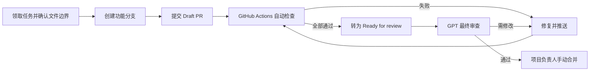

# GitHub CI 与 PR 协作规范

## 1. 目标

本规范用于 GPT 单一负责人和项目负责人协作。
GitHub Actions 先做客观检查，GPT 再做独立复查，项目负责人最后手动合并。

不启用“必须审批后合并”，因为同一账号创建的 PR 不能审批自己的 PR。
GPT 的审查结论通过 PR 评论留痕，不冒充 GitHub Approval。

## 2. 标准流程



执行要求：

1. GPT 从独立任务分支工作，不直接提交到 `main`。
2. PR 创建时选择 Draft，自动检查在 Draft 阶段同样运行。
3. `CI Gate` 变绿后才转为 Ready for review。
4. GPT 检查代码、视觉、契约、测试与任务文档，并在 PR 留下结论。
5. 只有 Critical 和 Important 问题都为 0 时，负责人才能手动合并。
6. 不启用自动合并，不在 CI 中部署，不允许 AI 自行修改仓库保护规则。

## 3. 自动检查内容

| 检查名称 | 执行内容 | 阻断条件 |
| --- | --- | --- |
| Backend Tests | Python 3.14 安装依赖并运行 pytest | 任一后端测试失败 |
| Frontend Tests | Node.js 24 执行 Vitest | 任一前端测试失败 |
| Frontend Build | 使用锁文件安装依赖并构建 Vite 生产包 | 安装或构建失败 |
| Docs Check | 检查协作类 Markdown 文档 | 文档格式不合规 |
| CI Gate | 汇总以上四项结果 | 任一检查未成功 |

后端测试只使用 CI Runner 内的 SQLite 临时数据库地址，不读取生产密钥，
也不会连接本地 MySQL 或 PostgreSQL。工作流使用 `pull_request` 事件和只读仓库权限，
不使用 `pull_request_target`，避免 PR 代码获得高权限令牌。

首版暂不包含以下内容：

- Docker 数据库集成测试；
- 自动部署；
- 自动合并；
- 自动把 PR 转为 Ready for review；
- Code Owner 强制审批；
- 邮件发送或第三方服务真实调用。

这些能力应在基础 CI 稳定后，以独立任务和独立 PR 增加。

## 4. main 分支 Ruleset 配置

首次合并本工作流后，由项目负责人在 GitHub 仓库中配置：

1. 打开 `Settings` → `Rules` → `Rulesets`。
2. 选择 `New ruleset` → `New branch ruleset`。
3. Ruleset 名称填写 `main-quality-gate`，状态选择 `Active`。
4. Target branches 选择默认分支，确认只匹配 `main`。
5. 启用 `Require a pull request before merging`。
6. Required approvals 保持 `0`，不要启用 Code Owner approval。
7. 启用 `Require conversation resolution before merging`。
8. 启用 `Require status checks to pass`，添加唯一必需检查 `CI Gate`。
9. 保持分支删除和强制推送为禁止状态。
10. 保存 Ruleset，并用一个 Draft PR 验证保护是否生效。

如果 `CI Gate` 暂时不出现在可选列表，先让包含该工作流的 PR 完整运行一次，
再返回 Ruleset 页面选择该检查。不要把四个子检查同时设成必需项；
只要求稳定的汇总检查 `CI Gate`，以后调整内部任务不会频繁修改规则。

在 CI 稳定运行一段时间后，可以再开启“合并前分支必须保持最新”。
首版不建议立即开启，避免并行 PR 频繁重跑全部任务。

## 5. GPT 与项目负责人的职责

详细执行规则由
`docs/tasks/GPT_DEVELOPMENT_WORKFLOW.md` 维护。

| 阶段 | GPT | 项目负责人 |
| --- | --- | --- |
| 实现前 | 确认任务、契约、数据、视觉和验收边界 | 确认产品范围与重大取舍 |
| 实现中 | 完成后端、前端、文件、邮件、安全和测试 | 查看 Draft PR 进度 |
| 提交 PR | 填写真实测试结果、契约变化和视觉证据 | 不在 CI 未完成时提前合并 |
| 合并前 | 独立复查完整 diff，给出分级结论 | 确认结论并手动合并 |

GPT 的实现和复查使用同一个 GitHub 账号，因此审查结论通过 PR 评论留痕，
不冒充独立用户的 GitHub Approval。

## 6. GPT 最终审查格式

GPT 在 PR 中使用以下固定格式发表评论：

```text
GPT Review

Critical: 0
Important: 0
Minor: 0

验证：Backend Tests / Frontend Tests / Frontend Build / Docs Check
结论：可以合并 / 修改后复审
```

问题等级定义：

- Critical：安全、数据破坏、权限越权或核心流程不可用。
- Important：需求未满足、接口不兼容、关键测试缺失或明显视觉失败。
- Minor：不阻断本次合并的可维护性、文案或细节改进。

## 7. CI 失败处理

1. 在 PR 的 `Checks` 页面找到第一个失败步骤。
2. 本地运行同名命令复现，不通过反复推送碰运气。
3. 只修复本分支负责范围内的问题；跨边界问题先在 PR 评论说明。
4. 推送修复后，旧的运行会被并发策略取消，只保留最新提交的结果。
5. 不使用跳过测试、删除测试或放宽保护规则的方式让 CI 变绿。

## 8. 所需 Secrets

当前 CI 不需要任何 GitHub Actions Secret。后端的两个数据库地址是 Runner 内临时值，
LLM、SMTP、QQ 邮箱和生产数据库凭据都不得加入此工作流。

未来加入集成测试或部署时，再按最小权限原则单独定义环境和 Secrets。
