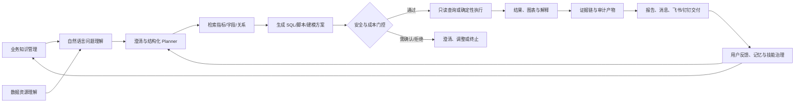

# ForgeSight 赛题对照开发功能归纳总结

> 版本：2026-09-07  
> 对照材料：`03会议材料-2026赛题手册.pdf` 中 A07「企业数据底座智能问析 Agent 系统」相关页面（第 26-30 页）  
> 对照范围：当前仓库 `codex/multi-database-adapters` 分支的前后端代码、测试与阶段验收文档。

## 1. 总体定位与归纳方法

本项目的主线不是单独实现一个聊天窗口，而是把企业已有的数据底座、业务知识和分析能力组织成一条可审计的智能分析链路：

```text
赛题业务问题
  -> 业务知识与数据资源理解
  -> 自然语言问题理解与澄清
  -> 结构化分析计划
  -> SQL/脚本生成与安全执行
  -> 结果解释、可视化与报告
  -> 证据留存、交付与反馈闭环
```

以下内容按“赛题要求的功能模块”先说明已开发能力，再说明在要求之上的拓展能力，最后总结特色、创新点和演示逻辑。

## 2. 赛题要求的功能与已开发实现

### 2.1 业务知识管理

**赛题要求**：维护业务对象、指标、规则、分析主题等知识，并支持查询、维护和展示，覆盖生产、质量、设备、库存等典型制造业务。

**已开发功能**：

- 管理端 `KnowledgePage` 提供业务对象、指标、规则、分析主题的统一维护入口。
- 支持知识草稿、审核、发布和版本化，分析时只引用已发布知识。
- 将指标口径、过滤条件、维度、时间范围和业务同义词整理为结构化对象，供 Agent 规划时检索。
- 通过技能治理页面维护分析技能，使“产量、合格数量、不良数量、设备停机时长”等主题可以复用。

**实现与证据**：

- 前端：`frontend-new/src/pages/admin/KnowledgePage*`、`SkillGovernancePage*`。
- 后端：`backend/app/api/knowledge.py`、`backend/app/knowledge/`、`backend/app/api/skills.py`。
- 设计依据：`docs/competition/README.md`、`docs/phase-5-agent/`。

**与赛题的对应关系**：业务人员不必先理解数据库字段，而是以企业业务语言提问；系统通过已维护的知识把问题转换为可执行的指标和分析任务。

### 2.2 数据资源理解

**赛题要求**：展示数据表、字段、类型、描述、样例和表间关系，并结合业务知识定位可用数据资源。

**已开发功能**：

- 数据源管理、连接测试、元数据扫描和数据资源目录。
- 展示表、字段、类型、业务描述、样例值、更新时间和关联关系。
- 支持资源检索、字段语义补充、关系图和数据质量/可用性状态。
- 业务数据库与平台数据库分离：业务数据保持只读，平台侧保存知识、会话、运行记录和治理信息。
- 当前分支加入多数据库适配器结构，为 MySQL、PostgreSQL 及后续数据库连接提供统一接口。

**实现与证据**：

- 前端：`frontend-new/src/pages/admin/ResourcesPage*`。
- 后端：`backend/app/api/datasources.py`、`backend/app/api/resources.py`、`backend/app/metadata/`、`backend/app/retrieval/`。
- 数据库脚本：`database/`、`backend/app/db/`。

**与赛题的对应关系**：资源理解是自然语言分析的前置条件。系统先找到“哪个表、哪个字段、哪个指标口径”可以回答问题，再生成查询，降低人工找数成本。

### 2.3 自然语言智能分析

**赛题要求**：用户使用自然语言提出产量趋势、工序良率、缺陷、停机时长、周报等问题，系统理解意图并形成查询、统计、指标、异常或报告任务。

**已开发功能**：

- `智能分析`页面支持创建会话、连续追问、澄清问题和重新开始分析。
- 识别问题类型、时间范围、业务对象、指标、维度、过滤条件和期望输出。
- 对缺少时间范围、指标口径或数据范围的问题先澄清，再进入执行流程。
- 通过 SSE/事件流显示分析进度，前端可看到当前步骤和最终结果。
- 支持分析结果解释、引用资产、追踪图和会话历史。
- 用户尚未发送有效消息时不会写入“最近调查”，避免空会话污染历史记录。

**实现与证据**：

- 前端：`frontend-new/src/pages/analysis/AnalysisPage*`、`SessionHistoryPage*`。
- 后端：`backend/app/api/analysis.py`、`backend/app/agent/graph.py`、`backend/app/agent/runner.py`、`backend/app/api/retrieval.py`。

**与赛题的对应关系**：该模块直接实现“用户提问 -> 智能分析”的核心入口，把业务人员的自然语言转成后续可验证、可执行的分析任务。

### 2.4 SQL/脚本生成、查看与安全执行

**赛题要求**：根据分析意图生成 SQL 或脚本，支持查看生成内容，并完成查询、筛选、分组、指标计算、图表代码和简单建模代码的执行。

**已开发功能**：

- Agent 生成结构化分析计划，并在需要时生成 SQL、图表配置或建模参数。
- 结果页支持查看 SQL、执行步骤和产生的分析产物。
- 只读校验、表白名单、字段范围、AST/方言约束、参数化、超时、行数上限和成本门控。
- 执行前使用 EXPLAIN/成本检查，超过限制时中止或要求用户确认。
- 业务数据连接保持只读，平台数据库承担会话、知识、报告、审计等写入。
- 失败可重试、恢复和幂等，避免重复执行或重复写入。

**实现与证据**：

- 后端：`backend/app/agent/`、`backend/app/gateway/`、`backend/app/api/analysis.py`、`backend/app/api/security.py`。
- 验收：`docs/phase-5-agent/PHASE5_ACCEPTANCE_REPORT.md`。

**与赛题的对应关系**：系统不仅“生成答案”，还把答案落到可检查的 SQL/脚本、执行边界和审计证据上，满足赛题对代码生成与执行可靠性的要求。

### 2.5 分析结果展示

**赛题要求**：以文字、表格或图表展示分析结果，必要时形成可交付报告。

**已开发功能**：

- 结果卡片展示结论、口径、数据范围、异常说明和空结果解释。
- 支持表格、文本，以及折线、柱状、饼/环形、散点、组合、热力等常用图表配置。
- 右侧证据面板展示可信执行、执行计划、当前节点、产物和引用资产。
- 支持结果导出、图表/结果复用和报告编排。
- 对“查无数据”与“查询成功但数据范围不完整”进行区分提示，不把空结果误报为业务结论。

**实现与证据**：

- 前端：`frontend-new/src/pages/analysis/`、`frontend-new/src/pages/reports/`。
- 后端：`backend/app/reports/`、`backend/app/api/reports.py`、`backend/app/api/analysis.py`。

**与赛题的对应关系**：结果既能被业务人员快速理解，也保留数据口径、执行过程和证据，覆盖赛题所要求的文本/图表/报告输出。

### 2.6 建模能力（技术要求中的专项能力）

**赛题要求**：支持线性回归、决策树、随机森林、逻辑回归、KMeans、Isolation Forest 等模型的训练、评估、推理和解释。

**已开发功能**：

- 建模页面和建模服务提供模型选择、特征配置、训练、评估、推理和结果查看。
- 覆盖回归、分类、聚类和异常检测等六类算法。
- 保存模型版本、训练参数、评估指标、特征信息和运行产物。
- Agent 负责提出结构化建模方案，确定性建模引擎负责实际执行，形成“智能建议 + 可复现运行”的组合。

**实现与证据**：

- 前端：`frontend-new/src/pages/modeling/ModelingPage*`、`ModelGovernancePage*`。
- 后端：`backend/app/modeling/`、`backend/app/api/modeling.py`、`backend/app/api/model_governance.py`。

**与赛题的对应关系**：建模是自然语言分析之后的可选分支，扩展了赛题要求的查询统计能力，使平台可用于预测、分类、聚类和异常识别。

### 2.7 可运行原型与工程化交付

**赛题要求**：提供可以运行和演示的原型，完成自然语言提问、智能分析、结果/报告输出的闭环，并具备清晰交互和异常处理。

**已开发功能**：

- React/Vite 前端、FastAPI 后端、MySQL 业务数据库和 PostgreSQL 平台数据库组成可运行原型。
- 登录、权限、租户、数据范围和管理端/业务端工作区。
- 统一 API、SSE 流式进度、后台 worker、检查点、恢复、重试和幂等。
- 前后端测试、构建检查和阶段验收文档，支持本地一键启动与演示。

**实现与证据**：

- 运行入口：`backend/app/main.py`、`frontend-new/`、`database/`。
- 任务和验收：`docs/tasks/`、`docs/phase-5-agent/`、`docs/phase-6-reports/`。

## 3. 在赛题要求基础上的拓展功能

### 3.1 有边界的 Planner Agent

在基础的自然语言问析之上，项目实现了结构化 Planner、能力注册表和执行器。Planner 只能调用已注册能力，受租户、权限、预算、超时和幂等约束；复杂问题可澄清、重规划和人工确认。这样保留 Agent 的灵活性，同时避免无边界生成和隐藏推理链。

### 3.2 证据链、安全治理与可恢复执行

每次运行都关联问题、计划、SQL/脚本、数据资源、执行节点、结果产物和审计事件。安全审计、只读边界、成本门控和失败恢复被统一到运行模型中，形成“可解释、可复核、可追责”的企业级闭环。

### 3.3 混合检索与语义索引

结合词法检索、语义检索、业务同义词和元数据索引，提高对字段别名、指标口径和历史分析内容的召回能力；检索结果进入 Planner 和结果解释，而不是只作为聊天上下文。

### 3.4 报告中心与交付自动化

在赛题“报告输出”基础上扩展模板、章节、证据复用、审核、发布、导出和交付能力。报告可由分析运行生成，并通过消息中心、邮件、飞书或钉钉发送，支持周报和管理汇报场景。

### 3.5 飞书、钉钉与邮箱统一入口

提供飞书 P2P 长连接、钉钉 Stream/OAuth 绑定和邮箱绑定。三类入口复用同一 Analysis Session/Run/Agent Worker，返回文本、表格或图表结果；权限、数据源选择、幂等和失败回退保持一致，避免多套机器人逻辑分叉。

### 3.6 异常监测与消息中心

围绕生产、质量、设备等指标增加监测规则、异常事件、告警详情、公告和消息中心。系统可把异常检测结果转为待处理任务，并与分析、报告和外部交付连接。

### 3.7 个人记忆、技能治理与持续学习边界

个人记忆用于保存经用户确认的偏好、口径和上下文；技能治理用于控制可用分析能力和版本。记忆不会自动扩大数据权限，学习开关、引用范围和治理状态可见可控。

### 3.8 多数据库适配器

当前分支将数据库连接、方言、元数据和执行能力抽象为适配器契约，便于从现有 MySQL/PostgreSQL 扩展到其他企业数据库。该能力服务于赛题的“数据底座”场景，但属于工程拓展，不改变业务数据只读和安全执行原则。

### 3.9 面向业务的前端体验重构

业务端与管理端分离，智能分析、工作台、报告、建模、消息和个人主页形成连续导航；分析空状态提供分析/建模/周报/绑定引导，结果页保留证据面板，关键切换与卡片使用轻量动效，兼顾可理解性和信息密度。

### 3.10 浏览器端 LLM Key 配置入口

个人主页增加 OpenAI Compatible 模型服务配置入口，可在浏览器内更新模型地址、模型名和 Key，并以脱敏方式回显。当前实现更新的是后端进程运行时配置，服务重启后仍需重新配置或改用环境变量；生产环境应继续使用服务端密钥托管和权限控制。

## 4. 特色与创新点

1. **从业务语言到治理后 SQL 的闭环**：不是只返回一段自然语言答案，而是把业务问题、指标口径、数据资源、SQL、执行结果和解释串成证据链。
2. **有边界的 Agent 自主性**：Planner 可以理解、澄清、规划和重试，但所有数据库访问都必须经过能力注册、权限、只读、白名单、成本和预算检查。
3. **统一运行模型**：网页、报告、飞书、钉钉和后台 worker 复用同一 Session/Run/Artifact 模型，结果可追踪、可复用、可交付。
4. **智能建议与确定性执行分离**：Agent 负责业务理解和方案建议，SQL/建模/报告引擎负责可复现执行，兼顾灵活性与工程可靠性。
5. **制造业数据底座适配**：把生产、质量、设备、库存等知识与表字段、指标和分析主题绑定，直接对应企业统一业务语义场景。
6. **从一次问答到持续运营**：报告、告警、消息、记忆、技能治理和多渠道交付把一次查询扩展为持续的数据运营闭环。
7. **可解释和可恢复**：展示执行步骤、引用资产、成本门控、异常原因和空结果解释，支持失败恢复、重试和幂等，降低企业采用门槛。

## 5. 功能之间的逻辑关系



对应到用户操作，可以归纳为：

1. 管理员维护业务知识和数据资源，系统建立可检索的语义底座。
2. 业务人员在智能分析中提出问题；若信息不足，系统先澄清，不直接猜测。
3. Planner 结合知识、元数据和权限生成结构化计划。
4. 执行层生成并展示 SQL/脚本，经过只读、白名单、成本和预算检查。
5. 运行结果形成表格、图表、文字解释和证据产物。
6. 用户可继续追问、切换建模、生成报告，或通过飞书/钉钉/邮件交付。
7. 已确认的口径、反馈和运行产物进入记忆、技能和治理流程，反哺下一次分析。

## 6. 赛题要求与拓展能力的映射

| 赛题要求 | 直接实现 | 主要拓展 | 带来的价值 |
| --- | --- | --- | --- |
| 业务知识管理 | 对象、指标、规则、主题维护与发布 | 技能治理、版本、记忆边界 | 统一企业口径，减少重复配置 |
| 数据资源理解 | 表/字段/样例/关系/资源目录 | 混合检索、多数据库适配器 | 更快定位可用数据，便于扩展底座 |
| 自然语言智能分析 | 意图识别、澄清、查询/统计/异常/报告 | Planner、重规划、分支分析 | 让非技术人员可以自助分析 |
| SQL/脚本生成与执行 | SQL 生成、查看、只读执行 | AST、EXPLAIN、成本门控、恢复幂等 | 降低越权、误查和高成本风险 |
| 结果展示 | 文本、表格、图表、解释 | 证据面板、追踪图、产物复用 | 结果可理解、可复核、可交付 |
| 建模技术要求 | 六类算法的训练/评估/推理 | 模型治理、Agent 方案建议 | 从描述性分析延伸到预测和异常识别 |
| 可运行原型 | React + FastAPI + 双数据库 | 多渠道交付、监控、消息中心 | 支持演示，也具备继续工程化的基础 |

## 7. 完成度与边界说明

- 按当前代码和已有阶段文档，A07 的五项核心任务、建模专项能力和自然语言到结果的可运行闭环均已有实现入口，可用于产品演示和赛题对照说明。
- 报告、飞书/钉钉、异常监测、记忆治理、多数据库适配器和浏览器端模型配置属于赛题要求之上的拓展能力，应在演示中作为“增强价值”呈现，不替代核心闭环。
- 赛题材料强调业务准确性、工程可用性和应用价值。正式参赛材料仍应补充制造业问题集上的准确率、成本、延迟、数据规模和异常恢复数据，不能只以页面效果代替指标验证。
- 外部平台的 App 凭证、生产数据库连接、模型服务密钥和正式部署参数不应写入仓库；浏览器端 LLM Key 配置目前是运行时配置，生产环境建议使用服务端密钥托管、权限审计和持久化配置中心。

## 8. 建议的赛题演示主线

1. 从工作台展示当前数据底座和可用指标。
2. 进入“智能分析”，输入“统计每条产线最近 7 天的产量趋势”。
3. 展示系统如何理解意图、定位字段、生成 SQL、执行只读和通过成本门控。
4. 展示结果表/图、空结果或口径提示，以及右侧证据链和执行步骤。
5. 继续追问质量、停机或异常问题，演示澄清和上下文复用。
6. 切换建模能力，展示异常检测或预测模型的训练、评估和解释。
7. 将分析结果编排为周报，审核后导出或发送到飞书/钉钉。
8. 进入管理端展示业务知识、资源目录、技能治理和安全审计，说明系统如何持续运营。

## 9. 参考资料

- `C:\Users\modomodo\Desktop\03会议材料-2026赛题手册.pdf`：A07 赛题背景、用户期待、技术要求、任务与评分关注点。
- [`docs/competition/README.md`](README.md)：仓库已有赛题映射与产品能力概览。
- [`docs/phase-5-agent/PHASE5_ACCEPTANCE_REPORT.md`](../phase-5-agent/PHASE5_ACCEPTANCE_REPORT.md)：Agent 闭环、安全、成本门控和验收记录。
- [`docs/phase-5-agent/FORGESIGHT_BOUNDED_PLANNING_AGENT_FINAL_DESIGN.md`](../phase-5-agent/FORGESIGHT_BOUNDED_PLANNING_AGENT_FINAL_DESIGN.md)：有边界 Planner、能力注册、运行模型和多渠道复用设计。
- [`docs/phase-6-reports/PHASE6_WEEKLY_REPORT_RESEARCH_AND_DESIGN.md`](../phase-6-reports/PHASE6_WEEKLY_REPORT_RESEARCH_AND_DESIGN.md)：报告模板、章节、审核、发布与交付设计。
- [`docs/integrations/DINGTALK_ANALYSIS_BOT.md`](../integrations/DINGTALK_ANALYSIS_BOT.md)、[`docs/integrations/FEISHU_P2P_BOT.md`](../integrations/FEISHU_P2P_BOT.md)：钉钉、飞书统一分析运行说明。

