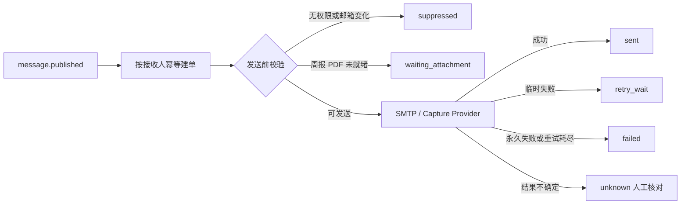

# E 邮件投递与重试契约

> 状态：实施完成，待合并
> 适用方：U 前端交互、T 集成测试、部署运维

## 1. 事件与投递边界

E 只领取 N 产生的 `message.published` Outbox 事件。一个事件按消息接收记录展开为
“消息 ID + 稳定用户 ID + email”唯一投递；重复事件只返回原投递，不会创建第二条任务。
邮箱未验证、账号停用、消息失效或周报数据权限已撤销时，任务标记为 `suppressed`。



## 2. 邮件内容

- 周报：标题、周期、版本、3～5 条摘要、重点异常、数据质量、安全站内链接；
  正常情况下附带与发布版本校验值一致的 PDF。
- 公告：标题、纯文本正文、发布人、发布时间、有效期和站内链接。
- 两类邮件都同时包含纯文本与 HTML，HTML 中的用户内容全部转义。
- 链接只由 `PUBLIC_APP_URL` 和内部资源 ID 构造，不包含邮箱、存储 URI或长期 token。

## 3. 附件规则

- PDF 未就绪时保持 `waiting_attachment`，不提前发送缺少附件的周报。
- PDF 超过 `MAIL_ATTACHMENT_MAX_BYTES` 时发送摘要与链接，正文明确提示附件省略，
  投递记录写入 `attachmentOmitted=true`。
- 不自动附加或改发 Excel。
- 发送前校验 PDF 路径位于报告存储根目录内，并核对文件大小、SHA-256 和发布版本内容校验值。

## 4. 失败与重试

明确未被服务商接受的临时网络、限流和服务商错误进入指数退避，默认最多尝试 3 次；
无效地址、附件完整性和内容错误直接失败。每次真实发送都有独立 `DeliveryAttempt`，
不会覆盖历史。调用服务商前先提交带在途租约的 `unknown` 不确定性屏障：若进程在服务商
接受后退出，该任务不会自动重发。租约到期后，管理员仍需核对服务商记录并显式确认，
才可人工重排，避免尚未返回的原调用与新任务并发发送。
等待 PDF 不消耗发送尝试次数。投递失败不修改报告、公告或站内消息状态。

SMTP 构造或运行时认证发现配置无效时，可运行任务统一进入 `blocked_configuration`，避免
每个轮询周期重复尝试。系统使用不暴露凭据的配置指纹检测变更；只有配置发生变化后，
Worker 才会自动重新排队并验证新配置。

## 5. 管理接口

```text
GET  /api/v1/deliveries
POST /api/v1/deliveries/{deliveryId}/retry
```

仅管理员可访问。列表支持按消息、报告、接收人、状态和创建时间筛选，邮箱以掩码返回。
人工重发只把原失败/等待任务重新排队，保留 attempt 历史，并写入安全审计日志。对于
`unknown`，还必须在在途租约到期后传入 `confirmUnknown=true`，表示管理员已核对并承担重发决策。

## 6. 部署配置

开发和测试使用 `MAIL_PROVIDER=capture`；生产使用 `MAIL_PROVIDER=smtp`。SMTP 凭据只放在
本地 `.env`、CI Secret 或部署密钥中。QQ 邮箱可作为系统发件服务，但不是接收邮箱限制，
任何已通过 Q 验证的合法邮箱都可以接收。

上线时至少配置：`PUBLIC_APP_URL`、`MAIL_FROM_ADDRESS`、`SMTP_HOST`、`SMTP_PORT`、
`SMTP_USERNAME`、`SMTP_PASSWORD` 和 `SMTP_USE_TLS`。非本机 `PUBLIC_APP_URL` 必须使用 HTTPS。

## 7. U/T 接入约束

- U 的失败管理页面直接使用投递 API，不在浏览器显示完整邮箱或错误正文。
- U 的邮件链接路由必须支持登录后回跳，最终内容权限仍由 API 校验。
- T 使用 fake/capture Provider 做自动化测试，不向真实邮箱发送测试邮件。
- 任何日志、测试夹具、截图和 PR 描述都不得包含真实 SMTP 凭据。
