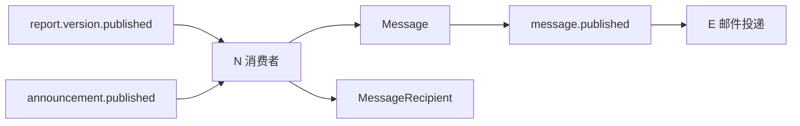

# N 消息中心与公告契约

> 状态：实施完成，待合并
> 适用方：E 邮件投递、U 前端交互、T 集成测试

## 1. 功能边界

消息中心统一承载 Agent 周报和管理员公告。它不是聊天系统：不提供回复、会话、确认回执，也不负责生成周报、导出文件或发送邮件。

## 2. 消息卡片

`GET /api/v1/messages` 只返回当前登录用户可见的消息。每张卡片包含：

| 字段 | 含义 |
| --- | --- |
| `id`、`type` | 消息 ID；类型为 `weekly_report` 或 `admin_announcement` |
| `sourceLabel` | 可直接展示的来源名称 |
| `title`、`summaryLines` | 标题和最多两行安全摘要 |
| `priority`、`isPinned` | 优先级和当前有效置顶状态 |
| `status`、`isRead`、`readAt` | 生命周期及当前用户已读状态 |
| `publishedAt`、`expiresAt` | 发布时间和可选失效时间 |
| `primaryAction` | 前端无需推断的主操作；周报携带报告及版本 ID |
| `renderMode` | 固定为 `plain_text`，前端不得按 HTML 渲染正文 |

列表支持 `type`、`read`、`priority`、`keyword`、`publishedFrom`、`publishedTo` 筛选，以及稳定游标分页。已撤回或过期的历史消息保留并明确标识，不做物理删除。

## 3. 用户接口

```text
GET  /api/v1/messages
GET  /api/v1/messages/unread-count
GET  /api/v1/messages/{messageId}
POST /api/v1/messages/{messageId}/read
```

读取详情会幂等记录首次已读时间。用户不能读取或修改其他用户的接收记录。周报详情在每次打开时重新校验当前数据范围；权限撤销后，即使历史消息仍存在，也不能读取周报正文。

## 4. 管理员公告接口

```text
GET   /api/v1/announcements
POST  /api/v1/announcements
PATCH /api/v1/announcements/{announcementId}
POST  /api/v1/announcements/{announcementId}/publish
POST  /api/v1/announcements/{announcementId}/withdraw
```

公告按 `draft → published → withdrawn/expired` 流转。草稿可编辑；发布后标题、正文、优先级、置顶、接收范围和有效期冻结。撤回必须提供原因，撤回和过期都保留审计记录。只有处于有效发布期的公告可以置顶。

公告正文只接受纯文本，服务端拒绝标签式内容，前端也必须按纯文本渲染。发布时由服务端重新计算接收人数，不信任客户端估算。

## 5. 事件与幂等



消费者通过租约领取 Outbox 事件，以事件 ID 创建唯一消息，并以“消息 ID + 用户 ID”创建唯一接收记录。重复投递、重复消费或领取后重试不会生成重复消息。缺失、禁用或当前无数据权限的用户会被跳过并记录处理结果；达到最大重试次数的事件进入死信状态。

## 6. 后续任务接入约束

- E 只消费 `message.published`，不要与 N 竞争原始周报或公告事件。
- U 直接渲染卡片字段和 `primaryAction`，不要在浏览器推断权限、置顶或生命周期。
- T 必须覆盖重复事件、跨用户读取、权限撤销、公告冻结、撤回、过期和死信恢复。
- 任何任务都不得把真实邮箱地址、授权码或用户数据写入仓库。
