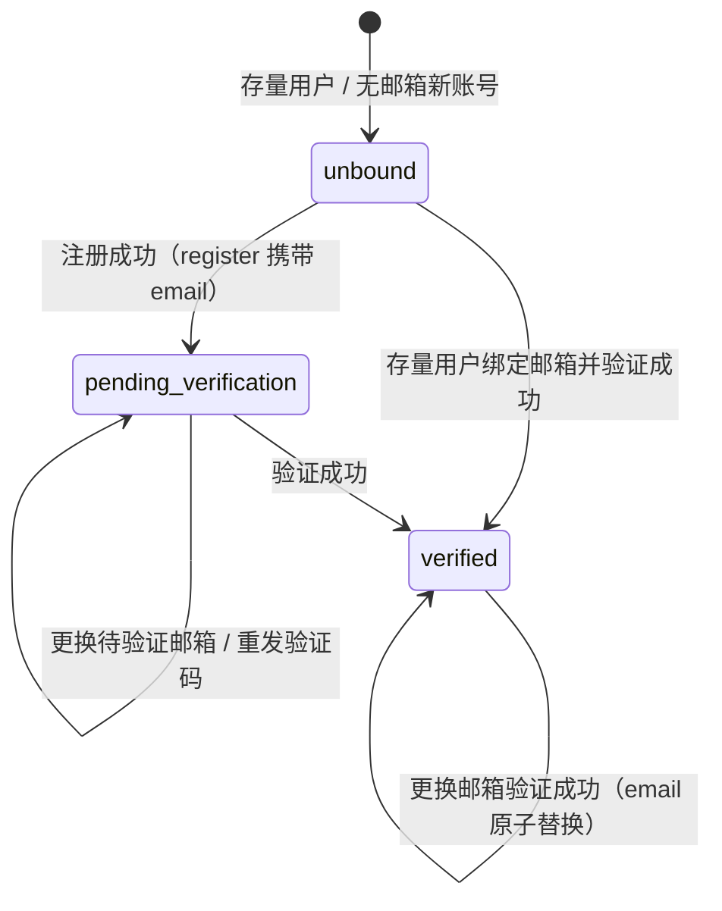

# Q01 邮箱身份与接口契约

> 状态：契约冻结（V1.1 已于 2026-08-13 通过 GPT 审查）
> 所属大任务：`Q邮箱绑定与验证`
> 本任务编号：Q01
> 负责人：GPT（初稿来源保留于历史 PR #6）
> 版本：V1.1
> 更新日期：2026-08-13

本契约冻结 Q02～Q07 后端实现所依据的邮箱身份状态、数据字段、验证挑战、
API、错误码与访问门禁。本版本已经冻结；此后变更必须
按 `docs/tasks/GPT_DEVELOPMENT_WORKFLOW.md` 第 6 节执行。
U03 前端绑定页按本契约接入。

> V1.1 修订说明（响应 GPT 首轮审查 Critical 1 / Important 8 / Minor 1）：
> 门禁覆盖匿名请求、门禁默认关闭与启动守卫、管理员修复入口改为仅设待验证目标、
> `code_hash` 可空、活动挑战唯一性改为每用户一条、新增不可变验证事件表、
> 验证错误码拆分、邮箱双字段（可投递 + canonical）、占用竞态与错误映射、E 任务所有权纠正。

<!-- markdownlint-disable MD013 -->

---

## 1. 契约范围与现有代码调查结论

### 1.1 契约范围

- 邮箱身份三态、转换规则与存量用户初始状态。
- `PlatformUser` 邮箱字段、规范化、唯一性、脱敏与兼容方案。
- `EmailVerificationChallenge` 验证挑战与 `EmailVerificationEvent` 验证事件的存储、生命周期与并发语义。
- 绑定、发码、验证、更换邮箱、注册、登录、当前用户共 8 个 API 的完整契约。
- 受限会话与完整会话的语义、白名单与门禁矩阵（含匿名请求处理）。
- 安全要求（枚举、暴力、重放、频控、审计、脱敏）。
- 验证邮件 Provider 抽象边界（不含任何视觉/模板决策）。
- 数据库增量迁移与回滚方案。

### 1.2 现有代码调查结论

| 调查项 | 结论 | 依据 |
| --- | --- | --- |
| 用户模型 | `PlatformUser`（平台库 `forge_sight_app`）无任何邮箱字段；主键为 `String(40)`（`u_` 前缀，`new_id()` 生成）；`username` 唯一且统一小写；`role` 为 `business/admin` | `backend/app/db/models.py:712` |
| 密码 | scrypt 哈希（零第三方依赖），格式 `scrypt$n$r$p$salt$hash` | `backend/app/auth/service.py:31` |
| Token | 无状态 HMAC-SHA256 自签，payload 仅 `sub/role/iat/exp`，TTL 7 天，无吊销机制 | `backend/app/auth/service.py:63` |
| 认证 API | `POST /api/auth/register`（201）、`POST /api/auth/login`、`GET /api/auth/me`、`POST /api/auth/logout`；注册即返回完整权限 token | `backend/app/api/auth.py` |
| 错误格式 | 现状统一为 `{"detail": "中文文案"}`；本契约在保留 `detail` 的基础上新增 `errorCode`，前端现有读取不受影响 | `backend/app/api/auth.py` |
| 鉴权依赖 | `optional_user`（无 token 回退演示模式，绝不 401）+ `require_user`；业务 API 目前大多可无 token 访问（渐进式演示） | `backend/app/auth/deps.py` |
| 审计 | `write_audit(action, resource, result, detail, user_name, role)` 写入 `audit_log` 表 | `backend/app/audit/service.py` |
| 数据库 | 平台库 PostgreSQL 14+（读写）；业务库 MySQL 8（只读，本任务零改动）；无 Alembic，平台库建表 = SQLAlchemy `create_all` + `database/tools/generate_platform_schema.py` 生成的 `database/postgresql/001_schema.sql`；`create_all` 不会给已有表加列，因此增量变更必须提供幂等 SQL | `database/README.md`、`database/bootstrap.py:216` |
| 测试设施 | pytest + SQLite 内存库 + monkeypatch 替换 `PlatformSession`；认证测试见 `backend/tests/test_auth_api.py`；CI 以 SQLite 环境变量跑全量后端测试 | `backend/tests/conftest.py`、`.github/workflows/ci.yml` |
| 前端现状 | `frontend-new/src/api/auth.js` 读取 `body.token/body.user`，错误读取 `detail` 文案；本契约保持 `token/user/detail` 形状兼容，新增字段为增量 | `frontend-new/src/api/auth.js` |

### 1.3 关键设计决策（审查重点）

| 决策 | 内容 | 理由 |
| --- | --- | --- |
| D1 | 邮箱状态不落独立列，由 `email` + `email_verified_at` 派生 | 避免双写不一致；API 输出 `emailStatus` 字符串 |
| D2 | 更换邮箱期间用户保持 `verified`，新邮箱快照只存在于挑战行；`user.email` 仅在验证成功时原子替换 | 满足"成功前旧邮箱继续有效"（REQUIREMENTS 11.1） |
| D3 | 注册只创建待验证账号并返回受限 token，验证码由前端随后调用发码接口触发 | 注册不被 SMTP 延迟/失败阻塞；发码失败可重试；整体流程仍满足 REQUIREMENTS 6.1 |
| D4 | 邮箱双字段：`email` 存**可投递形式**（仅域名小写，本地部分原样）；`email_canonical` 存**唯一比较形式**（整体小写），唯一索引只建在 canonical 上 | 不改变可投递地址（REQUIREMENTS 11.1 只要求域名规范化）；canonical 仅用于去重与频控，不用于投递 |
| D5 | 业务错误统一 `{"detail": "<文案>", "errorCode": "<稳定码>"}` | `detail` 兼容现有前端，`errorCode` 是冻结的机器契约 |
| D6 | 验证成功后颁发新 full token（token 轮换） | token 无状态，无法服务端升级受限会话；轮换同时解决"验证后立刻获得完整权限" |
| D7 | 存量旧 token（无 `auth_scope` 声明）一律视为 restricted | fail-closed；存量用户首次登录被引导绑定（REQUIREMENTS 6.2） |
| D8 | 发码成功响应不含挑战 ID | 缩小可探测面（见第 7 节） |
| D9 | **邮箱门禁默认关闭**（`AUTH_EMAIL_GATE_ENABLED=false`），按第 6.4 节安全顺序显式开启；开启且邮件不可真实投递时拒绝启动 | 防止 Q 合并后锁死全部存量用户与种子管理员（安全上线顺序） |
| D10 | **演示模式默认关闭**（`DEMO_MODE_ENABLED=false`）；门禁开启时匿名请求一律 401，演示回退失效 | 堵住"删除 Authorization 头绕过门禁"的 Critical 漏洞；演示模式仅作显式开发配置 |
| D11 | 管理员修复入口**只设置待验证目标并触发发码**，不直接置 verified | 邮箱所有权始终由验证码证明；防锁死靠 feature flag 与正常验证流程 |
| D12 | 频控计数基于不可变验证事件表（`email_verification_event`），滚动小时窗口可精确计算 | 挑战行会被复用，`send_count` 无法承载跨 IP/跨挑战的窗口计数 |

---

## 2. 邮箱身份状态机

### 2.1 状态定义（派生自数据，不单独存储）

| 状态 | 判定条件 | 业务含义 | 登录后 token | nextAction |
| --- | --- | --- | --- | --- |
| `unbound` | `email IS NULL AND email_verified_at IS NULL` | 账号从未提供过邮箱（存量用户初始态） | restricted | `bind_email` |
| `pending_verification` | `email IS NOT NULL AND email_verified_at IS NULL` | 已提供邮箱、所有权未验证（新注册） | restricted | `verify_email` |
| `verified` | `email_verified_at IS NOT NULL` | 邮箱所有权已验证 | full | `null` |

### 2.2 状态转换



| 转换 | 合法性 | 触发点 |
| --- | --- | --- |
| unbound → pending_verification | 合法 | `POST /api/auth/register` 携带 email 成功 |
| unbound → verified | 合法 | 存量用户 `challenges` + `verify` 成功 |
| pending_verification → verified | 合法 | `verify` 成功（挑战邮箱与待验证邮箱一致） |
| pending_verification → pending_verification | 合法（行值不变） | 重发验证码；换目标邮箱（行值在 verify 时更新） |
| verified → verified（更换邮箱） | 合法 | `change` + `verify` 成功后 `email`/`email_canonical` 与 `email_verified_at` 在同一事务原子替换 |
| verified → pending_verification | **非法** | `email_verified_at` 一旦写入永不回退 |
| pending_verification / verified → unbound | **非法** | 已写入的邮箱不删除（管理员修复入口也只能改目标邮箱，必须审计） |
| verified → verified（同邮箱再次验证） | 非法（无状态变化） | 返回 `409 EMAIL_ALREADY_VERIFIED` |

### 2.3 存量用户初始状态

- 现有全部账号 `email = NULL`、`email_verified_at = NULL` → 初始状态 `unbound`。
- 存量用户登录成功 → restricted token + `nextAction: "bind_email"`，前端进入绑定页（U03）。
- 种子管理员账号同样进入 `unbound`；不在代码中硬编码任何真实邮箱。
- 迁移不重置密码、不删除任何账号。

---

## 3. 用户字段与邮箱规范化

### 3.1 `platform_user` 新增字段

| 字段 | 类型 | 约束 | 说明 |
| --- | --- | --- | --- |
| `email` | `VARCHAR(254)` | NULL；**可投递形式** | 当前邮箱（含未验证的目标邮箱），用于投递与展示 |
| `email_canonical` | `VARCHAR(254)` | NULL；**唯一比较形式**；部分唯一索引 | 用于去重、查找与频控，不用于投递 |
| `email_verified_at` | `TIMESTAMP` | NULL | 最近一次验证成功的服务器时间（UTC） |

不变式：`email IS NULL ⇔ email_canonical IS NULL`；两者始终同写同改。

### 3.2 规范化规则

**可投递形式 `normalize_email(raw) -> str`**（写入 `email`、用于 SMTP 投递与展示）：

1. 去除首尾空白字符（含全角空格）。
2. **仅域名部分转小写**；本地部分原样保留（保持可投递性，REQUIREMENTS 11.1）。
3. 校验格式（严格 ASCII 正则，允许常见合法字符组合与 plus-address），总长 ≤ 254，本地部分 ≤ 64。
4. 任何一步失败 → 抛 `AUTH_INVALID_EMAIL_FORMAT`（HTTP 400）。

**唯一比较形式 `canonicalize_email(deliverable) -> str`**（写入 `email_canonical`，
仅用于唯一约束、冲突检测与频控桶键）：

1. 整体转小写（本地部分与域名）。
2. **不做 plus-stripping**：`user+tag@x.com` 与 `user@x.com` 视为不同邮箱（冻结）。
3. Unicode/IDN：首期**仅支持 ASCII 邮箱**；IDN 域名、Unicode 本地部分 → `400 AUTH_INVALID_EMAIL_FORMAT`
   （后续版本可扩展，扩展时必须先走契约变更流程）。

### 3.3 唯一性与大小写规则

- 唯一约束只建在 `email_canonical` 上（PostgreSQL 部分唯一索引：非 NULL 行唯一，NULL 行互不冲突）。
- 比较前一律先 canonicalize：不同大小写、带/不带首尾空格视为同一邮箱。
- `A@Example.com` 与 `a@example.com` 投递形式不同，但 canonical 相同 → 冲突 → `EMAIL_TAKEN`。

### 3.4 脱敏规则 `mask_email(deliverable) -> str`

| 本地部分长度 | 输出 |
| --- | --- |
| ≥ 2 | 首字符 + `***` + `@` + 原域名，例：`demo@example.com` → `d***@example.com` |
| 1 | `*` + `@` + 原域名，例：`a@b.cn` → `*@b.cn` |

适用面：

- `/me` 与所有登录/注册/发码/验证响应中的 `emailMasked`。
- 审计日志 `resource` 字段。
- **任何 API 响应不返回未脱敏的邮箱**；邮件投递由服务端使用可投递形式，不经 API 暴露。

### 3.5 验证时间与邮箱状态

- `email_verified_at` = 验证成功的服务器时间；重复验证、更换邮箱成功后刷新。
- API 侧 `emailStatus` 取值即第 2.1 节三态；`/me` 不返回挑战内部信息。

---

## 4. 验证挑战、验证事件与规则

### 4.1 `email_verification_challenge` 表

```sql
CREATE TABLE IF NOT EXISTS email_verification_challenge (
    id            VARCHAR(40)  NOT NULL,  -- new_id("c")
    user_id       VARCHAR(40)  NOT NULL,
    purpose       VARCHAR(24)  NOT NULL,  -- bind / verify / change（服务端派生）
    email         VARCHAR(254) NOT NULL,  -- 可投递形式的目标邮箱快照
    email_canonical VARCHAR(254) NOT NULL, -- 唯一比较形式（频控/去重用）
    code_hash     VARCHAR(256) NULL,      -- HMAC-SHA256 摘要；消费后置 NULL（见约束）
    expires_at    TIMESTAMP    NOT NULL,
    attempt_count INTEGER      NOT NULL DEFAULT 0,
    send_count    INTEGER      NOT NULL DEFAULT 1,
    last_sent_at  TIMESTAMP    NOT NULL,
    consumed_at   TIMESTAMP    NULL,
    superseded_at TIMESTAMP    NULL,
    created_at    TIMESTAMP    NOT NULL,
    PRIMARY KEY (id)
);
CREATE INDEX IF NOT EXISTS ix_email_verification_challenge_user
    ON email_verification_challenge (user_id);
CREATE INDEX IF NOT EXISTS ix_email_verification_challenge_email_created
    ON email_verification_challenge (email_canonical, created_at);
-- 每个账号至多一条活动挑战（与 purpose 无关）
CREATE UNIQUE INDEX IF NOT EXISTS uq_email_verification_challenge_active
    ON email_verification_challenge (user_id)
    WHERE consumed_at IS NULL AND superseded_at IS NULL;
```

约束说明（修复审查 Important 3/4）：

- `code_hash` 允许 NULL；**活动挑战（`consumed_at IS NULL AND superseded_at IS NULL`）必须
  `code_hash` 非空**（由服务层保证，Q03 加测试）。
- 唯一索引按 `(user_id)` 而非 `(user_id, purpose, email)`：一个账号同一时刻只追求一个目标邮箱，
  从根上排除"两个不同目标邮箱的挑战同时活动"的竞态（绑定与更换流程互斥）。
- **创建挑战的一致性方案（Q03 实现约束）**：
  1. 事务开始；
  2. `SELECT ... FROM platform_user WHERE id = :user_id FOR UPDATE` 锁定用户行（PostgreSQL），串行化同一账号的并发发码；
  3. 若目标邮箱与现有活动挑战邮箱 canonical 相同且未过期未超次 → 复用该行（重发路径）；
  4. 否则将现有活动挑战置 `superseded_at = now`，再 INSERT 新挑战；
  5. 提交。唯一索引作为兜底：并发突破导致 IntegrityError 时，服务层捕获并重试一次或映射业务错误（禁止 500）。
  SQLite 无行锁：测试语义 = 依赖唯一索引 + IntegrityError 映射（Q07 在 SQLite 与 PostgreSQL 双语义下测试）。
- 频控计数**不依赖**本表（挑战行会被复用、IP 不在挑战行上），统一来自 4.3 事件表（决策 D12）。

### 4.2 验证码规则

| 规则 | 值 | 配置项 |
| --- | --- | --- |
| 生成 | 6 位数字（`secrets` 安全随机源），允许首位为 0 | — |
| 有效期 | 600 秒（10 分钟） | `EMAIL_CODE_TTL_SECONDS` |
| 重发冷却 | 60 秒 | `EMAIL_CODE_RESEND_SECONDS` |
| 单挑战错误上限 | 5 次，达到后挑战永久失效 | `EMAIL_CODE_MAX_ATTEMPTS` |
| 小时级频控 | 每邮箱 5 / 每账号 5 / 每 IP 10（含发码与验证，来源见 4.3） | `EMAIL_HOURLY_LIMIT_EMAIL/ACCOUNT/IP` |
| 存储 | 仅安全摘要（HMAC-SHA256，服务端密钥），明文不落库、不落日志 | `EMAIL_CODE_SECRET` |

`code_hash = HMAC-SHA256(EMAIL_CODE_SECRET, "{code}:{id}:{email_canonical}")` 的 hex 摘要；
验证时对候选码计算同式摘要后 `hmac.compare_digest` 比较。

### 4.3 `email_verification_event` 不可变验证事件表（修复审查 Important 5）

```sql
CREATE TABLE IF NOT EXISTS email_verification_event (
    id             VARCHAR(40)  NOT NULL,  -- new_id("e")
    user_id        VARCHAR(40)  NOT NULL,
    email_canonical VARCHAR(254) NOT NULL,
    purpose        VARCHAR(24)  NOT NULL,
    challenge_id   VARCHAR(40)  NULL,
    event_type     VARCHAR(24)  NOT NULL,  -- code_sent / send_failed / verify_attempt / verify_success
    outcome        VARCHAR(32)  NOT NULL DEFAULT '',  -- sent / provider_error / invalid_code / expired / attempts_exceeded / superseded / consumed / not_found / success
    ip             VARCHAR(45)  NOT NULL DEFAULT '',
    created_at     TIMESTAMP    NOT NULL,
    PRIMARY KEY (id)
);
CREATE INDEX IF NOT EXISTS ix_email_verification_event_email_time
    ON email_verification_event (email_canonical, created_at);
CREATE INDEX IF NOT EXISTS ix_email_verification_event_user_time
    ON email_verification_event (user_id, created_at);
CREATE INDEX IF NOT EXISTS ix_email_verification_event_ip_time
    ON email_verification_event (ip, created_at);
CREATE INDEX IF NOT EXISTS ix_email_verification_event_challenge_time
    ON email_verification_event (challenge_id, created_at);
```

- 每行不可变、只追加（append-only），是滚动小时窗口计数的唯一事实源：
  每邮箱 = `COUNT WHERE email_canonical = ? AND created_at > now-1h`；
  每账号 = 按 `user_id`；每 IP = 按 `ip`（发码与验证共享 IP 桶）。
- **Provider 发送失败（`send_failed`）同样计入发码频控**（冻结）：失败尝试消耗服务器资源，
  不因投递失败而豁免防滥用限流。
- `verify_attempt`（含 `invalid_code/expired/attempts_exceeded/...`）计入 IP 桶与挑战 `attempt_count`
  （双写：`attempt_count` 保证单挑战上限，事件表保证窗口频控）。
- 保留策略：事件行保留 `EMAIL_EVENT_RETENTION_DAYS`（默认 30）天，由启动清理任务删除过期行；
  只删除超过保留期的行，不删除挑战历史（挑战行供审计，不自动清理）。
- 频控判断与时序：先记事件、后检查阈值；超限返回 429 并审计（拦截事件本身也入表）。

### 4.4 生命周期规则

- **重发（同邮箱）**：冷却内 → `429 CHALLENGE_RESEND_COOLDOWN`；冷却过后复用同一挑战行：
  生成新码、`expires_at` 重置、`send_count + 1`、`last_sent_at` 更新。
- **更换目标邮箱**：锁定用户行后置旧活动挑战 `superseded_at = now`，同一事务 INSERT 新挑战
  （Q03"新验证码发出后使同用途旧挑战失效"）。
- **单次使用**：验证成功后置 `consumed_at = now` **且** `code_hash = NULL`（双保险）。
- **重复验证（重放）**：已消费的挑战上 `code_hash` 已置 NULL，候选码比较必然失败 →
  `400 CODE_INVALID`（不泄露任何跨账号信息）。
- **并发验证**：消费与用户邮箱更新在同一数据库事务内原子完成
  （`UPDATE email_verification_challenge SET consumed_at=now, code_hash=NULL
  WHERE id=? AND consumed_at IS NULL AND superseded_at IS NULL AND expires_at > now AND attempt_count < max`
  并检查影响行数；PostgreSQL 加行锁）。同一挑战并发双提交，恰好一次成功、另一次按失败分支处理。
- **verify 事务内占用竞态（修复审查 Important 8）**：提交用户邮箱前检查
  `email_canonical` 是否已被其他账号占用；唯一索引冲突（并发注册/验证同一邮箱）→
  捕获 IntegrityError → 回滚挑战消费 → `409 EMAIL_TAKEN`。**任何 IntegrityError 禁止暴露为 500**。
- **发码前占用检查（challenges/change）**：目标 `email_canonical` 已被**其他账号**绑定 →
  `409 EMAIL_TAKEN`；已被本人绑定且已验证 → `409 EMAIL_ALREADY_VERIFIED`。
- **幂等键**：`user_id` 上的活动挑战唯一索引即幂等边界 —— 同一账号的发码幂等复用活动挑战行，
  验证成功以消费状态保证恰好一次。Provider 失败时不消费挑战、不新建挑战
  （返回 `502 EMAIL_SEND_FAILED`，冷却后可重试）。

---

## 5. API 契约

### 5.0 通用约定

- 认证头：`Authorization: Bearer <token>`（验证相关端点接受 restricted 与 full）。
- 成功响应沿用现有 `{token, user, ...}` 形状；`user` 对象统一包含
  `{id, username, displayName, role, title, emailMasked, emailStatus}`，永不包含 `password_hash`。
- 业务错误统一信封：

```json
{
  "detail": "人类可读中文文案（可由 GPT/UX 微调）",
  "errorCode": "STABLE_CODE（冻结，不可变更）"
}
```

- 参数校验错误（长度、类型）保持 pydantic 默认 422。
- `nextAction` 取值：`null` | `"bind_email"` | `"verify_email"`。

### 5.1 错误码总表（冻结）

| errorCode | HTTP | 出现接口 | detail 示例 |
| --- | --- | --- | --- |
| `AUTH_INVALID_CREDENTIALS` | 401 | login | 用户名或密码错误（不区分账号是否存在） |
| `AUTH_ACCOUNT_DISABLED` | 401 | login | 账号已停用 |
| `AUTH_USERNAME_TAKEN` | 409 | register | 用户名已存在 |
| `EMAIL_TAKEN` | 409 | register / challenges / change / verify | 该邮箱已被其他账号绑定 |
| `AUTH_INVALID_EMAIL_FORMAT` | 400 | register / challenges / change / verify / admin | 邮箱格式不正确 |
| `EMAIL_ALREADY_VERIFIED` | 409 | challenges / change / admin | 该邮箱已完成验证 |
| `CHALLENGE_RESEND_COOLDOWN` | 429 | challenges / change | 验证码发送过于频繁，请稍后再试（响应含 `retryAfterSeconds`） |
| `CHALLENGE_RATE_LIMITED` | 429 | challenges / change / verify | 操作过于频繁，请稍后再试 |
| `CODE_INVALID` | 400 | verify | 验证码不正确（含已消费挑战上的重放） |
| `CODE_EXPIRED` | 400 | verify | 验证码已过期，请重新获取 |
| `CODE_ATTEMPTS_EXCEEDED` | 400 | verify | 错误次数过多，请重新获取验证码 |
| `CHALLENGE_NOT_FOUND` | 404 | verify | 验证请求不存在或已失效（挑战不存在/已被取代/邮箱与活动挑战不一致——统一，防探测他人挑战） |
| `EMAIL_VERIFICATION_REQUIRED` | 403 | 全部业务/管理接口（门禁，restricted） | 请先完成邮箱验证 |
| `EMAIL_SEND_FAILED` | 502 | challenges / change | 验证邮件发送失败，请稍后重试 |
| `USER_NOT_FOUND` | 404 | admin | 用户不存在 |

错误码拆分依据（修复审查 Important 6）：`verify` 的调用者已通过本人 token 鉴权，
区分 `CODE_INVALID / CODE_EXPIRED / CODE_ATTEMPTS_EXCEEDED` 不泄露"邮箱是否已注册"；
涉及"挑战是否属于本人/是否存在"的失败仍统一为 `CHALLENGE_NOT_FOUND`。

### 5.2 `POST /api/auth/register`

- 鉴权：无。幂等：无幂等键；重复用户名/邮箱返回 409。

请求：

```json
{ "username": "zhangsan", "password": "pass1234", "displayName": "张三", "email": "ZhangSan@Example.COM" }
```

成功 `201`：

```json
{
  "token": "<restricted>",
  "user": {
    "id": "u_xxx", "username": "zhangsan", "displayName": "张三",
    "role": "business", "title": "业务人员",
    "emailMasked": "Z***@example.com", "emailStatus": "pending_verification"
  },
  "nextAction": "verify_email"
}
```

失败：`400 AUTH_INVALID_EMAIL_FORMAT` / `409 AUTH_USERNAME_TAKEN` / `409 EMAIL_TAKEN` / `422`。
备注：注册不直接发码（决策 D3）；前端随后调用 `POST /api/auth/email/challenges`（可省略 email）。

### 5.3 `POST /api/auth/login`

- 鉴权：无。幂等：天然幂等（只读 + 发 token）。

请求：

```json
{ "username": "zhangsan", "password": "pass1234" }
```

成功 `200`（已验证用户）：

```json
{
  "token": "<full>",
  "user": { "...": "...", "emailMasked": "Z***@example.com", "emailStatus": "verified" },
  "nextAction": null
}
```

成功 `200`（存量未绑定用户）：`token` 为 restricted、`emailStatus: "unbound"`、`nextAction: "bind_email"`。
成功 `200`（待验证用户）：`token` 为 restricted、`emailStatus: "pending_verification"`、`nextAction: "verify_email"`。
失败：`401 AUTH_INVALID_CREDENTIALS`（统一文案）/ `401 AUTH_ACCOUNT_DISABLED`。

### 5.4 `GET /api/auth/me`

- 鉴权：任意有效 token。幂等：是。

成功 `200`：

```json
{
  "user": {
    "id": "u_xxx", "username": "zhangsan", "displayName": "张三",
    "role": "business", "title": "业务人员",
    "emailMasked": "Z***@example.com", "emailStatus": "verified"
  }
}
```

失败：`401`（无/无效 token，现状保持）。不返回挑战内部信息与未脱敏邮箱。

### 5.5 `POST /api/auth/email/challenges`

- 鉴权：任意有效 token。用途：发送验证码（`purpose` 服务端派生）。
- 请求 `email` 可省略：省略时对账号当前待验证邮箱重发（仅 pending 用户）；
  unbound 用户省略 email → `400 AUTH_INVALID_EMAIL_FORMAT`。
- 发码前占用检查（4.4）：目标邮箱 canonical 被其他账号占用 → `409 EMAIL_TAKEN`。

请求：

```json
{ "email": "demo@example.com" }
```

成功 `200`：

```json
{ "ok": true, "emailMasked": "d***@example.com", "retryAfterSeconds": 60, "purpose": "bind" }
```

失败：`400` / `409 EMAIL_TAKEN` / `409 EMAIL_ALREADY_VERIFIED`（verified 用户对当前邮箱重发）/
`429 CHALLENGE_RESEND_COOLDOWN` / `429 CHALLENGE_RATE_LIMITED` / `502 EMAIL_SEND_FAILED`。
幂等：同账号活动挑战复用同一行（冷却后更新）；换邮箱则锁定用户行 + 取代旧挑战 + 插入新行。

### 5.6 `POST /api/auth/email/change`

- 鉴权：任意有效 token。用途：更换邮箱（`purpose=change`，与 challenges 共享同一服务逻辑，
  `email` 必填；对 pending 用户即"更换目标邮箱"）。
- 发码前占用检查同 5.5。

请求：

```json
{ "email": "new@example.com" }
```

成功 `200`：

```json
{ "ok": true, "emailMasked": "n***@example.com", "retryAfterSeconds": 60, "purpose": "change" }
```

失败：与 challenges 相同（`400` / `409 EMAIL_TAKEN` / `409` / `429` / `502`）。

### 5.7 `POST /api/auth/email/verify`

- 鉴权：任意有效 token。用途：提交验证码，消费活动挑战并提交邮箱变更。
- 幂等/并发：单挑战恰好一次成功（原子消费）；成功后重放 → `400 CODE_INVALID`。

请求：

```json
{ "email": "demo@example.com", "code": "123456" }
```

成功 `200`：

```json
{
  "token": "<full，轮换后的新 token>",
  "user": { "...": "...", "emailMasked": "d***@example.com", "emailStatus": "verified" },
  "nextAction": null
}
```

失败：

- `400 AUTH_INVALID_EMAIL_FORMAT`
- `400 CODE_INVALID`（码错误；含已消费挑战上的重放）
- `400 CODE_EXPIRED`（挑战过期）
- `400 CODE_ATTEMPTS_EXCEEDED`（超过单挑战错误上限）
- `404 CHALLENGE_NOT_FOUND`（挑战不存在 / 已被取代 / `email` 与活动挑战不一致）
- `409 EMAIL_TAKEN`（事务内占用竞态：目标邮箱已被其他账号验证）
- `429 CHALLENGE_RATE_LIMITED`

### 5.8 `POST /api/auth/logout`

- 鉴权：任意有效 token。行为不变（无状态 token，审计"退出登录"），返回 `{"ok": true}`。

### 5.9 `POST /api/auth/admin/email-bind`（Q06，防锁死运维入口，修复审查 Important 2）

- 鉴权：**admin 角色 + full token**（即管理员自身已验证邮箱）。
- 用途：为指定账号**设置待验证目标邮箱并触发验证码发送**；**不直接置 verified**，
  所有权仍由验证码证明。目标用户必须为 `unbound` 或 `pending_verification`
  （`verified` → `409 EMAIL_ALREADY_VERIFIED`，无需修复）。

请求：

```json
{ "username": "someone", "email": "real@example.com" }
```

成功 `200`：

```json
{ "ok": true, "emailMasked": "r***@example.com", "purpose": "bind" }
```

行为：目标用户状态 → `pending_verification`（`email`/`email_canonical` 写入目标邮箱、
`email_verified_at` 保持 NULL），创建挑战并发送验证码；后续由目标用户本人提交验证码完成验证。
失败：`400 AUTH_INVALID_EMAIL_FORMAT` / `404 USER_NOT_FOUND` / `409 EMAIL_ALREADY_VERIFIED` /
`409 EMAIL_TAKEN` / `403 EMAIL_VERIFICATION_REQUIRED`（非管理员或受限会话）。
审计：`write_audit("管理员修复邮箱绑定（触发验证）", resource=<脱敏邮箱>, result="已记录")`。

### 5.10 端到端路径（Q01 验收四条路径）

1. **新用户注册**：`register`(201, restricted, verify_email) → `challenges`(省略 email 重发或首次发码) →
   邮箱收码 → `verify`(200, full token, nextAction=null) → 可访问工作台。
2. **存量用户首次登录**：`login`(200, restricted, bind_email) → `challenges {email}`(purpose=bind) →
   `verify`(200, full) → 工作台。
3. **更换邮箱**：`login`(full) → `change {newEmail}` → 期间旧邮箱持续有效、会话保持 full →
   `verify`(200) → `user.email` 原子切换为新邮箱。
4. **验证码失败路径**：码错误（`CODE_INVALID`，计数 +1）→ 5 次后 `CODE_ATTEMPTS_EXCEEDED` →
   过期 `CODE_EXPIRED`（600 秒）→ 重发（60 秒冷却 / 小时频控）→ 重放（`CODE_INVALID`）。
   所有失败均审计、均返回稳定 errorCode。

---

## 6. 登录与访问门禁

### 6.1 Token 语义

- token payload 新增声明：`auth_scope: "full" | "restricted"`（保留 `sub/role/iat/exp`）。
- **restricted token**：账号未验证邮箱时登录/注册所颁发；只能访问 6.2 白名单。
- **full token**：账号邮箱已验证时登录颁发，或 `verify` 成功后轮换颁发。
- **有效作用域**（服务端判定，双保险）：
  `claims.auth_scope == "full"` **且** 数据库行 `email_verified_at IS NOT NULL` → full；否则 restricted。
- 存量旧 token（无 `auth_scope` 声明）一律视为 restricted（决策 D7）；升级后存量会话被引导绑定。
- 未绑定/待验证用户**可以登录**，仅获得受限会话（REQUIREMENTS 11.3）。

### 6.2 白名单与门禁矩阵（修复审查 Critical 1）

**门禁开启时（`AUTH_EMAIL_GATE_ENABLED=true`）**：

| 接口组 | 未登录 | restricted | full |
| --- | --- | --- | --- |
| `GET /health`、`POST /api/auth/register`、`POST /api/auth/login` | ✓ | ✓ | ✓ |
| `GET /api/auth/me`、`POST /api/auth/logout`、`POST /api/auth/email/challenges` / `change` / `verify` | ✗ 401 | ✓ | ✓ |
| 其余全部业务/管理接口（analysis、gateway、datasources、knowledge、retrieval、overview、reports、modeling、model-governance、resources、security 及未来 `/api/v1/**`） | **✗ 401（删除 Authorization 头不能绕过门禁）** | **✗ 403 `EMAIL_VERIFICATION_REQUIRED`** | ✓ |

**门禁关闭时（`AUTH_EMAIL_GATE_ENABLED=false`，默认值）**：

| 接口组 | 未登录 | restricted | full |
| --- | --- | --- | --- |
| 白名单接口 | 同上 | ✓ | ✓ |
| 其余业务/管理接口 | 按 `DEMO_MODE_ENABLED`：`false`（默认）→ 401；`true` → 演示模式回退 | ✓（视为 full） | ✓ |

- **匿名请求一律先经过门禁判定**：门禁开启时非白名单接口匿名返回 401，演示回退失效；
  未验证用户删除 Authorization 头不能获得任何业务访问（REQUIREMENTS 11.3、17.1）。
- **演示模式**是显式开发配置（`DEMO_MODE_ENABLED`，安全默认 `false`）；
  门禁开启时演示模式对非白名单接口不生效。
- 门禁实现于鉴权依赖层（Q06）：restricted token 命中非白名单 → 统一
  `403 {"detail": "请先完成邮箱验证", "errorCode": "EMAIL_VERIFICATION_REQUIRED"}`；
  前端无法通过绕过绑定页绕过该门禁。

### 6.3 管理员与存量账号

- 管理员与普通用户执行同一门禁：admin 也必须验证邮箱后方可使用管理接口。
- 种子管理员走存量绑定流程；异常情况由 5.9 运维入口触发绑定（仍需验证码验证所有权），
  或按 6.4 临时关闭门禁。
- 存量账号：登录 → restricted + bind_email，绑定完成后恢复正常。

### 6.4 防锁死与安全上线顺序（修复审查 Important 1）

- **门禁默认关闭**：`AUTH_EMAIL_GATE_ENABLED=false`。Q 合并后存量用户与种子管理员不受影响，
  可继续正常使用；绑定 API 已就绪，可逐步引导验证。
- **启动守卫**：当 `AUTH_EMAIL_GATE_ENABLED=true` 且 `MAIL_PROVIDER=capture` 且
  `AUTH_EMAIL_GATE_ALLOW_CAPTURE=true` 不成立时，应用**拒绝启动**并明确报错
  （门禁开启却无真实投递能力 = 锁死配置）。测试与开发环境显式设置 `AUTH_EMAIL_GATE_ALLOW_CAPTURE=true`
  以演练门禁逻辑。
- **安全上线顺序（冻结）**：
  1. 部署 Q（门禁默认关闭，存量不受影响，绑定/验证 API 可用，真实 Provider 未就绪时发码走 capture 且不开启门禁）；
  2. E 任务由 GPT 交付真实 SMTP Provider、投递服务和邮件视觉模板；
  3. 种子管理员完成自身邮箱绑定与验证；
  4. 显式开启门禁（配置变更 + 审计"邮箱门禁开启"事件）；
  5. 观测登录/绑定指标，异常时回滚 = 关闭门禁开关（**不回滚数据库 schema**）。
- 验证邮件发送使用 capture/smtp 可替换 Provider（第 8 节），核心登录不依赖外部邮件服务可用性。

---

## 7. 安全要求

| 威胁 | 对策 |
| --- | --- |
| 邮箱枚举 | 登录错误统一文案（现状保留）；`verify` 中"挑战是否属于本人/是否存在"统一 `CHALLENGE_NOT_FOUND`，只有本人挑战可区分 `CODE_INVALID/CODE_EXPIRED/CODE_ATTEMPTS_EXCEEDED`（无跨账号泄露）；发码接口只作用于**调用者自己的账号**；`/me` 只返回本人脱敏邮箱；全站 API 不返回未脱敏邮箱。明示例外：`EMAIL_TAKEN`（注册/change/verify 一致返回，注册反馈必需，业界通行，已明示）。 |
| 匿名绕过门禁 | 门禁开启时非白名单接口匿名一律 401；演示模式默认关闭且门禁开启时失效（Critical 1 修复）。 |
| 验证码暴力尝试 | 单挑战 5 次上限（`attempt_count` + 事件表双保险）；验证接口受 IP 小时频控；每次失败审计（不含码）。 |
| 重放 | 单次使用原子消费；消费后 `code_hash` 置 NULL；重放 → `CODE_INVALID`。 |
| 频控维度 | 账号（≤ 5/时）、邮箱 canonical（≤ 5/时，跨账号）、IP（发码+验证 ≤ 10/时）；计数全部来自不可变事件表 `email_verification_event`（滚动小时窗口可精确计算）；Provider 失败同样计入（4.3）。 |
| 审计事件 | `请求邮箱验证码` / `重发邮箱验证码` / `邮箱验证码发送失败` / `邮箱验证成功` / `邮箱验证失败` / `邮箱验证码频控拦截` / `邮箱验证挑战被取代` / `管理员修复邮箱绑定（触发验证）` / `邮箱门禁关闭` / `邮箱门禁开启`。`resource` 一律存**脱敏邮箱**。 |
| 日志脱敏 | 验证码、密码哈希、完整 token、未脱敏邮箱不进入任何日志；事件表 `ip` 仅用于频控，不进入审计 detail。 |
| 凭据 | 系统**绝不**要求用户提供邮箱密码或授权码（REQUIREMENTS 11.1）；发信使用系统级 Provider 凭据（E 任务统一配置），Q 不接触 SMTP 密码。 |
| 测试 | 所有测试使用 capture/fake Provider；任何测试不得触发真实 SMTP；`EMAIL_CODE_SECRET` 生产必填（与 `auth_token_secret` 同要求）。 |
| 数据库错误映射 | 任何 IntegrityError（唯一约束冲突等）必须映射为业务错误码（`EMAIL_TAKEN` 等），禁止 500。 |

---

## 8. Provider 边界

### 8.1 接口（Python Protocol，Q04 交付）

```python
class VerificationMailProvider(Protocol):
    def send_code(self, to: str, code: str, purpose: str) -> SendResult: ...

@dataclass
class SendResult:
    ok: bool
    provider_message_id: str = ""
    error_category: str = ""   # 如 timeout / rejected / config
    error_summary: str = ""
```

- `CaptureMailProvider`（默认，`MAIL_PROVIDER=capture`）：记录 `{to, code, purpose}` 供测试断言与开发调试，
  任何日志不得输出验证码明文（capture 内容仅内存/测试对象可读）。
- 发送失败语义：挑战保留、`send_count` 不变、记 `send_failed` 事件（计入频控）、
  返回 `502 EMAIL_SEND_FAILED`，冷却后可重试（不误报已发送）。
- 本任务**不实现**：SMTP 具体厂商与连接配置（E 任务）、邮件 HTML/纯文本视觉模板（E02/GPT）、
  周报/公告邮件、投递队列与重试（E 任务）。

### 8.2 预留配置

`MAIL_PROVIDER`、`MAIL_FROM_ADDRESS`、`MAIL_FROM_NAME`（见第 10 节）；
邮件服务连接信息命名由 E 任务统一，Q 只读取上述三项 + `EMAIL_CODE_*`。

---

## 9. 数据库与迁移

### 9.1 变更清单

| 对象 | 变更 |
| --- | --- |
| `platform_user` | 新增 `email VARCHAR(254)`、`email_canonical VARCHAR(254)`、`email_verified_at TIMESTAMP`（均 NULL，存量兼容） |
| `platform_user` | 部分唯一索引 `uq_platform_user_email (email_canonical) WHERE email_canonical IS NOT NULL` |
| 新表 | `email_verification_challenge`（DDL 见 4.1；活动挑战唯一索引按 `user_id`） |
| 新表 | `email_verification_event`（DDL 见 4.3；频控事实源，append-only） |
| 业务库 MySQL | **零改动**（保持只读红线） |

### 9.2 迁移方式

- ORM 模型同步更新（`backend/app/db/models.py`），重新生成 `database/postgresql/001_schema.sql`
  （新库全量，含新表新列）。
- 新增**幂等增量脚本** `database/postgresql/002_email_identity.sql`（手写，`IF NOT EXISTS` 语义），
  由 `bootstrap.py` 在 `create_all` 之后顺序执行 —— 解决 `create_all` 不给已有表加列的问题：

```sql
ALTER TABLE platform_user ADD COLUMN IF NOT EXISTS email VARCHAR(254);
ALTER TABLE platform_user ADD COLUMN IF NOT EXISTS email_canonical VARCHAR(254);
ALTER TABLE platform_user ADD COLUMN IF NOT EXISTS email_verified_at TIMESTAMP;
CREATE UNIQUE INDEX IF NOT EXISTS uq_platform_user_email
    ON platform_user (email_canonical) WHERE email_canonical IS NOT NULL;
-- email_verification_challenge / email_verification_event 建表与索引（见 4.1 / 4.3，全部 IF NOT EXISTS）
```

- 幂等性：全部语句可重复执行；`bootstrap.py` 与 CI 均不会删除已有用户、报告、会话或审计数据。
- SQLite 测试兼容：测试库经 `Base.metadata.create_all` 全量建表，部分唯一索引在 SQLite（≥3.8）同样支持；
  行锁（`FOR UPDATE`）在 SQLite 上不可用 → 以唯一索引 + IntegrityError 映射兜底（Q03/Q07 双引擎语义测试）。
- 存量数据：新列全 NULL → 全部账号进入 `unbound`，不重置密码、不产生脏数据冲突
  （唯一索引只约束非 NULL 行）。

### 9.3 回滚方案

- **不回滚数据库 schema、不删除已验证邮箱**（Q00 明确要求）。
- 回滚 = `AUTH_EMAIL_GATE_ENABLED=false` 放行门禁（数据与 schema 保留），
  或代码级回退门禁/API 改造（数据继续保留）。
- 事件表过期数据（超过保留期）可由启动清理任务删除；挑战表历史行供审计，不自动清理；
  如未来要清理挑战表，只允许删除 `consumed_at`/`superseded_at` 均非空的过期历史行，
  且必须为独立受审计的运维操作。

---

## 10. 配置项

| 配置项 | 默认值 | 说明 |
| --- | --- | --- |
| `MAIL_PROVIDER` | `capture` | `capture` / `smtp`（smtp 由 E 任务实现） |
| `MAIL_FROM_ADDRESS` | `""` | 发件人地址 |
| `MAIL_FROM_NAME` | `ForgeSight` | 发件人名称 |
| `EMAIL_CODE_SECRET` | 无默认，生产必填 | 验证码 HMAC 服务端密钥 |
| `EMAIL_CODE_TTL_SECONDS` | `600` | 验证码有效期（秒） |
| `EMAIL_CODE_RESEND_SECONDS` | `60` | 重发冷却（秒） |
| `EMAIL_CODE_MAX_ATTEMPTS` | `5` | 单挑战最大错误次数 |
| `EMAIL_HOURLY_LIMIT_EMAIL` | `5` | 每邮箱每小时发码上限（canonical 桶） |
| `EMAIL_HOURLY_LIMIT_ACCOUNT` | `5` | 每账号每小时发码上限 |
| `EMAIL_HOURLY_LIMIT_IP` | `10` | 每 IP 每小时发码+验证上限 |
| `AUTH_EMAIL_GATE_ENABLED` | **`false`** | 邮箱门禁总开关（安全默认关闭，按 6.4 顺序开启） |
| `AUTH_EMAIL_GATE_ALLOW_CAPTURE` | `false` | 门禁开启 + capture Provider 组合的显式放行（测试/开发用） |
| `DEMO_MODE_ENABLED` | **`false`** | 未登录演示模式开关（安全默认关闭；门禁开启时对非白名单接口失效） |
| `EMAIL_EVENT_RETENTION_DAYS` | `30` | 验证事件表保留天数 |

真实凭据只进入后端环境变量，不提交 `.env`。

---

## 11. 契约变更流程

按 `docs/tasks/GPT_DEVELOPMENT_WORKFLOW.md` 第 6 节：变更需单独列出旧契约、新契约与
变更原因，说明对前端、邮件、迁移和存量数据的影响；未经 GPT 确认不得直接修改实现。

---

## 12. 实现进度与依赖（Q02～Q07）

| 任务 | 状态 | 依赖本契约的内容 |
| --- | --- | --- |
| Q02 用户模型与安全迁移 | 已完成 | 第 3、4.1、4.3、9 节 |
| Q03 验证码生成/保存/验证服务 | 已完成 | 第 4 节（含行锁/事件表/并发约束） |
| Q04 验证邮件适配边界 | 已完成 | 第 8 节 |
| Q05 注册/登录/me API 改造 | 已完成 | 第 5 节 |
| Q06 服务端受限访问门禁 | 未开始 | 第 6 节（含匿名请求、演示模式开关、启动守卫） |
| Q07 自动化测试与安全检查 | 未开始 | 第 2、4、7 节（双引擎并发语义） |
| U03 前端绑定页（GPT） | 未开始 | 冻结后接入 |
| E 任务邮件投递 | 未开始 | GPT 统一负责 Provider、投递、重试、降级、API、测试和 E02 邮件视觉模板 |
