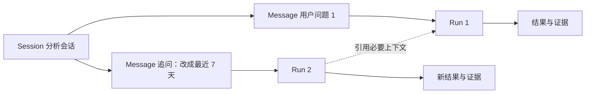
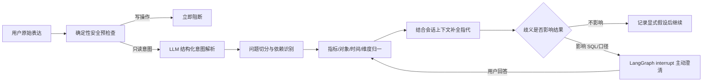
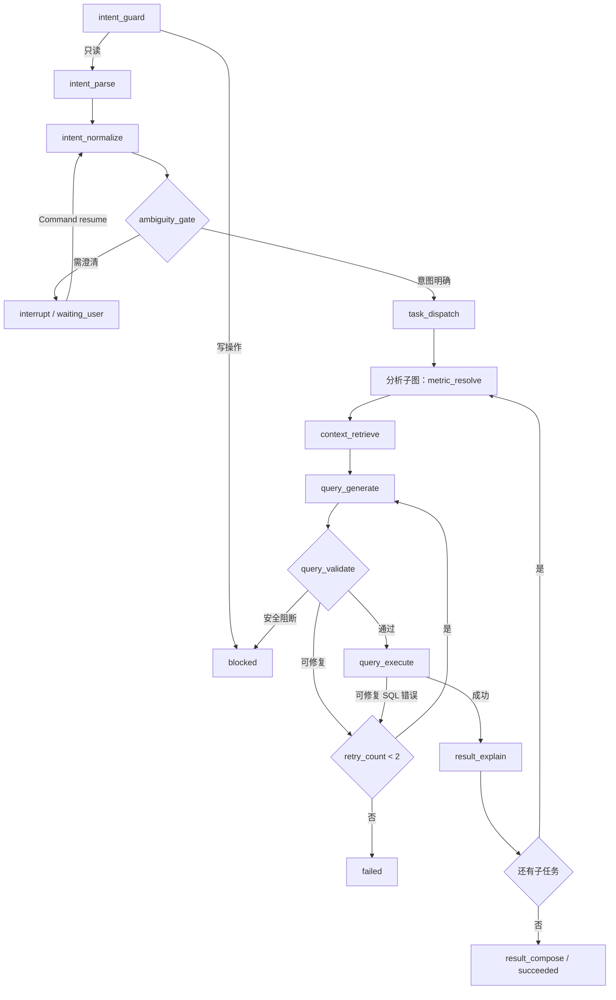
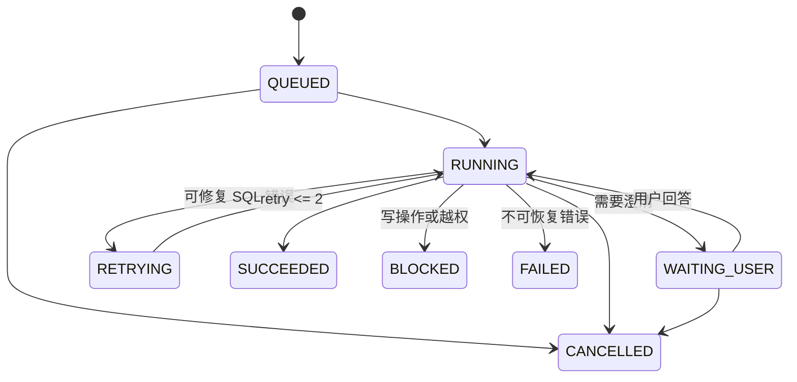
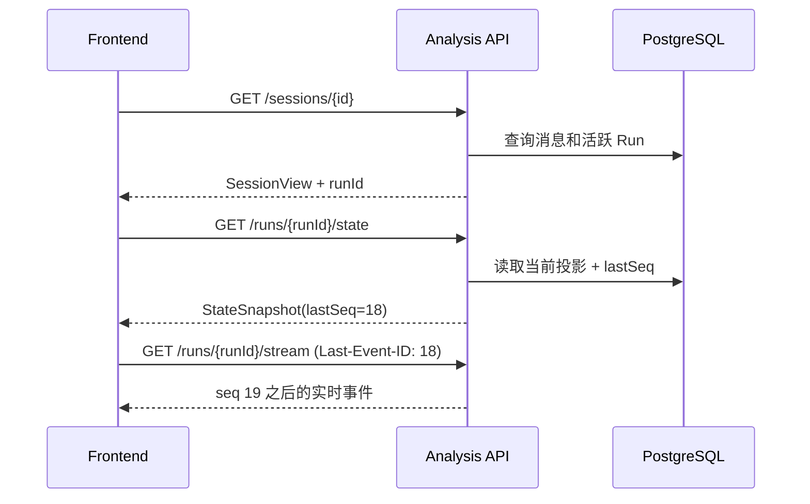

# ForgeSight 阶段 5：智能问析 Agent 闭环设计

> 文档状态：设计基线 v5（5A—5F 第一版闭环已完成并通过收口验收）  
> 适用范围：`forge-sight/backend` 与 `forge-sight/frontend-new`  
> 平台数据库：PostgreSQL `forge_sight_app`  
> 业务数据库：按数据源连接，只读访问  
> 明确不包含：机器学习建模、模型训练与模型治理；这些仍属于阶段 7

> 2026-07-22 收口进度：已完成确定性复合问题拆解、依赖任务结果传递、跨轮指代识别、对象/时间合并澄清、LangGraph `interrupt/Command(resume)`、MySQL/PostgreSQL `EXPLAIN` 成本门控、过期租约恢复、Checkpoint 续跑、并发幂等验收、双层只读拦截审计，以及真实 Session/Run/SSE 页面接入。阶段 5 后续只接受缺陷修复，不再增加机器学习或完整报告生成能力。

---

## 1. 这一步到底要做成什么

阶段 5 不是简单地补一个“自然语言转 SQL”接口，而是要把前四个阶段已经具备的数据源、元数据、业务知识、指标口径、语义检索和只读执行器串成一个可运行、可观察、可恢复、可追溯的智能分析闭环：

```text
用户提问
  → 理解业务问题
  → 匹配指标口径
  → 定位数据资源
  → 生成 SQL
  → 安全与语义校验
  → 只读执行并检查结果
  → 生成图表和可追溯结论
```

阶段 5 完成后，前端不能只看到最终答案，还要能够：

- 实时看到 Agent 当前进行到哪一步、已经完成什么、为什么等待或失败；
- 查看口径、数据表、SQL、校验、执行摘要和结论依据组成的分析证据链；
- 页面刷新或网络短暂中断后恢复到相同状态；
- 在需要澄清时暂停，用户补充信息后从原位置继续；
- 对稳定检查点执行“从这里继续”，生成新分支，同时保留原分析历史；
- 区分可自动重试的技术错误、需要用户处理的业务歧义和必须阻断的安全风险；
- 查看本次分析的模型调用次数、Token、耗时和估算费用，并限制失控重试带来的资源消耗。

核心产品原则是：**真实执行、过程可见、状态可恢复、结果可解释、消耗可度量、历史不可被悄悄改写。**

---

## 2. 范围与非目标

### 2.1 本阶段必须完成

1. 基于 LangGraph 的七步问析工作流；LangGraph 负责节点调度、条件路由、暂停恢复和底层 checkpoint。
2. 会话、消息、运行、步骤、事件、检查点、分析产物的 PostgreSQL 持久化。
3. REST API + SSE 实时事件流。
4. 多轮追问及条件修改，例如“改成最近 7 天”“只看 L03 产线”。
5. 健壮意图层：支持一句话包含多个问题、复合分析、上下文指代；多个候选口径或关键条件不明确时主动澄清。
6. 写操作意图层拦截 + SQL AST 层拦截。
7. SQL 语法或字段错误有限自动修复，最多 2 次。
8. 断线重连、页面刷新恢复、事件去重和缺口补偿。
9. 分析证据链与 Trace DAG。
10. 从稳定检查点创建新分支，即产品中的“状态回溯”。
11. LLM 调用、Token、耗时、重试增量和估算费用的分层追踪，并以 Run 预算限制异常消耗。

### 2.2 本阶段明确不做

- 机器学习意图识别、任务草案、训练、评估、推理和模型治理；
- 阶段 6 的完整周报/月报编排，只输出当前单次分析的图表和简要结论；
- 多 Agent 协作、Agent 自由选择任意工具、MCP 或 Skill 市场；
- Python 任意代码执行沙箱；
- 向量检索重构；阶段 5 直接消费阶段 4 的语义上下文包；
- destructive rollback，即删除检查点之后的历史；
- 将前端、业务事件、Artifact、权限或 SQL 安全直接绑定到 LangGraph 内部协议；LangGraph 仅作为后端工作流运行引擎。

当前 `frontend-new/src/api/analysis.js` 中的 `modeling-proposal` 是原型演示逻辑。阶段 5 接真 API 时应将其从问析闭环移出：识别到建模类问题时返回 `CAPABILITY_NOT_AVAILABLE` 或跳转建议，但不得伪装成阶段 5 已经完成的建模能力。

---

## 3. 从开源项目借鉴什么

### 3.1 DataFoundry：最直接的产品与工程参考

本地项目：`D:\aaa\a-外包\datafoundry-main`

DataFoundry 对 ForgeSight 最有价值的不是页面外观，而是运行记录的组织方式：

- `threadId` 表示会话，`runId` 表示一次运行；
- 同一份 Agent 事件既持久化，又实时发给前端；
- 事件处理顺序是“先持久化，再投影检查点/Trace，最后推送 UI”；
- 上下文包、工具结果和终态可以形成检查点；
- Trace DAG 将用户轮次、上下文、工具、产物、终态和分支连接起来；
- Trace 记录每次模型调用的输入、输出、上下文预算和 Token 消耗，便于定位高成本步骤；
- “Continue from here”不是覆盖原历史，而是基于检查点创建子会话；
- 页面刷新后通过会话、事件、产物接口重建界面，而不依赖浏览器内存。

ForgeSight 应采用这些原则，但不复制 DataFoundry 的通用 Skill、MCP、Artifact 和复杂多分支能力。DataFoundry 中的 `remaining tokens` 主要用于观察上下文窗口，ForgeSight 必须进一步区分“单次调用用量、Run 累计用量、上下文窗口剩余量、估算费用和执行预算剩余量”，不能把它们混成一个数字。

官方仓库：[DataFoundry](https://github.com/datagallery-lab/datafoundry)

### 3.2 LangGraph：检查点、暂停和时间旅行语义

本地参考仓库：`D:\aaa\a-外包\agent-architecture-references\langgraph`

LangGraph 把每一步执行后的状态保存为 checkpoint，并用 `thread_id` 组织同一会话状态；其 time travel 明确区分 replay 与 fork，原检查点不会被改写。这验证了 ForgeSight 将“回溯”定义为“基于历史检查点创建分支”的方向。

采用：

- 每个稳定步骤后保存状态快照；
- 等待人工输入时持久化并可长期暂停；
- 从旧状态继续时保留原始历史；
- 状态快照与运行配置一起版本化。

阶段 5 正式采用 LangGraph 作为内部工作流运行引擎，并使用 PostgreSQL Checkpointer。这里的“第一版”按产品主体完整版本定义：除机器学习外，多轮对话、多问题分解、澄清暂停、恢复、重试、检查点、分支回溯、报告前置分析能力都要具备，因此不再重复自研一套工作流运行时。

LangGraph 的职责严格限定为：节点调度、条件边、`interrupt/resume`、运行恢复和底层 checkpoint。ForgeSight 仍然拥有 Session/Run、领域事件、Artifact、Trace、权限、数据源隔离、指标口径和 SQL 安全，前端不得直接依赖 LangGraph 内部事件或状态格式。

官方资料：[LangGraph 仓库](https://github.com/langchain-ai/langgraph)、[Persistence](https://docs.langchain.com/oss/python/langgraph/persistence)、[Time travel](https://docs.langchain.com/oss/python/langgraph/use-time-travel)、[Interrupts](https://docs.langchain.com/oss/python/langgraph/interrupts)、[Streaming](https://docs.langchain.com/oss/python/langgraph/streaming)

### 3.3 AG-UI：前后端 Agent 事件的分类思路

本地参考仓库：`D:\aaa\a-外包\agent-architecture-references\ag-ui`

AG-UI 将运行生命周期、文本流、工具调用、步骤、状态快照和状态增量分成不同事件类型。这一点适合 ForgeSight：业务状态不应该塞进一段“AI 正在思考……”文本里，前端应收到机器可读事件，再由组件决定如何展示。

借鉴：

- Run、Step、Message、State、Tool/SQL 事件分离；
- 状态快照与增量事件并存；
- 暂停/人工输入是一种正式运行结果，不是异常；
- 协议与传输解耦。

第一版不完整实现 AG-UI；ForgeSight 使用更小的领域事件集合，并预留向 AG-UI 映射的适配层。

官方仓库：[AG-UI Protocol](https://github.com/ag-ui-protocol/ag-ui)

### 3.4 DB-GPT：数据 Agent 的工具边界与大结果快照

本地参考仓库：`D:\aaa\a-外包\agent-architecture-references\DB-GPT`

DB-GPT 明确将 `sql_query` 设计为只读工具；同时把完整工具结果与 LLM 上下文分离：Prompt 中只保留摘要和引用，完整结果作为独立快照保存。这适合 ForgeSight 的 SQL 结果与证据链设计。

借鉴：

- 数据访问工具必须是只读的、受控的；
- 大结果集不进入对话上下文，只给 LLM 摘要或采样；
- 完整执行结果作为独立产物持久化，供追溯和恢复；
- 运行状态事件独立于聊天文本，避免污染对话。

不采用 DB-GPT 的 Shell、任意代码解释器和多 Agent 能力，因为它们会明显扩大阶段 5 的安全面和答辩复杂度。

官方资料：[DB-GPT 仓库](https://github.com/eosphoros-ai/DB-GPT)、[Agent 概览](https://docs.dbgpt.cn/docs/agents/introduction/database/)

### 3.5 最终技术决策

| 决策项 | 阶段 5 选择 | 原因 |
|---|---|---|
| 工作流引擎 | LangGraph + PostgreSQL Checkpointer | 避免重复实现暂停恢复、条件分支、持久化执行和 checkpoint |
| 实时协议 | 领域事件 + SSE | 浏览器支持好，实现成本小，适合单向状态推送 |
| 历史与恢复 | LangGraph 执行 checkpoint + ForgeSight append-only 领域事件和当前投影 | 运行恢复与产品恢复职责分离 |
| 回溯 | 从 checkpoint 创建新 session 分支 | 不改写历史，结果可审计 |
| 大结果 | Artifact 独立存储，事件只传摘要/引用 | 避免事件和 Prompt 过大 |
| LLM 用量 | Call Attempt 明细 + Run 聚合 + 可版本化价格表 | 能解释每一步的 Token、费用和重试增量，历史费用不被新价格改写 |
| 资源预算 | 调用次数、重试次数、Token、费用和总时长多重上限 | 防止失败循环、Prompt 膨胀和重试放大成本 |
| 框架边界 | `ForgeSightGraphRunner` + 领域事件适配器 | LangGraph 可升级替换，前端和业务数据模型不受影响 |

---

## 4. 核心领域模型

### 4.1 七个必须分清的概念

| 概念 | 含义 | 生命周期 |
|---|---|---|
| Session | 一次连续的业务分析对话 | 包含多个用户轮次和多个 Run |
| Message | 用户、Agent 或系统在会话中的一条消息 | 归属 Session，可关联 Run |
| Run | 一次用户提问触发的完整 Agent 运行 | 从受理到成功、失败、阻断或等待用户 |
| AnalysisTask | 从本轮表达中分解出的一个可执行分析问题 | 一个 Run 包含 1～3 个 Task，可有依赖关系 |
| Step | 某个 Task 在七步流程中的一个步骤或一次重试尝试 | 归属 Run 和 Task；意图解析等全局步骤可不绑定 Task |
| LLM Call Attempt | 某个 Step 对模型发起的一次实际调用，包括失败或重试调用 | 归属 Run、Task、Step 和 attempt；完成后记录用量与状态 |
| Artifact | SQL、上下文包、结果集、图表配置、结论等不可变产物 | 被 Run、Task、Step、Checkpoint 引用 |

Checkpoint 不是第六种业务内容，而是某一时刻对 Run 可恢复状态和相关 Artifact 引用的冻结记录。

### 4.2 多轮对话关系



多轮不是把全部旧 SQL 和全部结果重新塞给 LLM。Agent 只使用：

- 最近若干条自然语言消息；
- 上一轮的结构化 `analysis_summary`；
- 当前数据源、指标、维度、时间等已确认约束；
- 必要 Artifact 的摘要与 ID。

---

## 5. 七步工作流

### 5.1 稳定步骤定义

| stepKey | 前端名称 | 输入 | 主要输出 | 可暂停/终止点 |
|---|---|---|---|---|
| `intent.parse` | 理解业务问题 | 用户消息、多轮摘要 | 指标词、维度、时间、排序/趋势等意图 | 写意图立即阻断；要素不足可澄清 |
| `metric.resolve` | 匹配业务口径 | 意图、企业统一知识 | 已发布指标及版本、候选口径 | 多口径或未发布口径可澄清/警告 |
| `context.retrieve` | 定位数据资源 | 问题、sourceId、指标 | 阶段 4 语义上下文包 | 无可用表/字段时失败或澄清 |
| `query.generate` | 生成分析 SQL | 上下文包、约束、数据库方言 | SQL 草案及生成说明 | LLM 不可用或输出非法时失败 |
| `query.validate` | 安全与语义校验 | SQL、白名单、指标公式 | 校验报告、规范化 SQL | 写操作、越权表、无界查询必须阻断 |
| `query.execute` | 执行并检查结果 | 已验证 SQL、只读连接 | 结果 Artifact、执行摘要、质量检查 | 语法/字段错可有限重试；数据源错误失败 |
| `result.explain` | 生成图表与结论 | 结果摘要、指标、执行证据 | KPI、图表配置、结论、发现 | 数值核对失败则失败，不输出猜测结论 |

“报告生成”不放入第八步。阶段 5 的 `result.explain` 只生成单次分析的可视化和简要结论；完整报告属于阶段 6。

### 5.2 健壮意图层：问题分解、上下文解析与主动澄清

`intent.parse` 不是一次普通的 LLM 分类调用，而是一条“确定性预检查 → 结构化解析 → 语义归一 → 歧义门控”的子流水线。它必须先把用户真正想完成的分析任务定义清楚，后续才允许检索资源和生成 SQL。



#### 5.2.1 标准输出 `IntentBundle`

LLM 必须按 Pydantic/JSON Schema 返回结构化结果，禁止让后续节点解析一段自然语言描述：

```json
{
  "mode": "multi_sequential",
  "summary": "先定位低于标准的工序，再分析这些工序的主要缺陷",
  "tasks": [
    {
      "taskId": "q1",
      "normalizedQuestion": "统计本月各工序良率并找出低于工序标准的工序",
      "analysisType": "comparison",
      "metricMentions": ["工序良率"],
      "dimensions": ["工序"],
      "filters": [],
      "timeRange": {"type": "relative", "value": "本月"},
      "comparison": {"type": "business_standard", "target": "工序标准良率"},
      "outputPreference": ["table", "bar_chart", "insights"],
      "dependsOn": [],
      "inheritedSlots": [],
      "unresolvedSlots": []
    },
    {
      "taskId": "q2",
      "normalizedQuestion": "分析 q1 中低于标准工序的主要缺陷类型",
      "analysisType": "ranking",
      "metricMentions": ["缺陷数量"],
      "dimensions": ["缺陷类型"],
      "filters": [{"sourceTask": "q1", "field": "工序", "operator": "in"}],
      "timeRange": {"inheritFrom": "q1"},
      "comparison": null,
      "outputPreference": ["table", "bar_chart", "insights"],
      "dependsOn": ["q1"],
      "inheritedSlots": ["timeRange"],
      "unresolvedSlots": []
    }
  ],
  "clarification": null,
  "assumptions": [],
  "safety": {"readOnly": true, "matchedWritePatterns": []}
}
```

`mode` 取值：

- `single`：一个独立分析任务；
- `compound`：多个要求可由同一结果集完成，例如“分析良率并标出低于标准的工序”；
- `multi_parallel`：多个相互独立的问题，例如“看工序良率，同时统计各产线停机时长”；
- `multi_sequential`：后一个问题依赖前一个结果，例如“先找良率最低工序，再看它的缺陷类型”；
- `follow_up`：对上一轮结果修改条件、下钻或改变展示。

#### 5.2.2 一句话多个问题怎么处理

不能按“和、并且、然后”机械切句，必须判断问题之间的数据和逻辑关系：

| 用户表达 | 识别方式 | 执行方式 |
|---|---|---|
| “分析各工序良率，并找出低于标准的工序” | `compound`，同指标同结果集 | 合并为一个子任务，一次 SQL 完成 |
| “分析各工序良率，再统计各产线停机时长” | `multi_parallel`，指标和主题独立 | 一个 Run 下生成两个子任务，第一版按顺序执行以控制数据库压力 |
| “找出良率最低的工序，再分析它的缺陷类型” | `multi_sequential` | q2 依赖 q1 Artifact，q1 完成后才生成 q2 SQL |
| “分析停机时长和不良率是否相关” | `compound` 相关性任务 | 不能拆成两个孤立统计，需对齐粒度和时间后联合分析 |
| “看一下 L03，再和 L01 比较” | `follow_up/compound` | 从会话继承指标和时间，补充比较对象 |

一个用户轮次只创建一个 Run；Run 内包含 `1..N` 个 `AnalysisTask`。每个子任务经过相同的口径、资源、SQL、校验、执行和解释节点，并在 `result.explain` 汇总为统一回答。为避免一句话触发无界工作量，默认最多自动执行 3 个子任务；超过 3 个时先列出识别到的任务，请用户确认范围。

前端七步证据链在单任务时保持现状；多任务时显示一级步骤“理解业务问题”，下面再按“问题 1/2/3”折叠展示各自的口径、SQL、执行和结论状态，不能把多个 SQL 混成一条证据链。

#### 5.2.3 哪些模糊情况必须追问

只要不同理解会实质改变指标公式、查询范围、分组粒度、数据源或结论，就必须追问：

- **指标口径模糊**：“良率”“效率”“完成率”匹配多个已发布指标；
- **分析对象模糊**：“哪个最好”“最近怎么样”没有明确产品、工序、产线或设备；
- **时间模糊**：“最近”“这段时间”“目前”且业务知识没有默认周期；
- **粒度模糊**：“按车间看”但数据底座只有产线，或日报/月报均可解释；
- **比较基准模糊**：“是否正常”“有没有下降”没有标准值或对比周期；
- **指代模糊**：“它”“这个工序”“刚才那个产品”可能指向多个历史对象；
- **范围模糊**：一句话包含多个问题，但先后关系和共享条件不明确；
- **数据源模糊**：当前会话可访问多个数据源，同一指标在多个源均有已验证绑定且用户未选；
- **跨问题条件模糊**：用户没有说明第二个问题是否沿用第一个问题的时间或筛选范围。

#### 5.2.4 哪些情况可以不追问

系统不能为了“绝对确定”频繁打断用户。以下情况可以采用确定性默认值，但必须把假设展示在证据链中：

- 企业知识库为该分析主题定义了唯一默认时间范围；
- 只有一个已发布指标与表达匹配，且当前数据源只有一个已验证绑定；
- “本月、本周、最近 7 天”等可根据企业时区唯一解析；
- 明确的追问可以从上一轮成功 Run 继承指标、对象和数据源；
- 只影响图表样式、不影响数字结果的偏好未说明时采用产品默认值。

不得只相信 LLM 自报的 `confidence`。歧义门控要综合：缺失槽位、候选指标分差、知识库默认值、指代候选数量、数据源绑定数量和会话继承证据。建议规则：

- 关键槽位完整且候选唯一：直接执行；
- 存在可靠企业默认值：执行并展示假设；
- 有两个以上合理候选且会改变 SQL/数字：必须澄清；
- 无法建立数据映射：不猜测，澄清或返回当前数据源不支持。

#### 5.2.5 主动澄清要一次问到位

一次澄清最多合并 3 个真正阻塞执行的问题，避免连续弹出多个卡片：

```json
{
  "interactionId": "int_01J...",
  "kind": "clarification",
  "title": "需要确认两个分析条件",
  "questions": [
    {
      "id": "metric",
      "prompt": "你所说的“良率”是指哪一个指标？",
      "options": ["工序良率", "检验通过率"],
      "required": true
    },
    {
      "id": "shared_time",
      "prompt": "第二个问题是否沿用第一个问题的本月范围？",
      "options": ["沿用本月", "分别设置时间"],
      "required": true
    }
  ],
  "allowCustom": true,
  "resumeNode": "intent_normalize"
}
```

前端应展示“系统已经理解的部分”和“仍需确认的部分”，用户回答后只重新运行受影响节点，不丢失已经确认的内容。

### 5.3 LangGraph 主流程



LangGraph 图的主要节点建议为：`intent_guard → intent_parse → intent_normalize → ambiguity_gate → task_dispatch → metric_resolve → context_retrieve → query_generate → query_validate → query_execute → result_explain → result_compose`。其中 `metric_resolve` 到 `result_explain` 可以作为子图对每个 `AnalysisTask` 执行；第一版顺序调度，后续在数据源配额允许时再并行。

`ambiguity_gate` 通过 `interrupt()` 暂停，回答通过 `Command(resume=...)` 恢复；SQL 修复通过条件边回到 `query_generate`，并由 State 中的 `retry_count` 保证最多两次。

### 5.4 Run 状态



后端存储使用稳定英文枚举，中文仅由前端渲染：

| 状态 | 含义 | 是否终态 | 前端主操作 |
|---|---|---:|---|
| `queued` | 已受理，等待执行 | 否 | 取消 |
| `running` | 正在执行 | 否 | 查看证据链、取消 |
| `waiting_user` | 等待用户补充信息 | 否 | 回答、取消 |
| `retrying` | 正在进行有限自动修复 | 否 | 查看原因、取消 |
| `succeeded` | 分析成功 | 是 | 追问、查看证据、从检查点继续 |
| `blocked` | 安全策略阻断 | 是 | 修改问题、查看审计说明 |
| `failed` | 无法继续 | 是 | 重试、修改问题、查看错误编号 |
| `cancelled` | 用户取消 | 是 | 重新运行 |

### 5.5 Step 状态

`pending / running / waiting_user / retrying / succeeded / failed / blocked / skipped / cancelled`

Step 必须有独立状态，不能只依赖 Run 状态推断。例如 `Run=failed` 时，前四步可能成功、第五步失败、后两步保持 `skipped`，这正是证据链应该展示的信息。

### 5.6 重试规则

重试必须按错误类别处理，不允许使用一个笼统的 `retry=true`：

| 错误类别 | 默认策略 | 最大自动重试 | 说明 |
|---|---|---:|---|
| LLM 网络超时、限流、临时 5xx | 指数退避并加入 jitter | 2～3 次 | 尊重供应商 `Retry-After`，熔断开启时不继续调用 |
| SQL 语法、已登记字段、别名或方言错误 | 携带结构化错误重新生成 | 2 次 | 每次必须重新经过完整安全校验 |
| LLM 结构化输出格式错误 | 强化 schema 约束后重试 | 1 次 | 不允许无限解析修补 |
| 指标、对象、时间或数据源歧义 | 转 `waiting_user` | 0 次 | 主动澄清，不靠重复调用碰运气 |
| 写意图、安全越权、未授权表 | 终态 `blocked` | 0 次 | 不得通过改写 Prompt 绕过策略 |
| 数据源断连或权限错误 | 终态 `failed` | 0 次 | 提示管理员处理连接或权限 |
| 合法空结果、数据质量失败 | 返回业务状态 | 0 次 | 不用重试掩盖真实数据问题 |

SQL 自动修复仅覆盖以下错误，最多 2 次：

- SQL 语法错误；
- 已登记字段名引用错误；
- 已登记关联路径的别名或方言错误；
- LLM 返回格式错误且可重新约束生成。

以下情况禁止自动重试：

- 写操作或越权访问；
- 指标口径歧义、对象或时间范围缺失；
- 无已验证的物理指标绑定；
- 数据源断连或权限错误；
- 查询超时；除非用户主动缩小范围；
- 结果为空但查询合法；空结果是业务结果，不是系统异常；
- 数值越界或结果质量检查失败；不得靠反复生成掩盖数据问题。

每次重试创建新的 `analysis_run_step` attempt 和事件，旧尝试不得覆盖。

每次 SQL 生成后还要保存规范化 SQL 指纹。若新 SQL 与本 Step 已失败的 SQL 指纹重复，立即停止自动修复并返回 `RETRY_NO_PROGRESS`，避免模型重复生成同一错误查询。

#### 5.6.1 Run 级资源预算

每个 Run 在开始时冻结预算快照，至少包含：

```text
max_llm_calls
max_retry_calls
max_input_tokens
max_output_tokens
max_total_tokens
max_estimated_cost
max_duration_seconds
```

预算应支持平台默认值、管理员模型配置和高风险任务覆盖值，但业务用户不能通过自然语言提升预算。执行器在每次模型调用前做预检、调用后按真实 usage 结算；任一硬上限耗尽后停止后续自动调用，返回 `RUN_BUDGET_EXCEEDED`。软阈值达到 80% 时产生预警事件，但不打断当前安全步骤。

失败调用、超时调用和重试调用都必须计入调用次数；只要供应商返回 usage，就必须计入 Token 与费用。重试产生的消耗单独聚合为 `retry_*`，答辩和管理员治理页面可以明确看到“为自动修复额外消耗了多少”。

---

## 6. 后端事件协议

### 6.1 为什么采用事件

如果 `POST /analysis` 等待七步全部结束后一次返回，前端无法可靠展示进度、澄清、重试、断线恢复和回溯。正确方式是：

1. `POST` 创建 Run，立即返回 `202 Accepted`；
2. 后端执行时产生结构化事件；
3. 事件先写 PostgreSQL，再推送 SSE；
4. 前端以相同 reducer 消费实时事件和历史事件；
5. 刷新时先获取快照，再从 `lastSeq` 补拉事件。

关键不变量：**persist before publish（先落库，再推送）**。否则前端可能看见一个刷新后永远找不回来的状态。

### 6.2 统一事件信封

```json
{
  "schemaVersion": "1.0",
  "eventId": "evt_01J...",
  "sessionId": "ses_01J...",
  "runId": "run_01J...",
  "taskId": "task_q1",
  "seq": 18,
  "type": "step.progress",
  "occurredAt": "2026-07-22T15:10:24.318+08:00",
  "stepKey": "query.execute",
  "attempt": 1,
  "visibility": "user",
  "replayable": true,
  "payload": {
    "status": "running",
    "label": "正在执行只读查询",
    "progress": 72,
    "detail": "已通过 7 项安全检查"
  }
}
```

字段规则：

- `eventId` 全局唯一，用于去重；
- `seq` 在单个 Run 内严格递增，`UNIQUE(run_id, seq)`；
- `taskId` 在 Run 级事件中可为空，在子问题的 Step、SQL、Artifact 事件中必须存在；
- `type` 决定 payload schema，不允许前端猜字段；
- `visibility` 为 `user / admin / debug / audit`；
- `replayable=false` 只允许用于 heartbeat 等无状态事件；
- 事件不得包含数据库密码、LLM Key、完整系统 Prompt 或模型隐式思维链；
- 推理展示只提供经过整理的任务说明和证据摘要，不暴露 chain-of-thought。

### 6.3 最小事件集合

#### 会话与运行

- `session.created`
- `run.accepted`
- `run.started`
- `run.status.changed`
- `run.completed`
- `run.failed`
- `run.blocked`
- `run.cancelled`

#### 步骤

- `tasks.planned`
- `task.started`
- `task.completed`
- `task.failed`
- `task.skipped`
- `step.started`
- `step.progress`
- `step.completed`
- `step.retrying`
- `step.failed`
- `step.blocked`
- `step.skipped`

#### 人机交互

- `clarification.requested`
- `clarification.resolved`
- `clarification.expired`

#### 领域产物

- `context.compiled`
- `sql.generated`
- `sql.validation.completed`
- `sql.execution.started`
- `sql.execution.completed`
- `artifact.created`
- `message.delta`
- `message.completed`

#### LLM 用量与预算

- `llm.call.started`（仅 admin/debug 默认可见）
- `llm.usage.recorded`
- `run.budget.warning`
- `run.budget.exceeded`

#### 恢复与分支

- `checkpoint.created`
- `branch.created`
- `state.snapshot`
- `heartbeat`

不需要为每个 token 写数据库。`message.delta` 可以在内存中合并为每 80～150ms 或每 200～500 字符写一次；`message.completed` 必须持久化完整最终文本。

### 6.4 SSE 格式

```text
id: 18
event: step.progress
data: {"schemaVersion":"1.0","eventId":"evt_...","runId":"run_...","seq":18,...}

```

要求：

- `Content-Type: text/event-stream`；
- 禁用反向代理缓冲和压缩；
- 每 15 秒发一个 `heartbeat`；
- 支持 `Last-Event-ID`，断线后从该 seq 之后继续；
- 若服务端发现事件已被归档或 seq 有缺口，返回 `EVENT_GAP`，前端改走快照恢复；
- 前端按 `eventId` 去重，按 `seq` 排序应用；
- 同一个 Run 只允许一个活跃执行器持有 lease，避免重复执行 SQL。

---

## 7. 前端需要的状态与展示契约

### 7.1 页面区域映射

现有智能问析页的结构可以保留，但数据来源要变：

| 页面区域 | 真实数据来源 | 更新方式 |
|---|---|---|
| 左侧会话列表 | Session API | 创建/更新会话后刷新 |
| 中部用户与 Agent 消息 | Message API + message events | 增量流式更新 |
| 中部步骤骨架 | Run snapshot 中的 7 个 Step | `step.*` 更新 |
| 多问题任务组 | `analysis_task` + Task Artifact | `tasks.planned/task.*` 更新 |
| KPI、图表、结论 | Artifact API | `artifact.created` 后加载 |
| 右侧分析证据链 | Step、Artifact、Checkpoint | 实时事件 + Trace API |
| 完整追踪 DAG | Trace API | 终态或用户打开时加载 |
| 运行消耗摘要 | Run usage projection | `llm.usage.recorded/run.completed` 更新 |
| 从这里继续 | Checkpoint + Branch API | 创建新 Session 并导航 |

### 7.2 前端不应直接显示后端枚举

前端统一映射：

| 后端状态 | 中文 | 视觉建议 |
|---|---|---|
| `queued` | 等待开始 | 中性灰，轻量骨架 |
| `running` | 正在分析 | 品牌蓝，当前步骤轻微脉冲 |
| `waiting_user` | 等待你确认 | 琥珀色澄清卡，不显示为错误 |
| `retrying` | 正在自动修正 | 琥珀色，显示“第 1/2 次” |
| `succeeded` | 分析完成 | 绿色状态点，不使用大面积绿色 |
| `blocked` | 已安全阻断 | 红色说明卡，强调没有执行 SQL |
| `failed` | 分析未完成 | 红色错误卡 + 可执行建议 |
| `cancelled` | 已取消 | 中性灰，可重新运行 |

### 7.3 每种关键状态必须返回什么

| 场景 | 后端必须提供 | 前端展示 | 可操作项 |
|---|---|---|---|
| 正在理解 | `stepKey/status/label/progress` | 七步骨架高亮当前步骤 | 取消 |
| 匹配到口径 | `metricId/name/version/status` | 证据链口径卡 | 查看口径 |
| 需要澄清 | `interactionId/question/options/allowCustom/expireAt` | 对话内澄清选择卡 | 选择或自定义回答 |
| 写意图阻断 | `code/userSafeMessage/auditId` | 安全阻断卡 | 修改问题、查看说明 |
| SQL 已生成 | `sqlArtifactId/dialect/summary` | 证据链“查看 SQL” | 展开 SQL |
| 校验完成 | 每个 check 的 `code/result/message` | 通过项/阻断项列表 | 无或修改问题 |
| 自动重试 | `attempt/maxAttempts/cause/changedFields` | 步骤内重试提示 | 取消 |
| 模型调用完成 | `model/callCount/inputTokens/outputTokens/totalTokens/durationMs/estimatedCost` | 业务端简要摘要，管理员端完整明细 | 展开运行详情 |
| 预算接近上限 | `budgetType/used/limit/ratio` | 轻量预警，不显示为执行失败 | 取消或等待当前步骤完成 |
| 预算耗尽 | `errorCode=RUN_BUDGET_EXCEEDED/budgetType/used/limit` | 安全终止说明 | 修改问题或由管理员调整策略 |
| 执行完成 | `durationMs/rowCount/scannedRows/dataAsOf` | 执行摘要 | 查看结果样例 |
| 分析完成 | KPI、Chart、Conclusion Artifact ID | 结果卡、图表和业务发现 | 追问、导出、证据链 |
| 系统失败 | `errorCode/userSafeMessage/retryable/debugId` | 错误卡 | 重试或修改问题 |
| 页面恢复 | `snapshotVersion/lastSeq` | 无闪烁恢复已有状态 | 继续等待或交互 |

### 7.4 与当前 mock DTO 的兼容

当前成功态使用：

```text
run.plan
run.planDetails
run.result.kpis
run.chart
run.conclusion
run.execution
run.sources
```

阶段 5 可继续输出一个聚合 `AnalysisRunView`，保证现有 `AnalysisPage.jsx` 可以逐步联调：

- `plan` 由 7 条 `analysis_run_step` 投影；
- `tasks` 由 `analysis_task` 投影；单问题也返回长度为 1 的数组，多问题时每个 Task 拥有自己的 `plan/planDetails`；
- `planDetails` 由步骤详情和相关 Artifact 投影；
- `result.kpis`、`chart`、`conclusion` 来自终态 Artifact；
- `execution` 来自 SQL execution Artifact；
- `sources` 来自指标、数据表和数据更新时间证据。

但这个聚合 View 是查询投影，不是唯一事实源。唯一事实源是 Run/Step 当前记录、append-only 事件和不可变 Artifact。

### 7.5 前端 reducer 要求

前端应只写一个 `reduceAnalysisEvent(state, event)`，实时 SSE 与历史重放共用：

```js
function reduceAnalysisEvent(state, event) {
  if (state.seenEventIds.has(event.eventId)) return state;
  if (event.seq <= state.lastSeq) return state;
  // 根据 type 更新 run、steps、messages、artifacts 和 interactions
  return nextState;
}
```

补充规则：

- 终态一旦确认，迟到的 `running` 或旧错误事件不得把界面改回中间态；
- 收到 seq 跳号时先缓冲，短时间仍缺失则请求补拉；
- `message.delta` 按 messageId 合并；
- `artifact.created` 只存引用，按需获取大对象；
- 路由切换或刷新时不清空仍在运行的 Run。

### 7.6 Token 与费用展示层级

业务人员端默认只显示不打扰分析阅读的摘要，例如：`分析完成 · 8.6s · 4 次模型调用`。在“分析证据链 → 运行详情”中可展开查看模型、输入 Token、输出 Token、总 Token、自动修正次数和估算费用，但不展示系统 Prompt、隐式思维链和供应商密钥。

管理员端提供完整治理视图：按日期、模型、用户、数据源、Run 和 Step 聚合 Token 与估算费用；区分正常调用与重试调用；展示缓存命中和可估算的节省量；支持异常 Token 增长和高重试率告警。

以下概念必须分开显示：

- `input/output/total tokens`：供应商返回的实际调用用量；
- `cached input tokens`：供应商明确返回时单列，不能自行猜测；
- `reasoning tokens`：供应商明确返回时单列，业务端默认隐藏；
- `context remaining`：模型上下文窗口估算剩余量，不等于账户余额；
- `estimated cost`：基于调用时价格快照计算的估算金额，不冒充供应商账单；
- `budget remaining`：ForgeSight 对本 Run 设置的内部执行预算。

---

## 8. 澄清不是报错，而是可恢复暂停

### 8.1 触发条件

- 健壮意图层的 `ambiguity_gate` 判断存在会实质改变 SQL 或结论的未解决槽位；
- 指标有多个候选且没有唯一可靠的企业默认值；
- 排名/趋势问题缺少时间、对象、粒度或比较基准；
- 一句话包含多个问题，但无法确定合并、独立还是依赖执行；
- 当前数据源没有已验证指标绑定，但存在其他可选择数据源；
- 用户追问中的指代或条件继承存在多个合理解释。

完整门控规则见 5.2。本节只定义 LangGraph 暂停和产品交互协议。

### 8.2 澄清对象

```json
{
  "interactionId": "int_01J...",
  "kind": "clarification",
  "title": "需要确认分析口径",
  "questions": [
    {
      "id": "metric",
      "prompt": "你希望按哪一种口径分析“良率”？",
      "options": [
        {
          "id": "metric_M001",
          "label": "工序良率",
          "description": "良品数量 / 投入数量，按工序统计",
          "value": {"metricId": "M-001"}
        },
        {
          "id": "metric_M006",
          "label": "检验通过率",
          "description": "通过检验记录数 / 检验记录总数",
          "value": {"metricId": "M-006"}
        }
      ],
      "required": true
    }
  ],
  "allowCustom": true,
  "understood": ["分析主题：质量", "当前数据源：华东制造数据底座"],
  "resumeNode": "intent_normalize",
  "expiresAt": null
}
```

### 8.3 恢复

用户回答时不创建一个与原 Run 无关的新 Run，而是：

1. 锁定对应 `interactionId`，防止重复提交；
2. 写入回答 Message 和 `clarification.resolved`；
3. 将 Run 从 `waiting_user` 改为 `running`；
4. 使用 LangGraph `Command(resume=...)` 从 `resumeNode` 继续；
5. 之前成功步骤仍保留，受回答影响的后续步骤重建新的 attempt。

---

## 9. PostgreSQL 持久化设计

PostgreSQL 中并存两层数据：

1. **LangGraph 执行状态层**：由 PostgreSQL Checkpointer 管理 graph checkpoint、pending task、interrupt 和恢复所需状态；
2. **ForgeSight 产品业务层**：保存 Session、Run、Step、领域 Event、Artifact、Interaction、Trace 和审计投影，供 API、前端和治理查询。

两层职责不能混淆：LangGraph checkpoint 是工作流恢复依据，`analysis_*` 表是产品事实和查询模型。核心字段使用列，扩展数据使用 JSONB，禁止把整个产品状态只塞进一个无法查询的大 JSON。

建议新增依赖 `langgraph`、`langgraph-checkpoint-postgres` 和其要求的 psycopg3 驱动；现有 SQLAlchemy 平台模型仍可独立使用。生产启动时执行 Checkpointer 的 schema setup，并对连接池、迁移和权限进行独立配置。

### 9.1 `analysis_session`

| 字段 | 类型 | 说明 |
|---|---|---|
| `id` | UUID/ULID | 会话 ID |
| `title` | varchar | 会话标题 |
| `user_id` | varchar | 所属用户 |
| `source_id` | bigint | 会话默认数据源；每个 Run 仍需冻结 sourceId |
| `status` | varchar | active/archived |
| `parent_session_id` | UUID nullable | 分支来源会话 |
| `fork_checkpoint_id` | UUID nullable | 分支起点 |
| `created_at/updated_at` | timestamptz | 时间 |

### 9.2 `analysis_message`

| 字段 | 类型 | 说明 |
|---|---|---|
| `id` | UUID/ULID | 消息 ID |
| `session_id` | UUID | 会话 |
| `run_id` | UUID nullable | 关联运行 |
| `role` | varchar | user/assistant/system/tool |
| `content` | text | 最终内容 |
| `status` | varchar | streaming/completed/failed |
| `sequence_no` | int | 会话内顺序 |
| `metadata_json` | JSONB | 安全的展示元数据 |
| `created_at` | timestamptz | 时间 |

### 9.3 `analysis_run`

| 字段 | 类型 | 说明 |
|---|---|---|
| `id` | UUID/ULID | Run ID |
| `session_id` | UUID | 会话 |
| `trigger_message_id` | UUID | 本轮用户消息 |
| `source_id` | bigint | 本轮冻结的数据源，严禁运行中跨源漂移 |
| `status` | varchar | Run 状态 |
| `current_step_key` | varchar nullable | 当前步骤 |
| `workflow_version` | varchar | 如 `analysis-v1` |
| `context_version` | int | 状态 schema 版本 |
| `last_event_seq` | int | 已持久化最大 seq |
| `error_code` | varchar nullable | 终态错误码 |
| `llm_call_count/retry_call_count` | int | 模型调用及其中重试调用累计 |
| `input_tokens/output_tokens/total_tokens` | bigint | Run 实际 Token 聚合 |
| `retry_tokens` | bigint | 自动重试额外产生的 Token |
| `estimated_cost/currency` | numeric/varchar | 按调用时价格快照聚合的估算费用 |
| `budget_snapshot_json` | JSONB | Run 开始时冻结的调用、Token、费用和时长预算 |
| `started_at/finished_at` | timestamptz | 时间 |
| `created_at/updated_at` | timestamptz | 时间 |

### 9.4 `analysis_task`

| 字段 | 类型 | 说明 |
|---|---|---|
| `id` | UUID/ULID | Task ID，与 IntentBundle taskId 建立映射 |
| `run_id` | UUID | 所属 Run |
| `task_order` | int | 用户表达中的稳定顺序 |
| `title` | varchar | 前端可读问题标题 |
| `normalized_question` | text | 归一化后的独立问题 |
| `mode` | varchar | single/compound/parallel/sequential/follow_up |
| `analysis_type` | varchar | query/trend/ranking/comparison/correlation 等 |
| `status` | varchar | pending/running/waiting/succeeded/failed/skipped |
| `depends_on_json` | JSONB | 前置 Task IDs |
| `intent_json` | JSONB | 已确认的指标、维度、时间、筛选和输出偏好 |
| `assumptions_json` | JSONB | 采用的企业默认值或上下文继承项 |
| `started_at/finished_at` | timestamptz | 时间 |

唯一约束：`UNIQUE(run_id, task_order)`。单问题 Run 也必须创建一个 Task，避免代码出现两套路径。

### 9.5 `analysis_run_step`

| 字段 | 类型 | 说明 |
|---|---|---|
| `id` | UUID/ULID | Step 记录 |
| `run_id` | UUID | Run |
| `task_id` | UUID nullable | 关联子问题；Run 级意图步骤可为空 |
| `step_key` | varchar | 稳定步骤 key |
| `step_order` | int | 1～7 |
| `attempt` | int | 初次为 1，重试递增 |
| `status` | varchar | Step 状态 |
| `label/detail` | text | 用户可见摘要 |
| `input_refs_json` | JSONB | 输入 Artifact IDs |
| `output_refs_json` | JSONB | 输出 Artifact IDs |
| `error_json` | JSONB nullable | 结构化错误 |
| `started_at/finished_at` | timestamptz | 时间 |

唯一约束：`UNIQUE(run_id, task_id, step_key, attempt)`。

### 9.6 `analysis_event`

| 字段 | 类型 | 说明 |
|---|---|---|
| `id` | UUID/ULID | eventId |
| `session_id/run_id` | UUID | 归属 |
| `task_id` | UUID nullable | 关联子问题 |
| `seq` | int | Run 内单调递增 |
| `event_type` | varchar | 事件类型 |
| `step_key` | varchar nullable | 关联步骤 |
| `attempt` | int nullable | 尝试号 |
| `visibility` | varchar | user/admin/debug/audit |
| `replayable` | boolean | 是否参与重放 |
| `payload_json` | JSONB | payload |
| `occurred_at` | timestamptz | 发生时间 |

唯一约束：`UNIQUE(run_id, seq)`；常用索引：`(run_id, seq)`、`(session_id, occurred_at)`、`(event_type, occurred_at)`。

### 9.7 `analysis_artifact`

| 字段 | 类型 | 说明 |
|---|---|---|
| `id` | UUID/ULID | Artifact ID |
| `run_id/task_id/step_id` | UUID | 来源；task_id/step_id 按 Artifact 粒度可空 |
| `type` | varchar | context/sql/validation/result/chart/conclusion/trace |
| `schema_version` | varchar | 内容版本 |
| `content_json` | JSONB nullable | 中小型结构化内容 |
| `storage_uri` | text nullable | 大结果外部路径；第一版可仍存 PostgreSQL |
| `summary_json` | JSONB | 给列表与 LLM 使用的摘要 |
| `checksum` | varchar | 完整性校验 |
| `source_fingerprint` | varchar nullable | 数据源/数据新鲜度指纹 |
| `created_at` | timestamptz | 时间 |

Artifact 创建后不可原地修改；更新必须生成新版本。

### 9.8 `analysis_checkpoint`

该表不再重复保存 LangGraph 的完整 State，只保存业务可读信息和底层 checkpoint 指针：

| 字段 | 类型 | 说明 |
|---|---|---|
| `id` | UUID/ULID | Checkpoint ID |
| `session_id/run_id` | UUID | 归属 |
| `step_key` | varchar | 创建位置 |
| `event_seq` | int | 对应事件序号 |
| `parent_checkpoint_id` | UUID nullable | 前一个检查点 |
| `workflow_version` | varchar | 工作流版本 |
| `state_schema_version` | int | 快照 schema |
| `langgraph_thread_id` | varchar | 通常等于 ForgeSight sessionId |
| `langgraph_checkpoint_ns` | varchar | LangGraph checkpoint namespace |
| `langgraph_checkpoint_id` | varchar | LangGraph 原始 checkpoint ID |
| `state_summary_json` | JSONB | 仅供产品展示的脱敏状态摘要，不用于底层恢复 |
| `artifact_refs_json` | JSONB | 不可变产物引用 |
| `rollbackable` | boolean | 是否允许“从这里继续” |
| `checksum` | varchar | 快照校验 |
| `created_at` | timestamptz | 时间 |

同一个 LangGraph graph super-step 可能生成技术 checkpoint，但并非都要显示给业务用户。Checkpoint Projector 只在稳定业务边界创建 `analysis_checkpoint` 投影。

### 9.9 `analysis_interaction`

保存澄清或以后可能出现的审批输入：`id/run_id/task_id/kind/status/prompt_json/response_json/resume_node/created_at/resolved_at`。

### 9.10 `analysis_branch`

保存 `parent_session_id / child_session_id / fork_checkpoint_id / created_by / created_at`。虽然这些字段可从 session 推导，单独记录便于审计和 Trace 查询。

### 9.11 `llm_call_attempt`

每次真实模型请求都保存一条记录，失败和重试也不能省略：

| 字段 | 类型 | 说明 |
|---|---|---|
| `id` | UUID/ULID | 调用 ID |
| `run_id/task_id/step_id` | UUID | 所属运行、任务和步骤；task_id 可空 |
| `attempt` | int | 当前 Step 内的模型调用尝试号 |
| `retry_of_call_id` | UUID nullable | 若为重试，指向前一次调用 |
| `provider/model/model_profile_id` | varchar | 实际供应商、模型和配置档案 |
| `input_tokens/cached_input_tokens` | bigint | 输入及供应商确认的缓存输入 Token |
| `output_tokens/reasoning_tokens/total_tokens` | bigint | 输出、推理和总 Token；缺失值保留 nullable，不猜测 |
| `context_window/context_remaining` | bigint nullable | 模型上下文容量和调用后估算剩余量 |
| `latency_ms` | bigint | 调用耗时 |
| `status/error_code` | varchar | started/succeeded/failed/cancelled 及结构化错误 |
| `estimated_cost/currency` | numeric/varchar | 估算费用 |
| `price_snapshot_json` | JSONB | 本次计价使用的输入、缓存、输出等单价及版本 |
| `usage_raw_json` | JSONB | 供应商原始 usage 的白名单字段，不保存 Prompt |
| `created_at/finished_at` | timestamptz | 时间 |

索引至少包含 `(run_id, created_at)`、`(step_id, attempt)`、`(provider, model, created_at)`。同一供应商请求 ID 应在可用时建立唯一约束，避免网络重放造成重复计费记录。

### 9.12 `llm_model_price`

保存 `provider/model/currency/input_price/cached_input_price/output_price/reasoning_price/unit_tokens/effective_from/effective_to/version/source/created_at`。价格必须版本化；历史调用使用 `llm_call_attempt.price_snapshot_json`，以后修改价格不能重算并篡改历史估算费用。

---

## 10. Checkpoint 与“状态回溯”

### 10.1 产品语义

前端可以继续叫“从这里继续”或“基于此节点新建分析”。不建议叫“回滚”，因为系统不会删除或改写当前会话历史。

执行后生成：

```text
原 Session A：保持不变
  └─ Checkpoint C
       └─ 新 Session B：引用 A 在 C 之前的可见历史，从 C 恢复后继续
```

### 10.2 哪些位置创建检查点

LangGraph Checkpointer 会在 graph super-step 边界保存底层执行状态；ForgeSight 只把以下稳定边界投影成业务可见、可分支的 checkpoint：

1. `ambiguity_gate` interrupt：已理解部分和待澄清问题均已冻结；
2. `context.retrieve` 完成：指标、数据源、表字段和关联路径已冻结；
3. `query.validate` 完成：SQL 已通过只读和语义校验；
4. `query.execute` 完成：结果 Artifact 与执行摘要已保存；
5. Run 终态：完整结果或错误状态已保存。

前端不展示每个 LangGraph 技术 checkpoint，更不能在每个 token 或进度百分比上提供“从这里继续”。

### 10.3 `rollbackable=true` 的条件

- LangGraph checkpoint 指针存在且可读取；
- `workflow_version` 仍受支持；
- 状态 schema 可迁移；
- 不含未完成数据库事务；
- 所有引用 Artifact 存在；
- 当前用户有父 Session 与数据源权限；
- 分支不会造成写操作；阶段 5 本身只读。

### 10.4 从执行前与执行后继续的区别

从 `query.validate` 检查点继续：默认重新执行 SQL，获得当前数据。

从 `query.execute` 检查点继续：

- 若用户只是要求“换一种图表”或“换个方式解释”，且 `source_fingerprint` 未失效，可以复用结果 Artifact；
- 若用户改变时间、对象、指标、维度，必须从受影响的最早步骤重新执行；
- 若数据源更新时间已变化，前端明确提示“历史结果基于旧数据”，默认重新执行；
- 用户可选择“复用当时结果”进行审计性复现，但界面必须标注数据快照时间。

### 10.5 分支继承方式

分支必须创建新的 ForgeSight Session 和新的 LangGraph `thread_id`。实现流程：

1. 读取父 checkpoint 对应的 LangGraph `StateSnapshot`；
2. 校验当前用户、sourceId、workflowVersion 和 Artifact 权限；
3. 只复制 allowlist 中的结构化状态和 Artifact 引用到新 thread，不复制任意序列化对象；
4. 写入 `analysis_branch` 和新的 `analysis_checkpoint` provenance；
5. 将用户的新指令作为子 Session 第一条消息，从受影响的最早节点继续。

产品会话历史不复制父 Session 的全部消息和 Artifact，只记录父引用和 fork 位置。查询子会话可见历史时：

1. 读取父 Session 至 fork checkpoint 对应位置；
2. 再追加子 Session 自己的消息；
3. 分支后的父 Session 新消息对子 Session 不可见。

这样能够避免复制大量历史，也不会产生“父会话后来变化，子会话历史跟着漂移”的问题。

---

## 11. API 设计

统一前缀：`/api/analysis`

### 11.1 会话

| 方法 | 路径 | 用途 |
|---|---|---|
| `POST` | `/sessions` | 创建会话，传 `title/sourceId` |
| `GET` | `/sessions` | 当前用户会话列表 |
| `GET` | `/sessions/{sessionId}` | 会话聚合视图，含消息和活跃 Run 摘要 |
| `PATCH` | `/sessions/{sessionId}` | 改标题/归档，不改变历史运行 |

### 11.2 运行

| 方法 | 路径 | 用途 |
|---|---|---|
| `POST` | `/sessions/{sessionId}/runs` | 提交问题并创建 Run，返回 202 |
| `GET` | `/sessions/{sessionId}/runs` | 运行列表 |
| `GET` | `/runs/{runId}` | 当前 `AnalysisRunView` 快照 |
| `POST` | `/runs/{runId}/cancel` | 取消运行 |
| `POST` | `/runs/{runId}/retry` | 用户主动重试失败 Run，创建新 Run 或明确新 attempt |

创建运行响应：

```json
{
  "runId": "run_01J...",
  "sessionId": "ses_01J...",
  "status": "queued",
  "streamUrl": "/api/analysis/runs/run_01J.../stream",
  "snapshotUrl": "/api/analysis/runs/run_01J...",
  "acceptedAt": "2026-07-22T15:10:20+08:00"
}
```

### 11.3 事件与恢复

| 方法 | 路径 | 用途 |
|---|---|---|
| `GET` | `/runs/{runId}/stream` | SSE 实时事件；支持 `Last-Event-ID` |
| `GET` | `/runs/{runId}/events?afterSeq=18&limit=500` | 历史补拉 |
| `GET` | `/runs/{runId}/state` | 最新可渲染状态快照 |
| `GET` | `/runs/{runId}/trace` | Trace DAG |
| `GET` | `/runs/{runId}/usage` | 当前用户可见的调用、Token、耗时与估算费用摘要；管理员可见 attempt 明细 |

### 11.4 澄清

| 方法 | 路径 | 用途 |
|---|---|---|
| `POST` | `/interactions/{interactionId}/responses` | 提交澄清答案，幂等 |

请求需带 `Idempotency-Key`，重复提交同一 interaction 返回第一次结果。

### 11.5 Artifact 与分支

| 方法 | 路径 | 用途 |
|---|---|---|
| `GET` | `/artifacts/{artifactId}` | 获取 SQL、结果、图表或结论 |
| `GET` | `/runs/{runId}/checkpoints` | 可用检查点 |
| `POST` | `/checkpoints/{checkpointId}/branches` | 创建子 Session |

创建分支请求：

```json
{
  "title": "从已验证 SQL 继续",
  "instruction": "改为只分析 L03 产线",
  "reuseArtifacts": "auto"
}
```

---

## 12. Trace DAG 设计

右侧证据链是线性摘要，完整追踪图是 DAG。节点类型：

- `user-turn`
- `run-start`
- `step`
- `context`
- `sql`
- `validation`
- `execution`
- `llm-call`
- `artifact`
- `checkpoint`
- `run-terminal`
- `branch`

边类型：

- `starts`
- `follows`
- `uses`
- `produces`
- `validates`
- `checkpoints`
- `branches_from`
- `continues_to`

Trace 节点必须是对 Event/Step/Artifact 的投影，不另造一套互相不一致的数据。示例：

```json
{
  "id": "trace_sql_01J...",
  "kind": "sql",
  "label": "生成只读 SQL",
  "status": "succeeded",
  "stepKey": "query.generate",
  "runId": "run_01J...",
  "artifactId": "art_sql_01J...",
  "checkpointId": null,
  "rollbackable": false,
  "startedAt": "...",
  "finishedAt": "...",
  "durationMs": 830
}
```

前端的“从这里继续”按钮只在 `checkpointId != null && rollbackable=true` 时出现。

`llm-call` 节点从 `llm_call_attempt` 和 `llm.usage.recorded` 投影，显示模型、attempt、耗时、Token、估算费用和是否属于重试。它与触发它的 Step 使用 `uses`/`produces` 连接，但业务端默认折叠，避免 Trace 被技术调用淹没。

---

## 13. 错误模型

所有错误使用统一结构：

```json
{
  "code": "SQL_VALIDATION_FAILED",
  "category": "validation",
  "userSafeMessage": "生成的查询未通过只读安全校验，本次没有访问数据库。",
  "suggestion": "请只描述需要查询或分析的数据，不要要求修改业务记录。",
  "retryable": false,
  "retryAfterMs": null,
  "debugId": "dbg_01J...",
  "details": {
    "failedChecks": ["WRITE_OPERATION_DETECTED"]
  }
}
```

建议错误码：

| 错误码 | 处理 |
|---|---|
| `INVALID_REQUEST` | 前端修正输入 |
| `WRITE_INTENT_BLOCKED` | 终态 blocked，写审计 |
| `CLARIFICATION_REQUIRED` | 转 waiting_user，不属于失败 |
| `AMBIGUOUS_METRIC` | 生成澄清选项 |
| `CONTEXT_NO_MATCH` | 提示当前数据源没有可用资源 |
| `METRIC_BINDING_UNAVAILABLE` | 提示管理员补充物理绑定 |
| `LLM_UNAVAILABLE` | 可人工重试，不无限自动重试 |
| `LLM_RATE_LIMITED` | 按 Retry-After 有限退避，超过阈值后失败 |
| `RETRY_NO_PROGRESS` | 连续生成相同失败 SQL，停止自动修复 |
| `RUN_BUDGET_EXCEEDED` | 调用、Token、费用或时长预算耗尽，停止后续模型调用 |
| `SQL_GENERATION_FAILED` | 最多自动修复 2 次 |
| `SQL_VALIDATION_FAILED` | 根据 check 决定阻断或修复 |
| `SQL_EXECUTION_FAILED` | 仅语法/字段类允许自动修复 |
| `QUERY_TIMEOUT` | 提示缩小范围 |
| `DATA_SOURCE_UNAVAILABLE` | 提示连接状态，不泄露凭据 |
| `RESULT_VALIDATION_FAILED` | 不生成结论，提示数据质量问题 |
| `RUN_CANCELLED` | 终态 cancelled |
| `EVENT_GAP` | 请求状态快照后恢复 |
| `CHECKPOINT_INCOMPATIBLE` | 禁止继续并说明版本不兼容 |

业务人员只看 `userSafeMessage/suggestion/debugId`；管理员在审计页面按 debugId 查看受脱敏保护的技术详情。

---

## 14. 数据源隔离与安全

### 14.1 sourceId 全链路冻结

`sourceId` 必须出现在并受权限校验的范围包括：

- Session 默认选择；
- Run 固定选择；
- 阶段 4 context retrieval；
- 指标物理绑定；
- 表字段和关联白名单；
- SQL 校验和执行；
- Artifact 的来源信息；
- Checkpoint 恢复；
- Branch 创建。

Run 开始后不能因管理员切换默认数据源而漂移。切换数据源应创建新的 Run，并重新从 `metric.resolve/context.retrieve` 执行。

### 14.2 双层只读保护

1. `intent.parse` 检测删除、修改、写入、建表等意图，提前阻断并写审计；
2. `query.validate` 使用 sqlglot AST，只允许 SELECT/安全 CTE、已登记表字段和函数；
3. 数据源账户本身只有只读权限，形成第三道数据库层防线；
4. 执行器设置超时、最大行数和事务只读。

### 14.3 事件、快照和日志的脱敏

- 不保存数据库密码、LLM Key、连接串；
- SQL Artifact 可对有权限的业务用户显示，但样例值按字段策略脱敏；
- 原始 Prompt 只在 debug/audit 范围保存必要摘要；
- 不持久化 Python pickle 或任意对象反序列化数据；Checkpoint 仅允许版本化 JSON schema；
- Artifact 和 Checkpoint 加 checksum；
- 结论中的每个数值必须可关联结果字段或派生表达式。

LangGraph 曾出现与 checkpoint 反序列化相关的安全公告，这进一步说明 ForgeSight 第一版应坚持 JSON allowlist，不接收任意序列化对象：[安全公告](https://github.com/langchain-ai/langgraph/security/advisories/GHSA-g48c-2wqr-h844)。

---

## 15. 状态恢复流程

### 15.1 页面首次进入或刷新



### 15.2 SSE 中断

1. 前端保留 `lastSeq`；
2. EventSource 自动重连；
3. 服务端先补发 `seq > lastSeq` 的持久化事件，再订阅新事件；
4. 若 Run 已终态，补发完成后关闭流；
5. 若存在缺口或本地状态损坏，重新请求 `/state`。

### 15.3 服务进程重启

LangGraph PostgreSQL Checkpointer 是恢复执行位置的权威来源；ForgeSight 的 `analysis_run` 是前端与产品状态投影。启动恢复任务扫描非终态 Run，并与 LangGraph thread state 对账：

- `waiting_user`：保持等待，不自动执行；
- `queued`：重新入队；
- `running/retrying`：检查 lease 是否过期；从 LangGraph 最近 checkpoint 恢复，或标记 `RECOVERY_REQUIRED`；
- 恢复前检查 workflow/state schema 与 Artifact；
- SQL 是否已经执行不能只凭 Step 状态猜测，必须检查 execution Artifact 的幂等记录；
- 阶段 5 全部只读，即使极端情况下重复 SELECT 也不会修改业务数据，但仍应避免重复消耗和不同时间点结果混淆。

---

## 16. 后端内部模块建议

```text
backend/app/agent/
  contracts.py          # Run/Step/Event/Artifact/Interaction Pydantic schema
  state.py              # LangGraph AnalysisState、IntentBundle、AnalysisTask
  graph.py              # StateGraph 定义、节点和条件边装配
  runner.py             # ForgeSightGraphRunner：invoke/stream/resume/cancel/fork
  checkpointer.py       # PostgreSQL Checkpointer 初始化与健康检查
  routers.py            # 歧义、子任务、重试、安全阻断条件路由
  stream_adapter.py     # LangGraph stream → ForgeSight 领域事件
  events.py             # 事件创建、seq 分配、persist-before-publish
  event_store.py        # PostgreSQL event append/query
  usage.py              # LLM Call Attempt、Token/费用聚合与价格快照
  budgets.py            # Run 预算预检、结算、预警和硬停止
  projector.py          # 事件 → RunView/Trace/当前状态投影
  checkpoint_projector.py # LangGraph checkpoint → 业务可见检查点
  branching.py          # 跨新 thread 的非破坏性分支
  interactions.py       # interrupt / Command(resume=...) 映射
  artifacts.py          # 不可变产物服务
  errors.py             # 错误码和用户安全消息
  nodes/
    intent_guard.py
    parse_intent.py
    normalize_intent.py
    ambiguity_gate.py
    dispatch_tasks.py
    resolve_metric.py
    retrieve_context.py
    generate_query.py
    validate_query.py
    execute_query.py
    explain_result.py
backend/app/api/
  analysis.py           # REST + SSE 路由
```

推荐运行时边界：

```python
class ForgeSightGraphRunner:
    async def start(self, run_id: str) -> None: ...
    async def resume(self, run_id: str, interaction_id: str) -> None: ...
    async def cancel(self, run_id: str) -> None: ...
    async def resume_from_checkpoint(self, checkpoint_id: str, child_run_id: str) -> None: ...
```

LangGraph State 只保存可序列化的小型状态和 Artifact ID，不保存完整查询结果、数据库连接或服务对象：

```python
class AnalysisState(TypedDict):
    session_id: str
    run_id: str
    user_id: str
    source_id: int
    user_question: str
    conversation_summary: dict
    intent_bundle: IntentBundle | None
    active_task_index: int
    task_results: list[dict]
    semantic_context_ref: str | None
    sql_draft_ref: str | None
    validation_ref: str | None
    execution_ref: str | None
    conclusion_ref: str | None
    retry_count: int
    budget_ref: str
    usage_summary: dict
    pending_interaction_id: str | None
    error: dict | None
```

节点接收 State，通过依赖容器调用 ForgeSight 业务服务，并返回显式 state update：

```python
async def execute_query_node(state: AnalysisState, runtime: Runtime[AgentContext]) -> dict:
    ...
```

`AgentContext` 注入 retrieval、LLM、validator、executor、artifact store、event writer，便于单测替换，但 Context 本身不进入 checkpoint。

LangGraph 产生的 `updates/tasks/checkpoints/custom` stream 只供 `stream_adapter.py` 消费；适配器转换为 ForgeSight 领域事件，先写 `analysis_event`，再通过 SSE 推送。前端永远不直接解析 LangGraph event。

---

## 17. 前端接入建议

```text
frontend-new/src/features/analysis/
  api.js                 # Session/Run/Event/Artifact/Branch API
  eventReducer.js        # 实时与重放共用 reducer
  eventTypes.js          # DTO 与运行时校验
  useAnalysisRun.js      # 快照加载、SSE、重连
  runViewAdapter.js      # 新 View → 现有 AnalysisPage props
  statusPresentation.js  # 中文、颜色、图标、可用操作映射
```

阶段 5 实现时不应让 `AnalysisPage.jsx` 直接解析 SSE 字符串或判断任意后端错误文案。页面只消费稳定 ViewModel。

建议保留现有七步证据链和 Trace 图；新增：

- 运行中逐步填充的 skeleton；
- 多问题任务组：显示“已识别 2 个分析问题”和各子任务状态；
- 澄清卡：同时展示已理解内容和最多 3 个待确认问题；
- 重试 attempt 展开项；
- 业务端运行消耗摘要与管理员端 Token/费用明细；
- 刷新恢复时不闪回空白页；
- 检查点节点的“从这里继续”；
- 历史数据复用时的“基于 2026-07-15 数据快照”标记；
- error debugId 的复制入口；
- 断线重连小状态，不用大面积错误弹窗。

---

## 18. 实施顺序

### 5A：LangGraph 与持久化地基

- 增加 LangGraph、PostgreSQL Checkpointer 与 psycopg3 依赖，建立连接池和健康检查；
- 新增 Session/Message/Run/Step/Event/Artifact/Checkpoint Projection/Interaction/Branch ORM；
- 新增 LLM Call Attempt、模型价格版本和 Run 预算/用量聚合 ORM；
- 定义状态枚举、迁移规则和错误码；
- 定义 `AnalysisState`、`IntentBundle`、`AnalysisTask` 和 graph 版本；
- 实现 Event Store、seq 分配、事件查询；
- 建立 Pydantic DTO 和 OpenAPI 示例。

验收：最小 LangGraph 可在 PostgreSQL 保存 checkpoint；能创建 Session/Run，写入领域事件并重建 RunView。

### 5B：健壮意图层

- 实现写意图确定性预检查；
- 实现结构化意图解析、问题切分、依赖判断和上下文指代解析；
- 实现歧义门控、合并澄清卡和 `interrupt/resume`；
- 实现单问题、compound、multi_parallel、multi_sequential、follow_up 五种模式；
- 子任务默认最多 3 个，并建立意图层回归用例集。

验收：单问题、多个独立问题、前后依赖问题、相关性问题、模糊口径和模糊指代均返回正确 IntentBundle 或澄清。

### 5C：LangGraph 七步真实闭环

- 装配主 Graph、分析子图和条件边；
- 接阶段 4 retrieval、现有 LLM provider、SQL validator/executor；
- 生成结构化 Artifact；
- SQL 修复通过条件边最多回退 2 次；
- 接入模型 usage 采集、价格快照、SQL 指纹无进展检测和 Run 多重预算；
- 多子任务第一版顺序执行，最终统一组合回答。

验收：工序良率、产量趋势以及“先找低良率工序，再分析缺陷”三个真实用例走通；每次模型调用均能关联 Run/Step/attempt 并正确聚合 Token。

### 5D：领域事件、异步执行与 SSE

- Run 创建后异步执行；
- 实现 LangGraph stream adapter；
- 实现 persist-before-publish；
- 前端 reducer、快照加载、实时状态；
- 断线续传与终态关闭。

验收：运行过程中刷新页面不丢状态。

### 5E：安全、Checkpoint、Trace 与分支

- 意图与 AST 双阻断；
- 将 LangGraph 技术 checkpoint 投影为稳定业务 checkpoint；
- Trace DAG 投影；
- 从 checkpoint 创建新 Session + 新 LangGraph thread；
- 结果 Artifact 复用和数据新鲜度检查。

验收：从“SQL 已校验”节点创建分支，原会话不变，新会话能修改时间条件后重新执行。

### 5F：可靠性和答辩用例

- 进程重启恢复；
- 并发和幂等；
- LLM 限流退避、熔断、Token/费用预算和失败调用计量；
- 数据源隔离；
- 性能与安全测试；
- 固化答辩演示脚本。

---

## 19. 验收用例矩阵

| 编号 | 用例 | 预期 |
|---|---|---|
| A01 | 分析 7 月各工序良率并对比标准 | 七步成功、真实 SQL、图表、结论、证据链 |
| A02 | 统计每条产线最近 7 天产量趋势 | 正确时间与维度，折线图可追溯 |
| A03 | 追问“改成最近 30 天，只看 L03” | 继承主题，修改约束，创建新 Run |
| A04 | “分析一下良率” | Run 进入 waiting_user，前端显示口径选项 |
| A05 | 澄清后刷新页面再回答 | 仍能恢复澄清卡并继续 |
| A06 | “删除异常记录后重新统计” | 意图层 blocked，SQL 未生成/未执行，有 auditId |
| A07 | LLM 生成 DELETE/未登记表 | AST/白名单层 blocked |
| A08 | SQL 字段拼错一次 | retrying 1/2，修复后成功，两个 attempt 均可见 |
| A09 | SQL 连续失败三次 | 最多 2 次自动修复，Run failed，给安全原因 |
| A10 | 合法查询返回空结果 | Run succeeded，显示“当前范围无数据”，不算系统失败 |
| A11 | 执行期间断开 SSE | 重连按 lastSeq 补发，无重复卡片 |
| A12 | 执行期间刷新页面 | 先快照后续流，界面不回到初始状态 |
| A13 | 重复发送同一澄清答案 | 幂等，只恢复一次 |
| A14 | 快速点击两次提交 | Idempotency-Key 只创建一个 Run |
| A15 | 切换数据源后追问 | 新 Run 固定新 sourceId，重新做口径绑定和检索 |
| A16 | 越权访问其他 sourceId 的 checkpoint | 403，不泄露快照内容 |
| A17 | 从 SQL 已校验检查点继续 | 创建子 Session，原历史不变，重新执行 SQL |
| A18 | 从结果检查点换图表 | 指纹有效时复用结果，标明数据快照时间 |
| A19 | 数据更新后复用旧结果 | 提示过期，默认重新执行 |
| A20 | 迟到/重复事件 | reducer 去重，终态不回退 |
| A21 | 服务重启时 Run=waiting_user | 恢复为等待，不自动猜测执行 |
| A22 | 检查点 workflow 版本不兼容 | 禁止继续，返回 CHECKPOINT_INCOMPATIBLE |
| A23 | “分析工序良率并找出低于标准的工序” | 识别为 compound，一次查询完成，不机械拆成两个任务 |
| A24 | “分析工序良率，同时统计各产线停机时长” | 一个 Run 下生成两个独立子任务，各自拥有 SQL 和证据链 |
| A25 | “先找良率最低工序，再分析它的缺陷类型” | 识别顺序依赖，第二个任务引用第一个结果 Artifact |
| A26 | “分析停机时长和不良率是否相关” | 识别为联合相关性任务，先校验时间和数据粒度，不拆成孤立统计 |
| A27 | “看看它最近怎么样”且存在两个可指代对象 | 主动澄清指代对象和“最近”的时间，不猜测 |
| A28 | 一句话识别出 5 个独立问题 | 列出任务并让用户确认最多执行 3 个，不直接全部运行 |
| A29 | 模糊条件可由唯一企业默认值补全 | 不打断用户，证据链明确展示采用的默认值 |
| A30 | 澄清卡包含两个缺失条件 | 一次合并询问，回答后通过 LangGraph resume 恢复 |
| A31 | 一个 Run 发生一次 SQL 自动修复 | 两个 LLM Call Attempt 均保留，重试 Token 单独累计，证据链显示 1 次自动修正 |
| A32 | 模型连续生成相同失败 SQL | SQL 指纹识别无进展，返回 RETRY_NO_PROGRESS，不继续消耗 Token |
| A33 | Run 达到 80% Token 软阈值 | 产生 run.budget.warning，当前安全步骤继续，前端显示轻量预警 |
| A34 | Run 达到 Token/费用/调用次数硬上限 | 返回 RUN_BUDGET_EXCEEDED，不再调用模型，已完成步骤和用量可追溯 |
| A35 | 供应商返回缓存输入或推理 Token | 分项保存；缺失分项保持空值，不从 totalToken 反推 |
| A36 | 管理员修改模型价格 | 历史 Call Attempt 的 price snapshot 和估算费用保持不变 |
| A37 | 业务用户与管理员查看同一 Run | 业务端只见简要消耗摘要，管理员可查看脱敏 attempt 明细 |

---

## 20. 答辩时如何解释这套设计

可以用六句话概括：

1. **不是让大模型直接连数据库。** Agent 只负责理解和生成候选 SQL，真正访问数据必须经过知识口径、元数据白名单、AST 只读校验和受控执行器。
2. **不是只支持一句话一个 SQL。** 意图层先识别单问题、复合问题、独立多问题和前后依赖问题，真正影响口径和结果的歧义会主动追问。
3. **不是只给最终答案。** LangGraph 负责可靠运行，ForgeSight 将每个节点投影成结构化事件和证据，前端可以实时展示，也能在刷新后恢复。
4. **不是假回溯。** 系统保存检查点，从历史节点继续会创建新 Session 和新 thread，原分析结果始终保留，满足企业审计。
5. **不是为官方样例写死。** 每次 Run 固定一个 sourceId，通过企业统一业务语义与当前数据源物理绑定生成查询，因此换制造业数据库时更换元数据和绑定，不需要改 Agent 主流程。
6. **不是无限调用模型碰运气。** 每次模型调用、Token、重试增量和估算费用都有记录，重试受错误类型和 Run 预算双重限制，达到阈值后安全停止。

---

## 21. 本设计锁定的关键结论

1. 阶段 5 使用 LangGraph 作为内部工作流引擎，并使用 PostgreSQL Checkpointer。
2. LangGraph 负责节点调度、条件路由、interrupt/resume 和底层 checkpoint；ForgeSight 负责产品业务与安全。
3. 意图层必须支持一句话多个问题、复合任务、顺序依赖、上下文指代和主动澄清。
4. PostgreSQL 中同时保存 LangGraph 执行状态、ForgeSight 当前投影、append-only 事件和不可变 Artifact。
5. 所有前端可见状态由 ForgeSight 结构化领域事件驱动，前端不直接依赖 LangGraph 事件。
6. 领域事件必须先持久化再推送；SSE 支持 lastSeq 恢复。
7. `waiting_user` 是由 LangGraph interrupt 支撑的正常暂停状态，不是失败。
8. 自动修复最多 2 次，只覆盖明确可修复的 SQL/格式问题。
9. 每次 LLM 调用作为独立 Attempt 持久化；失败和重试调用同样计量，Run 保存聚合用量和冻结预算。
10. Token、上下文剩余量、估算费用和内部预算必须分开表达；模型价格按调用时版本快照保存。
11. 写操作在意图层和 SQL 层双重阻断，业务数据库账户继续保持只读。
12. 回溯采用基于 checkpoint 的非破坏性分支，新分支使用新 Session 和新 LangGraph thread。
13. 大结果、SQL、图表和结论作为 Artifact 保存，Graph State 和事件只传摘要及 ID。
14. 机器学习不进入阶段 5；相关原型状态从真实问析 API 契约中移除。

这十四条应作为阶段 5 前后端实现、测试和评审的共同基线。任何后续改动如果违反其中一条，需要先更新本设计文档并说明原因。
