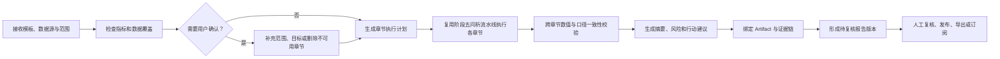

# ForgeSight 阶段六：制造业周期报告调研与产品设计

> 调研日期：2026-07-23  
> 范围：周报、月报、专题报告；不包含机器学习建模报告  
> 结论性质：产品与技术设计依据；第一版实现已于 2026-07-23 启动

## Executive Summary（执行摘要）

制造业周报并不是某一个固定岗位独立完成的文档。生产、质量、设备和库存数据分别由对应业务团队负责，生产主管、质量负责人、设备负责人等形成分主题判断，生产经理或工厂运营负责人汇总、复核，厂长及管理层用于决策。Oracle 的制造产品把班次报告直接放在 Production Supervisor 工作台中，并将交接说明、异常、计划数量、完成数量和报废数量纳入同一个工作流；这说明报告的业务所有者是生产管理人员，而不是系统管理员。[1][2]

现有产品大致分成三类。Oracle、SAP、Siemens 等制造平台重视制造上下文、OEE、损失分类、工单和异常；Power BI、Tableau、Quick BI 等 BI 产品重视模板、订阅、定时推送、附件和指标定义；新一代 AI BI 又增加自动摘要、异常说明和引导式下钻。[5][6][7][8][9][10][12][13] ForgeSight 不应照搬任何一类，而应结合自身的数据底座、业务知识、Agent 闭环和证据链，将“固定模板”和“自然语言专题报告”统一在一套报告编排引擎中。

阶段六建议建设为“Agent 自动生成 + 业务人员复核发布 + 管理员治理模板与权限”的双端系统。业务人员选择数据源、报告类型、时间范围和对象范围后，系统先检查指标覆盖和数据完整性，再复用阶段五问析流水线完成多个章节分析，最终生成结构化在线报告和 PDF。每个结论必须关联指标版本、SQL、结果集、数据时间范围和证据链；指标缺失、数据不完整或临时推导时，应在章节置信度和限制说明中明确披露。

第一版不应做复杂的 Word 式自由排版，而应完成真正可用的闭环：模板选取、自动生成、生成进度、在线阅读、局部重算、人工修订、复核发布、版本冻结、PDF 导出、定时订阅和失败记录。这样既满足赛题的“周报、月报或专题分析结果”，也能体现 ForgeSight 相比普通 ChatBI 的差异。

## Introduction（调研范围与方法）

本次调研围绕四个问题展开：

1. 制造企业中谁生成、复核和使用周期报告；
2. 一份可用于经营决策的制造业周报通常包含什么；
3. 制造执行平台和 BI 产品已经提供了哪些能力；
4. ForgeSight 应如何复用现有数据源隔离、知识库、Agent、Artifact 和证据链。

资料优先采用标准组织和厂商官方文档。ISO 22400 用于确认制造 KPI 的定义方式；Oracle、SAP、Siemens 和 IBM 用于观察制造业务产品；Microsoft、Tableau 和阿里云 Quick BI 用于观察报告订阅、AI 解读、权限和交付方式。厂商文档能证明产品能力，但不能代表所有企业的组织制度，因此岗位分工部分属于结合多项资料形成的产品推断。

## Main Analysis（主要分析）

### 一、周报究竟是谁在做

#### 1.1 真实工作不是单人写作，而是四层责任链

| 层级 | 典型人员 | 在报告中的责任 |
| --- | --- | --- |
| 数据产生者 | 班组长、操作员、质检员、维修人员、仓管人员及 MES/QMS/EAM/WMS | 产生工单、产量、检验、停机、库存和事件记录 |
| 章节责任人 | 生产主管、质量工程师、设备工程师、物料计划员 | 确认业务口径，解释异常，补充原因和行动 |
| 报告责任人 | 生产经理、运营经理、车间主任 | 选择范围，汇总结论，复核并发布 |
| 报告使用者 | 厂长、部门负责人、经营管理层 | 掌握目标完成情况、风险和待决策事项 |

Oracle 明确把工单监控、异常处理、交接说明和班次报告放在生产主管工作台中，并指出主管需要向利益相关者和下一班次报告活动。[1][2] ISO 22400-2 则要求 KPI 描述包括公式、时间行为、单位/维度以及适用用户组，说明同一个数字不能脱离口径、时间和使用角色。[4]

因此，在 ForgeSight 中：

- **Agent 是报告生成者，但不是业务责任人。**
- **业务人员是报告创建者、复核者和发布者。**
- **管理员负责数据源、语义、模板、权限和推送渠道治理，不负责替业务部门签发周报。**
- 页面上的“作者”应区分“Agent 自动生成”和“业务责任人/复核人”，不能只显示“Agent 自动生成”。

#### 1.2 不同报告有不同负责人

综合周报通常由生产经理或运营负责人牵头；质量周报由质量负责人牵头；设备周报由设备或维修负责人牵头；库存周报由物料计划或仓储负责人牵头；专题报告由发起问题的业务人员负责。系统可以自动建议复核角色，但不能假设所有报告都由同一个人审批。

### 二、周报一般应包含什么

#### 2.1 所有周期报告都应具备的骨架

一份成熟报告至少包含以下八部分：

1. **报告身份**：报告类型、工厂/车间/产线、数据源、统计周期、生成时间、数据更新时间、版本和负责人。
2. **管理摘要**：本周期整体表现、最重要的三项变化、主要风险和需要管理层决策的事项。
3. **核心 KPI**：本期值、目标值、上期值、同比/环比、偏差方向、口径版本和置信度。
4. **趋势与结构**：按天、产线、工序、产品、设备等维度展示趋势和贡献。
5. **异常与原因**：异常时间、对象、影响程度、已知原因、证据状态；无法证明原因时只能写“相关因素”或“待确认”。
6. **重点下钻**：Top N 问题产品、工序、设备、缺陷和低库存项。
7. **行动闭环**：事项、责任人、截止日期、状态和复核结果。
8. **附录与证据**：数据表、指标定义、SQL、数据范围、缺失项、推导口径和完整证据链。

Oracle 的班次报告包含计划、完成和报废数量，并将交接说明和异常处理纳入报告流程。[1] SAP 的制造分析支持从工厂、产线、工作中心和资源等层级比较，并围绕 OEE 的可用性、性能和质量损失继续下钻。[5][6] Siemens 强调把制造数据转化为带上下文的信息，并围绕产量、质量、OEE 和资源利用率形成可行动洞察。[7] 这些共同说明，报告不能停留在“本周数值是多少”，而要回答“偏差在哪里、为什么重要、下一步做什么”。

#### 2.2 ForgeSight 第一版应提供的报告模板

| 模板 | 主要使用者 | 默认内容 |
| --- | --- | --- |
| 制造运营综合周报 | 生产经理、厂长 | 产量与计划、良率与缺陷、停机、库存风险、跨主题异常、行动项 |
| 生产周报 | 生产主管 | 工单完成、产量、计划达成、产线/工序趋势、未完成工单 |
| 质量周报 | 质量负责人 | 工序良率、抽检不良率、缺陷 Pareto、重点产品、异常批次 |
| 设备周报 | 设备负责人 | 总停机、非计划停机、设备排名、原因分布、影响产线 |
| 库存周报 | 物料计划员 | 最新库存、安全库存缺口、仓库与产品分布、风险清单 |
| 专题分析报告 | 任意业务人员 | 由自然语言问题生成动态章节，不要求套用完整综合模板 |

月报可以复用同一模板，只改变统计周期、比较基线和趋势粒度；不应另建一套独立引擎。专题报告则从问题出发动态形成大纲，例如“分析 7 月良率下降原因并形成专题报告”。

#### 2.3 指标设计必须服从语义层

ISO 22400 将 KPI 视为具有公式、构成元素、时间行为、单位/维度和使用场景的正式对象。[3][4] Tableau Pulse 也将指标定义作为同类指标的单一真相源，定义度量、聚合、时间维度、比较方式、过滤维度、目标和有利方向。[10]

ForgeSight 报告必须复用现有两层知识模型：

- 企业统一业务语义决定“良率”“非计划停机”“低于安全库存”是什么意思；
- 当前数据源物理绑定决定具体使用哪些表、字段、过滤条件和时间字段；
- 报告版本冻结本次使用的指标版本，之后知识库变更不能悄悄改写已发布报告；
- 没有已发布口径时允许 Agent 临时推导，但必须降低置信度，并在报告中列出推导公式和待确认提示。

### 三、现有产品生态给我们的启发

#### 3.1 制造平台：上下文与行动优先

Oracle 的报告和工作中心、班次、工单、异常及交接直接关联，生成 PDF 只是工作流末端。[1] SAP 将原始制造数据转换成面向分析的数据对象，并提供现场监控、历史运营分析和 OEE 损失下钻。[5][6] Siemens 将 MOM、IoT 等来源聚合后形成生产上下文，强调质量、吞吐和 OEE。[7] IBM Maximo 的设备分析则把资产健康、工单趋势、维护历史、成本和合规报告与维修工作流结合。[14]

对 ForgeSight 的启发是：报告模板不能只是保存一组图表，而应保存业务主题、指标、维度、比较策略、异常规则和章节目的。每个异常最好能进入行动项，而不是停在自然语言建议。

#### 3.2 BI 产品：订阅、分发和治理已经是基础能力

Power BI 支持按小时、天、周、月或数据刷新后发送报告，并可附带 PDF/PPT；它还强调订阅权限、行级安全和敏感度标签。[8] Tableau 支持定时发送视图或工作簿快照，并允许数据刷新后触发；Pulse 进一步将趋势、异常和变化通过邮件或 Slack 摘要推给指标关注者。[10][11] Quick BI 支持按周期把截图、链接、Excel/PDF 推送到邮件、钉钉、企微、飞书和 Webhook，并提供任务、发送记录、日志、手动触发和负责人转交。[12]

所以阶段六不能只有“生成报告”和“下载 PDF”，还应有：

- 立即生成与定时生成；
- 生成后人工复核再发布；
- 接收人、渠道、频率和时区；
- 仅数据完成刷新后生成；
- 发送预览、发送记录和失败重试；
- 数据权限和报告权限一致；
- 已发布版本不可被后台重新生成覆盖。

第一版外部渠道采用飞书群自定义机器人。飞书将这类 Webhook 机器人定位为外部系统到群聊的通知入口，支持文本、富文本和交互式卡片；安全上可叠加关键词、IP 白名单和签名密钥。[15] ForgeSight 使用交互式卡片发送报告摘要和站内详情链接，Webhook 与签名密钥仅保存在服务端环境变量中。

#### 3.3 AI 产品：摘要有价值，但不能代替证据

Power BI 可在订阅中生成随数据变化的 Copilot 摘要；Tableau Pulse 会发现趋势、异常和变化，并引导用户继续分析；Quick BI 允许配置解读范围、知识库、分析思路、模型和复合解读，并按日、周、月定时生成。[9][10][13]

ForgeSight 应学习“可配置的分析思路”，但不能只让模型阅读仪表板截图后自由发挥。报告 Agent 必须基于结构化 Artifact：指标结果、比较结果、异常结果、图表规格、SQL 校验报告和数据覆盖报告。LLM 主要承担大纲规划、表述、跨章节归纳和限制说明，数值计算继续由 SQL/Python 执行。

## Synthesis & Insights（ForgeSight 产品设计）

### 5.1 双端职责

业务端“报告中心”承担真实业务流程：

- 查看我的报告、待我复核、已发布和订阅报告；
- 从模板或自然语言创建报告；
- 查看生成进度、章节结果、置信度和证据；
- 修改标题、管理摘要、业务说明和行动项；
- 对单个章节调整条件并重新生成；
- 提交复核、发布、导出和订阅。

管理员端“报告治理”承担平台治理：

- 管理报告模板、默认章节及指标集合；
- 设置模板适用的数据源类型和最低覆盖要求；
- 管理复核角色、导出权限、渠道、敏感字段和水印；
- 查看调度任务、失败记录、使用量和审计日志。

管理员不能从业务总览页面被直接跳转过去“替业务人员维护数据”。两端共享同一报告对象，但显示不同操作。

### 5.2 创建报告不是一个按钮，应是四步轻量向导

第一步选择报告类型和当前数据源。系统立即显示模板在该数据源上的覆盖情况，例如“质量周报 5/5 指标可用，综合周报 11/14 指标可用”。

第二步选择报告范围：周期、车间/产线/产品/工序、比较基线、目标读者。周报默认使用已结束的自然周，但允许选择“本周截至当前日期”，并必须明确展示是否为不完整周期。

第三步确认分析大纲。系统根据模板和实际可用数据生成章节，标出：

- 可直接生成；
- 使用临时推导指标；
- 数据不足，建议移除；
- 需要用户补充目标值或业务说明。

第四步确认生成。用户看到预计章节数、预计查询量、当前数据更新时间和安全范围，然后启动任务。

### 5.3 生成中的前端状态

后端应返回足够细的状态供前端展示，而不是固定播放假动画：

| 状态 | 前端表达 |
| --- | --- |
| `queued` | 等待执行 |
| `checking_coverage` | 检查指标与数据覆盖 |
| `planning` | 生成报告大纲 |
| `running_sections` | 正在分析第 N/M 个章节 |
| `validating` | 校验数字、比较周期和跨章节一致性 |
| `composing` | 生成管理摘要和行动建议 |
| `awaiting_review` | 生成完成，等待业务复核 |
| `published` | 已发布 |
| `partial` | 部分章节失败，可查看和重试 |
| `failed` | 生成失败，保留过程和原因 |

每个章节也应有独立状态，失败时允许只重试该章节。已有阶段五的 SSE、Run、Step、Artifact 和重试机制可以直接复用。

### 5.4 报告阅读与复核界面

报告详情不应放在 640 像素的小弹窗里。应使用独立页面：

- 左侧：章节目录和完成状态；
- 中间：结构化报告正文、KPI、图表、表格、管理摘要和行动项；
- 右侧：当前段落的指标口径、数据范围、SQL、结果集、置信度和证据链；
- 顶部：版本、数据源、统计周期、状态、复核人、发布和导出操作。

点击结论或图表应切换右侧证据。用户可以编辑“业务说明”和“行动项”，但 Agent 计算结果与原始证据保持只读。局部重新生成会产生新草稿版本，并显示与上一版的差异。

### 5.5 数据源切换

一份报告默认只绑定一个数据源，禁止 Agent 在未明确授权时跨数据源拼接。切换数据源时系统重新计算模板覆盖：

1. 查找该数据源已发布的指标物理绑定；
2. 检查所需表、字段和时间覆盖；
3. 禁用无法生成的章节并解释原因；
4. 将报告的 `source_id`、指标版本和数据快照写入报告版本。

这使 ForgeSight 保持“可适配任意制造业数据库”的定位：模板定义业务问题，不写死官方表名；物理绑定负责将模板落到不同企业的数据结构。

## Recommendations（Agent 与后端架构建议）

### 6.1 报告 Agent 工作流



报告 Agent 不是重新做一个问析系统。每个章节本质上是一组带明确目的的分析任务，继续使用阶段五的意图处理、语义检索、只读 SQL、安全门控、结果校验、图表生成和 Artifact。阶段六新增的是跨任务编排、跨章节一致性、版本、复核、导出和调度。

### 6.2 建议的数据模型

| 表 | 作用 |
| --- | --- |
| `report_template` | 模板名称、受众、主题、版本、最低覆盖要求 |
| `report_template_section` | 章节目标、指标集合、默认维度、比较策略和顺序 |
| `report` | 报告业务身份、数据源、范围、负责人和当前状态 |
| `report_version` | 冻结的报告内容、指标版本、数据时间和审批信息 |
| `report_section` | 章节状态、摘要、置信度、失败原因和对应分析 Run |
| `report_section_artifact` | 章节与阶段五 Artifact 的复用关系 |
| `report_subscription` | 周期、时区、接收人、渠道、发布策略 |
| `report_delivery` | 每次生成/发送的状态、重试次数和错误信息 |

报告正文建议存结构化 JSON，而不是只存 HTML/PDF。HTML/PDF 是版本化导出物，结构化内容才支持局部重算、证据定位和多终端展示。

### 6.3 建议 API

```text
GET    /api/v1/reports
POST   /api/v1/reports
GET    /api/v1/reports/{report_id}
GET    /api/v1/reports/{report_id}/events
POST   /api/v1/reports/{report_id}/sections/{section_id}/regenerate
POST   /api/v1/reports/{report_id}/submit-review
POST   /api/v1/reports/{report_id}/approve
POST   /api/v1/reports/{report_id}/publish
GET    /api/v1/reports/{report_id}/export?format=pdf
GET    /api/v1/report-templates
GET    /api/v1/report-templates/{id}/coverage?sourceId=...
GET    /api/v1/report-subscriptions
POST   /api/v1/report-subscriptions
```

调度任务不能只放在 FastAPI 进程内。第一版可以复用阶段五已有的持久化任务表、租约和 Worker，把定时器仅作为“按时创建 report job”的触发器；真正执行仍由可恢复 Worker 完成。

## 七、第一版范围

第一版应实现：

1. 综合、生产、质量、设备、库存和专题六类报告；
2. 数据源与模板覆盖检查；
3. 手动生成与每周/每月定时生成；
4. 真实章节进度和局部失败重试；
5. 在线结构化报告、PDF 导出；
6. 章节级置信度、指标说明和证据链；
7. 人工修订说明、提交复核、发布与版本冻结；
8. 站内订阅和发送记录，外部渠道第一版采用飞书群自定义机器人 Webhook。

### 第一批实现状态（2026-07-23）

- 已建立报告模板、报告、不可变版本、章节、订阅与发送记录模型；
- 已提供六类内置制造业报告模板及数据源级指标覆盖检查；
- 已将报告章节映射为阶段五 Agent 多任务 Run，并复用 SQL、结果、口径、置信度与 Artifact；
- 已提供报告列表、独立详情、复核、发布、HTML/PDF 打印出口与飞书主动推送 API；
- 已将前端假数据与假进度替换为真实 API 和后端状态轮询；
- 飞书 Webhook 和签名密钥只允许通过服务端环境变量配置，未配置时界面明确显示待配置。

尚未完成的后续批次是：持久化调度器自动创建周期报告、章节局部重算、业务说明与行动项编辑、正式服务端 PDF 渲染、多级审批和管理员报告治理界面。

后续再增加 DOCX/PPTX、多级审批、多人协作评论、跨数据源联合报告、复杂自由排版和钉钉/企微/飞书全部渠道。这样第一版已经是去掉机器学习模块后可作为最终产品演示的完整报告能力。

## 八、验收标准

- 报告中的每个数值都能追溯到指标版本、SQL、结果集、数据源和时间范围；
- 同一报告不同章节使用同一统计周期和对象范围，若不同必须显式标注；
- 比较类结论必须检查是否覆盖两个完整周期，不足时降级说明而不是强行比较；
- 临时推导指标必须显示公式、低置信度和待确认提示；
- 单章节失败不会使整份报告消失，可查看原因并局部重试；
- 已发布版本不可被重新生成覆盖；
- 切换数据源后必须重新检查模板覆盖，不得沿用原数据源物理表字段；
- 调度重复触发具有幂等键，不会在同一周期生成两份相同报告；
- 业务人员只能看到其数据权限范围内的报告和证据；
- 报告列表、详情、证据链、导出和订阅均使用真实 API，不保留假数据生成动画。

## Limitations & Caveats（限制）

公开资料主要描述标准软件能力，无法代表每家制造企业的具体岗位名称和审批制度。ISO 22400-2 当前版本已处于待修订状态，因此本设计只采用其“指标应包含公式、单位、时间行为和用户组”的原则，不宣称模板中的所有指标均由该标准强制要求。[4] 报告推送到钉钉、企微、飞书等渠道还涉及企业账号、应用审批和安全配置，第一版应保留适配层，不能把某一家渠道写死在核心模型中。

## Bibliography（参考资料）

[1] Oracle. “Manage Process Manufacturing Work Orders in the Production Supervisor Workbench.” https://docs.oracle.com/en/cloud/saas/readiness/common/rrdem/manage-process-manufacturing-work-orders-in-the-production-supervisor-workbench.html

[2] Oracle. “Overview of Managing Production for Your Work Centers.” https://docs.oracle.com/en/cloud/saas/supply-chain-and-manufacturing/25b/faumf/overview-of-managing-production-for-your-work-centers.html

[3] ISO. “ISO 22400-1:2014 — Key performance indicators for manufacturing operations management.” https://www.iso.org/standard/56847.html

[4] ISO. “ISO 22400-2:2014 — Definitions and descriptions.” https://www.iso.org/cms/render/live/en/sites/isoorg/contents/data/standard/05/44/54497.html

[5] SAP. “About SAP Digital Manufacturing for insights.” https://help.sap.com/docs/SAP_DIGITAL_MANUFACTURING/de1d05db7d6e42f6ac2ba773dd5fd555/e0f7ace739d24b1c9de043264a4a09fc.html

[6] SAP. “Advanced Analytics.” https://help.sap.com/docs/sap-digital-manufacturing/insights/advanced-analytics

[7] Siemens. “Opcenter Intelligence.” https://www.siemens.com/en-us/products/opcenter/manufacturing-intelligence/

[8] Microsoft. “Email subscriptions for reports and dashboards in Power BI.” https://learn.microsoft.com/en-us/power-bi/collaborate-share/end-user-subscribe

[9] Microsoft. “Add Copilot summaries to email subscriptions.” https://learn.microsoft.com/en-us/power-bi/create-reports/copilot-summaries-in-subscriptions

[10] Tableau. “Create Metrics with Tableau Pulse.” https://help.tableau.com/current/online/en-us/pulse_create_metrics.htm

[11] Tableau. “Create a Subscription to a View or Workbook.” https://help.tableau.com/current/online/en-gb/subscribe_user.htm

[12] 阿里云 Quick BI. “订阅推送概述.” https://help.aliyun.com/zh/quick-bi/user-guide/subscription-push-overview

[13] 阿里云 Quick BI. “小 Q 解读订阅.” https://help.aliyun.com/zh/quick-bi/user-guide/q-insights-s-commentary-on-subscriptions

[14] IBM. “Maximo Application Suite — Asset Management.” https://www.ibm.com/products/maximo/asset-management

[15] 飞书开放平台. “手把手教你用飞书 Webhook 打造一个消息推送 Bot.” https://open.feishu.cn/community/articles/7271149634339422210

## Methodology Appendix（方法附录）

检索时间为 2026-07-23。优先使用 ISO、Oracle、SAP、Siemens、Microsoft、Tableau、阿里云和 IBM 官方页面；通过“岗位责任—制造指标—报告交付—AI 解读—ForgeSight 架构”五个维度交叉归纳。对于资料没有明确规定的企业组织分工，本文均以“建议”或“产品推断”表述，没有将厂商案例扩展为强制行业规范。
