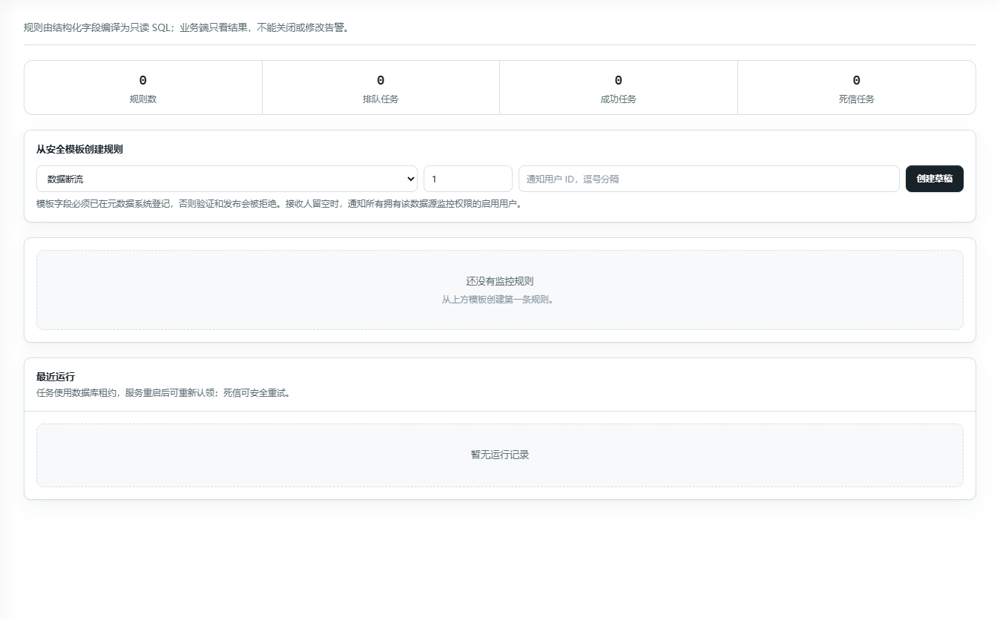

# forge_sight_features_20260919_20260919_123044

- Source: `forge_sight_features_20260919_20260919_123044.pptx`
- Total slides: 3

## Slide 1

ForgeSight

背景与目标

产品服务

产品特色

技术路线

团队合作展示

成本模型和可行性分析

3.2

智能异常监控

业务服务

连续监测数据断流、工序良率下降和非计划停机。

异常出现后通知责任人，呈现趋势、样本量、

数据截至时间与恢复状态。

底层实现

规则绑定：从受控模板选字段，验证后发布。

1

周期评估：只读查询，以确定性规则判断。

2

状态与投递：留存证据，记录触发、持续、

3

恢复，并通过站内消息或 IM 通知。

从一次性查询延伸到持续监测，让异常与恢复都有据可查。

## Slide 2

ForgeSight

背景与目标

产品服务

产品特色

技术路线

团队合作展示

成本模型和可行性分析

3.4

多数据源适配

业务服务

企业保留原有数据库，在同一平台登记、扫描、

治理和问析，无需先集中搬迁业务数据。

底层实现

适配器注册：统一连接、扫描、方言与执行接口。

1

元数据归一：按租户、数据源和 Schema 隔离。

2

安全执行：方言感知 SQL 经只读校验、

3

表白名单、限行、超时与成本门控。

保留原有数据底座，扩展数据库类型时复用同一问析流程。

## Slide 3

ForgeSight

背景与目标

产品服务

产品特色

技术路线

团队合作展示

成本模型和可行性分析

3.5

受治理技能学习

业务服务

借鉴 Hermes 的经验学习思路，将成功方法

沉淀为技能；审核发布后在后续问析中复用。

底层实现

经验提取：有帮助或修正反馈形成候选技能。

1

人工治理：审核、发布或停用，保留版本与证据。

2

检索复用：词法与语义召回已发布技能，

3

命中记录回流到下一轮学习。

把优秀分析转化为可复用的业务服务。
