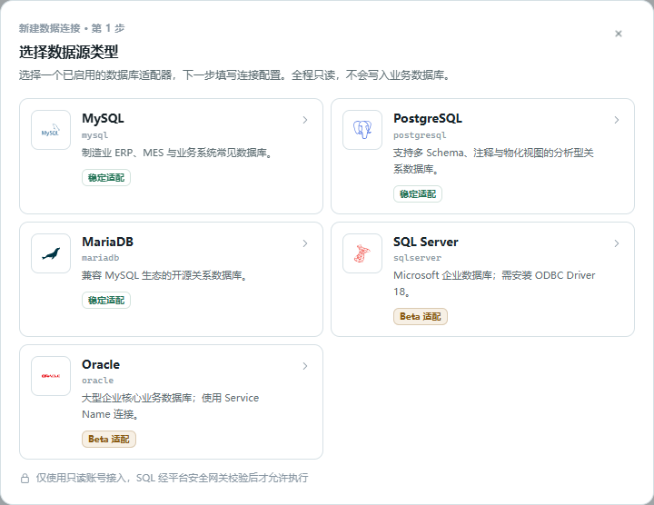
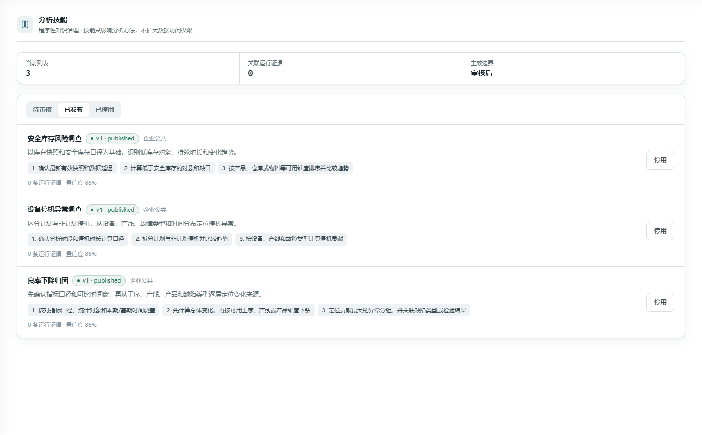

# ForgeSight_产品特色_3.2_3.4_3.5_技术细节增强版

- Source: `ForgeSight_产品特色_3.2_3.4_3.5_技术细节增强版.pptx`
- Total slides: 3

## Slide 1

ForgeSight

背景与目标

产品服务

产品特色

技术路线

团队合作展示

成本模型和可行性分析

3.2

智能异常监控

业务服务

• 主动发现：持续监测数据断流、良率下降和非计划停机。

• 多端提醒：异常触发后通过站内消息、飞书或钉钉通知。

• 处置闭环：同步趋势、样本量、数据时间与恢复状态。

底层实现

规则建模：Rule Template 绑定数据源、表和字段，确定性验证后发布。

1

周期调度：Monitoring Worker 按 cursor / watermark 读取完整周期。

2

确定性评估：只读网关执行查询，LLM 不参与触发；PostgreSQL 保存状态与证据。

3

确定性规则主动发现风险，让触发、持续与恢复全程可追溯。

## Slide 2

ForgeSight

背景与目标

产品服务

产品特色

技术路线

团队合作展示

成本模型和可行性分析

3.4

多数据源适配

业务服务

• 统一接入：在同一平台登记、扫描并治理多类数据库。

• 原库分析：无需集中迁移，直接连接现有业务数据。

• 快速扩展：新增数据库仅需实现统一适配器接口。

底层实现

适配器注册：Adapter Registry 统一 connect、scan、quote、execute 接口。

1

元数据归一：Schema、表、字段、主外键与注释映射统一资源模型。

2

安全网关：方言 SQL 经 AST 只读校验、白名单、限行、超时与 EXPLAIN 门控。

3

新增数据库只扩展适配器，无需重建 Agent 分析主流程。

## Slide 3

ForgeSight

背景与目标

产品服务

产品特色

技术路线

团队合作展示

成本模型和可行性分析

3.5

受治理技能学习

业务服务

• Hermes 思路：把成功 Run、用户反馈沉淀为候选技能。

• 审核复用：发布后的技能进入后续分析上下文。

• 持续进化：新的使用反馈生成下一版本并留痕。

底层实现

技能提取：从成功 Run 和 helpful / corrected 反馈提取特征、步骤与证据。

1

治理状态：candidate → published / rejected / retired，版本与审核记录可追溯。

2

混合检索：词法 + 语义召回并注入 Agent Context，反馈生成下一候选版本。

3

借鉴 Hermes 的经验学习机制，让高质量分析持续积累且不扩大数据权限。
