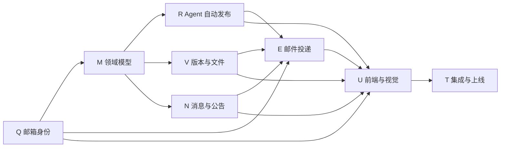

# GPT 单一负责人开发流程

> 状态：当前有效
>
> 适用范围：Q、M、R、V、N、E、U、T 全部任务
>
> 生效日期：2026-08-13
>
> 决策：项目复杂度暂不需要两个开发 AI，GPT 统一负责设计、实现、验证和审查。

本文是本轮任务的唯一 AI 执行规则。若与旧的双 AI 分工、聊天记录或未合并 PR
中的说明冲突，以本文和 `AGENTS.md` 为准。

## 1. 负责人和决策权

GPT 负责：

- 需求澄清、架构和领域契约；
- 数据模型、迁移、后端服务、Agent 编排和 API；
- 权限、安全、幂等、并发、重试、监控和后端测试；
- 前端交互、视觉设计、图表、图片、响应式和可访问性；
- PDF、Excel、邮件模板和浏览器验收；
- PR 自审、CI 复核、任务文档和最终交接。

项目负责人负责：

- 产品范围和优先级决策；
- 对重大取舍作最终确认；
- 手动合并 PR；
- 决定是否重新引入其他开发者或 AI。

未经项目负责人明确变更本文，其他 AI 不得创建实现分支、修改代码或继续执行
Q～T 任务。可以提供研究意见，但不能与 GPT 并发修改仓库。

## 2. 为什么采用单一负责人

- 后端契约、前端交互、PDF 和邮件模板共享同一需求上下文，减少重复解释和接口返工。
- 数据库模型、配置、入口和报告服务包含共享文件，串行修改比多分支抢占更安全。
- GPT 可以从实现直接进入浏览器和视觉验收，不需要等待跨 AI 交接。
- CI、PR 和任务状态只有一条责任链，项目负责人更容易判断是否可以合并。

单一负责人不代表省略审查。每个任务仍必须经过“测试先行、实现、CI、独立复查、
负责人合并”五个质量阶段。

## 3. 全任务责任

| 大任务 | GPT 交付内容 | 关键前置 |
| --- | --- | --- |
| Q 邮箱绑定与验证 | 身份契约、模型、迁移、验证码、API、门禁、绑定界面和安全测试 | 无 |
| M 业务数据模型与迁移 | 报告、文件、消息、公告、组织权限、Outbox、迁移和并发测试 | Q 身份契约 |
| R 智能生成与自动发布 | 调度、预检、章节编排、证据、校验门、冻结发布和恢复 | M |
| V 版本管理与文件导出 | Schema、校验、不可变版本、PDF、Excel、下载和文件任务 | M；与 R 对齐 |
| N 消息中心与公告 | 消息、接收人、已读、公告、权限、事件、API 和界面 | M、Q |
| E 邮件投递与重试 | Provider、邮件模板、任务、Worker、重试、降级、安全链接和失败管理 | Q、M、R、V、N |
| U 前端交互与视觉设计 | 全部页面、图表、图片、排版、动效、响应式和浏览器验收 | 稳定后端契约 |
| T 集成测试与上线验收 | 追踪矩阵、迁移演练、端到端、安全、性能、视觉、监控和交接 | Q～U |

## 4. 推荐交付顺序



执行批次：

1. Q 完成身份和邮箱基础。
2. M 完成所有后续任务依赖的数据模型。
3. R、V、N 依次实现；存在完全独立部分时可在同一负责人下交错验证，但不得混入同一 PR。
4. E 串联验证邮箱、报告版本、PDF 和消息。
5. U 完成统一产品体验；稳定契约确定后可提前完成不依赖真实 API 的设计研究和视觉规范。
6. T 做全链路验收和发布准备。

## 5. 分支和 PR 规则

每个大任务使用独立分支和 Draft PR：

```text
gpt/q-email-identity
gpt/m-domain-model
gpt/r-agent-publish
gpt/v-file-export
gpt/n-message-center
gpt/e-email-delivery
gpt/u-web-ui
gpt/t-release-check
```

要求：

1. 从最新 `main` 创建分支，不直接提交到 `main`。
2. 一个大任务一个 PR，小任务使用独立提交并在提交标题包含编号。
3. 先创建 Draft PR；只有全部验收通过后才能转为 Ready for review。
4. 不使用 force push 覆盖已经进入审查的提交。
5. 不启用自动合并或自动部署。
6. API、Schema、事件、错误码或环境变量变化必须写入 PR。
7. UI、PDF 或邮件视觉改动必须附可核验的截图或渲染证据。

## 6. 单一负责人质量检查点

### 检查点 A：契约

在实现依赖范围较大的功能前，先冻结：

- 请求和响应；
- 状态枚举和转换；
- 错误码和 HTTP 状态；
- 权限和数据范围；
- 事件、幂等键和事务边界；
- 数据库约束、索引和迁移方式。

### 检查点 B：测试先行

先添加能暴露缺失行为的测试，再实现最小正确代码。数据库任务必须覆盖存量数据、
重复迁移、唯一约束、并发和回滚；外部服务必须使用 fake provider。

### 检查点 C：分层实现

按“模型与迁移 → 服务 → API → 前端 → 文件/邮件 → 集成”推进。虽然由同一个 GPT
负责，仍不得在契约未稳定时让前端猜测字段，也不得让视觉模板持有业务逻辑。

### 检查点 D：真实验证

按风险运行：

- 后端 pytest；
- 前端 Vitest；
- Vite 生产构建；
- Markdown 和配置检查；
- 数据库迁移演练；
- 真实浏览器交互、控制台和网络检查；
- PDF、邮件和响应式渲染检查。

### 检查点 E：独立复查

实现结束后重新阅读需求和完整 diff，按 `Critical / Important / Minor` 分级记录。
Critical 和 Important 必须清零，`CI Gate` 必须通过，才能交给项目负责人合并。

## 7. 高风险共享文件

以下文件没有第二 AI 的所有权冲突，但仍必须小范围、串行修改：

- `backend/app/db/models.py`
- `backend/app/config.py`
- `backend/app/main.py`
- `backend/app/api/reports.py`
- `backend/app/reports/service.py`

修改时在 PR 中解释原因，避免任务外重构和全文件格式化。数据库迁移不得删除或重建
已有用户、报告、会话、消息和审计数据。

## 8. 审查记录格式

GPT 在 PR 中使用：

```text
GPT FINAL REVIEW

Task: Q01-Q07
Reviewed commit: <commit SHA>

Critical: 0
Important: 0
Minor: 0

Verification:
- Backend Tests: passed
- Frontend Tests: passed
- Frontend Build: passed
- CI Gate: passed

Decision: READY FOR OWNER MERGE
```

这是一份可审计的自查记录，不冒充 GitHub Approval。项目负责人仍负责点击合并。

## 9. DeepSeek 交接历史

2026-08-13，项目负责人决定停止双 AI 实现模式：

- DeepSeek 的 PR #6 在 Q01 契约 V1.1、提交
  `380732ec50f28d5235a5d33e1358fb008d2fd5cc` 处停止。
- GPT 已审查并接受该 Q01 契约。
- 先前授予 DeepSeek 的 Q02 许可已经通过 `GPT BLOCKED` 评论撤销。
- GPT 接管时保留 Q01 契约和审查记录，从新的 `gpt/q-email-identity` 分支继续 Q02～Q07。
- PR #6 只作为交接来源，不再继续开发或直接合并。

如果未来重新启用多开发者协作，必须先更新本文件，重新定义文件所有权、共享文件顺序、
分支规则和最终审查责任；不能仅通过聊天消息恢复旧分工。

## 10. 完成定义

单个大任务只有同时满足以下条件才算完成：

- 所有小任务达到各自验收标准；
- 契约、实现、测试、视觉或文件证据完整；
- 存量数据和已有 API 兼容性得到验证；
- CI Gate 通过；
- GPT 最终复查无 Critical 或 Important；
- 项目负责人手动合并；
- 小任务状态在实现 PR 验收完成后更新；整个大任务目录只在代码合并后的后续文档提交中迁移，避免文档领先于实际代码。
