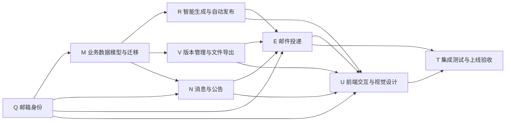

# 项目任务拆分与依赖

> 命名规则：一个英文字母代表一个大任务，格式为“`字母 + 任务名称`”；
> `字母 + 00` 代表该大任务的执行计划；大任务下的小步骤使用
> “`字母 + 01/02/... + 具体实现内容`”。字母是稳定任务代号，不代表优先级。

## 1. 任务总览

| 大任务 | 计划编号 | 主要交付 | 依赖 | 状态 | 建议优先级 |
| --- | --- | --- | --- | --- | --- |
| `Q邮箱绑定与验证` | `Q00` | 用户邮箱字段、验证码、安全门禁、认证 API | 无 | 已完成 | P0 |
| `M业务数据模型与迁移` | `M00` | 报告模型、组织权限、文件、消息、公告、Outbox | Q 的身份契约 | 已完成 | P0 |
| `R智能生成与自动发布` | `R00` | 定时创建、数据检查、章节生成、校验门、直发 | M | 未完成 | P0 |
| `V版本管理与文件导出` | `V00` | 校验器、不可变版本、PDF、Excel、鉴权下载 | M；与 R 对齐 | 未完成 | P0 |
| `N消息中心与公告` | `N00` | 消息/接收人服务、公告 API、未读状态 | M、Q | 未完成 | P0 |
| `E邮件投递与重试` | `E00` | 邮件适配器、模板、附件、队列、重试 | Q、M、V、N、R | 未完成 | P0 |
| `U前端交互与视觉设计` | `U00` | 绑定页、消息中心、周报页、公告管理、失败管理 | Q、R、V、N、E | 未完成 | P0 |
| `T集成测试与上线验收` | `T00` | 全链路测试、指标、审计、迁移演练、发布清单 | Q～U | 未完成 | P0 |

## 2. 依赖关系



## 3. 推荐交付批次

### 批次 A：基础契约

- `Q邮箱绑定与验证` 完成邮箱身份与受限登录契约。
- `M业务数据模型与迁移` 完成所有领域表、迁移、状态枚举和唯一约束。

这两个任务决定其余任务的接口稳定性，应最先合并。

### 批次 B：核心后端，可并行

- `R智能生成与自动发布` 实现 Agent 定时生成和自动发布。
- `V版本管理与文件导出` 实现版本校验、PDF/Excel 文件。
- `N消息中心与公告` 实现消息和公告。

三项可在 `M` 合并后并行，接口通过各自 `字母00` 计划中定义的契约对齐。

### 批次 C：触达闭环

- `E邮件投递与重试` 串联用户邮箱、站内发布版本、PDF 文件和投递重试。

### 批次 D：界面与验收

- `U前端交互与视觉设计` 接入所有后端能力并完成 Web 端体验。
- `T集成测试与上线验收` 完成端到端验收、迁移演练、监控和发布准备。

## 4. 分支与 PR 建议

每项任务独立分支、独立 PR，避免一个超大 PR 同时改认证、报告和通知：

```text
task/q-email-identity
task/m-domain-model
task/r-agent-publish
task/v-file-export
task/n-message-center
task/e-email-delivery
task/u-web-ui
task/t-release-check
```

每个 PR 必须：

- 链接 `REQUIREMENTS.md` 和对应大任务目录中的 `字母00_执行计划.md`。
- 标明依赖的前置 PR。
- 列出 schema、环境变量和 API 契约变化。
- 提供后端与前端测试结果。
- UI 变更提供关键页面截图。
- 不提交真实邮箱服务凭据或用户邮箱数据。

## 5. 全局完成定义

只有满足以下条件，整个需求才算完成：

- 8 个大任务及其全部小任务完成各自文档中的验收标准，并移动到 `已完成` 目录。
- 自动周报不再等待人工复核。
- 站内消息与邮箱投递均使用同一已发布版本。
- PDF 与 Excel 下载受服务端权限保护。
- 邮件失败、附件失败和 Agent 失败均可观测、可重试且不互相错误回滚。
- 旧报告数据可继续读取，数据库迁移可在现有平台库上安全执行。
- 后端和前端全量测试通过，新增关键路径包含端到端测试。
