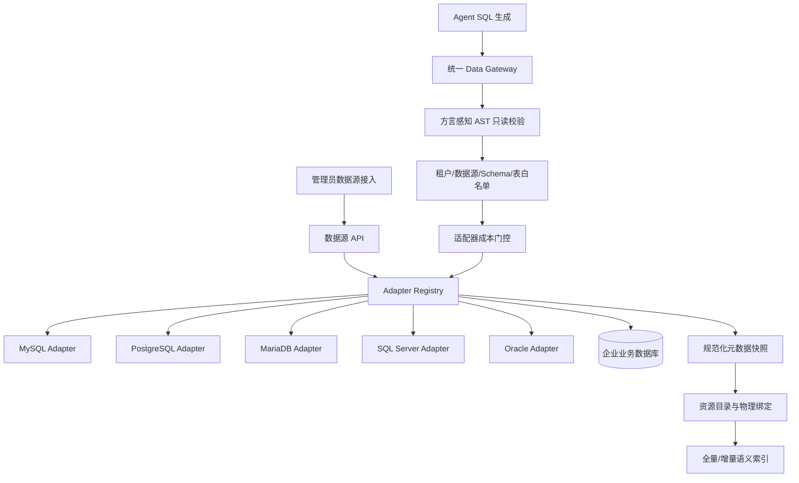

# W00 多数据库适配执行计划

> 状态：进行中（核心代码已实现，真实 SQL Server/Oracle 集成验收待完成）
>
> 大任务：`W多数据库适配`
> 目标：在不引入跨数据源联邦查询、不改变现有 Agent 主流程的前提下，将 ForgeSight 建设为可稳定接入 MySQL、PostgreSQL、MariaDB、SQL Server 和 Oracle 的制造业数据问析平台。
> 前置基础：现有多租户、数据源登记、元数据扫描、语义索引、SQL 安全门控和证据链能力。
> 设计日期：2026-08-28

## 一、交付边界

本任务解决“同一套 ForgeSight 如何接入不同类型的关系型数据库”。每次分析仍明确绑定一个数据源，暂不实现分析空间、跨库 JOIN、数据联邦和跨源指标计算。

交付包括：

- 统一数据库适配器契约和注册机制；
- PostgreSQL 现有适配缺陷修复；
- MySQL、PostgreSQL、MariaDB、SQL Server、Oracle 五类连接器；
- Schema、表、字段、主外键和注释的规范化扫描；
- 方言感知的 SQL 生成、AST 校验、服务端限行与成本门控；
- 动态数据源类型 API 和管理员接入流程；
- 按租户、数据源、Schema 隔离的资源目录和语义索引；
- 连接器契约测试、真实数据库集成测试、灰度和回滚方案。

不包括：

- 跨数据源 SQL JOIN；
- Trino、Presto 等联邦查询引擎；
- MongoDB、Redis、Excel 等非关系型或文件型数据源；
- 自动发布未经管理员审核的企业指标口径；
- 修改业务端现有“选择单个数据源后问析”的交互模型。

## 二、现状与问题

当前 MySQL/PostgreSQL 差异散落在以下位置：

- `backend/app/gateway/adapters.py`：连接 URL、只读会话、连接池；
- `backend/app/metadata/scanner.py`：Schema、表、字段和关系扫描；
- `backend/app/gateway/sql_validator.py`：方言兼容和 AST 解析；
- `backend/app/gateway/cost_guard.py`：EXPLAIN 与成本摘要；
- `backend/app/agent/graph.py`：SQL 方言提示；
- `backend/app/metadata/service.py`、`backend/app/monitoring/worker.py`：标识符引用；
- `backend/app/knowledge/candidates.py`：方言映射。

继续增加 `if source.type == ...` 会导致安全规则、扫描规则和 Agent 提示不一致。因此必须先完成适配器收口，再新增数据库。

## 三、目标架构

## 四、实施步骤

- [W01 统一适配器架构与领域契约](./W01_统一适配器架构与领域契约.md)
- [W02 PostgreSQL 适配补强](./W02_PostgreSQL适配补强.md)
- [W03 五类连接器与管理端接入](./W03_五类连接器与管理端接入.md)
- [W04 契约测试、灰度与回滚](./W04_契约测试灰度与回滚.md)

实施顺序必须是：

1. 建立契约和注册表，但保持 MySQL/PostgreSQL 行为不变；
2. 将现有 MySQL/PostgreSQL 迁移进适配器并跑通回归测试；
3. 完成 PostgreSQL 专项补强和数据迁移；
4. 依次增加 MariaDB、SQL Server、Oracle；
5. 接入动态配置表单和能力矩阵；
6. 运行真实数据库集成测试、迁移演练和灰度验收。

## 五、统一完成定义

一种数据库只有同时满足以下条件，才允许标记为“已验证”：

- 管理员可以通过 API 和前端登记、修改、测试和停用连接；
- 密码不通过普通数据源读取接口返回；
- 可以选择业务 Schema，并准确扫描表、字段、主键、外键和注释；
- 同名不同 Schema 的表不会覆盖或串用；
- 新表默认待确认，确认后才进入问析白名单；
- 语义索引按 `tenant_id + source_id + schema_name` 隔离；
- Agent 获得正确方言说明并生成该数据库可执行的 SQL；
- AST 只读校验、表白名单、超时、服务端限行和审计均生效；
- EXPLAIN 可用时执行成本门控，不可用时明确降级且收紧其他限制；
- 查询结果、图表、结论和证据链记录真实数据源及 Schema；
- 通过对应连接器的契约测试和真实数据库集成测试；
- 回滚不会破坏原有 MySQL/PostgreSQL 数据源和历史分析记录。

## 六、关键决策

1. 多数据库不等于跨数据库查询；当前每个分析任务只执行于一个数据源。
2. 方言差异只允许存在于 Adapter 和方言配置对象中，不允许继续散落到业务服务。
3. 安全规则由统一 Gateway 强制执行，Adapter 不能绕过。
4. 生产安全同时依赖应用校验和数据库 SELECT-only 账号，不能只相信 LLM 或 AST。
5. `Schema` 是资产身份的一部分，不再默认所有 PostgreSQL 数据都位于 `public`。
6. 不因某驱动可以建立连接就宣称“已支持”；必须满足统一完成定义。

## 七、2026-08-29 实施记录

已完成：

- 建立 `gateway/connectors` 统一契约、注册表和兼容门面；
- MySQL、PostgreSQL、MariaDB、SQL Server、Oracle 五类 Adapter 已接入同一 Registry；
- 元数据扫描、预览、Agent SQL、监控查询、AST 校验、限行和成本门控已改为方言感知；
- 资源物理身份升级为 `source_id + schema_name + table_name`，同名表会要求 Schema；
- 新增 `018_multi_database_adapter.sql`，并重新生成完整 PostgreSQL 初始化结构；
- 管理端支持动态显示五种数据源、数据库专属参数、Schema 范围和成熟度；
- 资源目录、字段预览、语义确认与真实关系图均使用 `schema.table`；
- 后端全量回归 `477 passed, 5 skipped`；前端测试 `102 passed`；生产构建通过。

仍需在发布前完成：

- 使用真实 PostgreSQL/MariaDB/SQL Server/Oracle 实例执行统一契约测试；
- SQL Server 与 Oracle 仍保持 `beta`，不可在界面或答辩中宣称完成生产验证；
- 将连接错误进一步归一化为稳定错误码，并完成驱动缺失/TLS/权限场景验收；
- 完成凭据服务（`credential_ref`）后迁移历史明文密码；当前普通读取接口不会回传密码，但平台库仍保留兼容字段；
- 增加连接器开关、异步大库扫描、扫描进度与取消能力。
